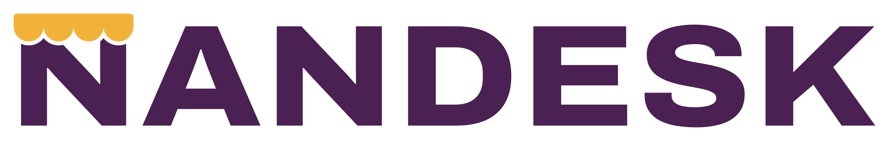
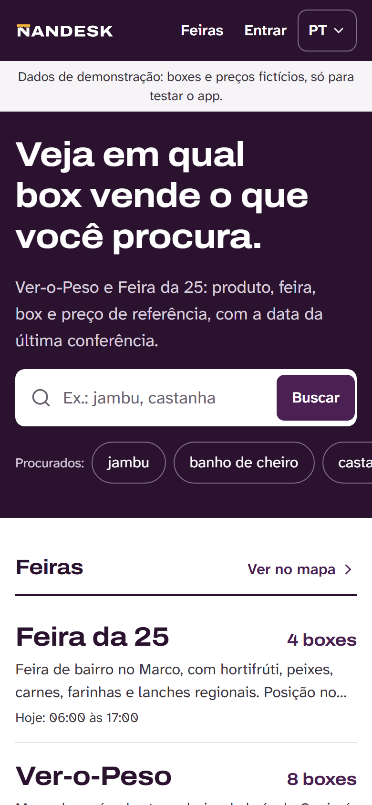
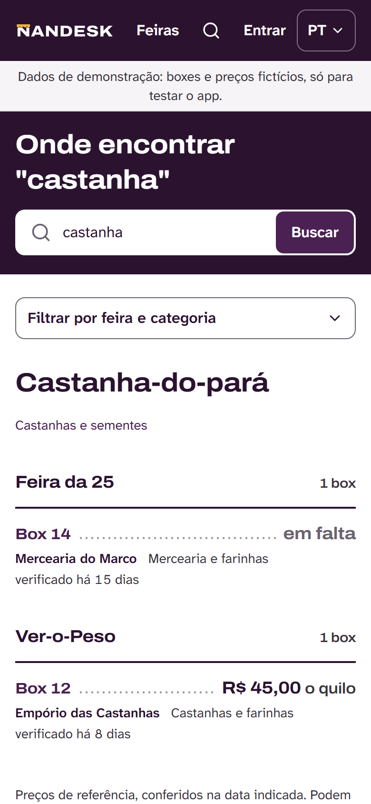
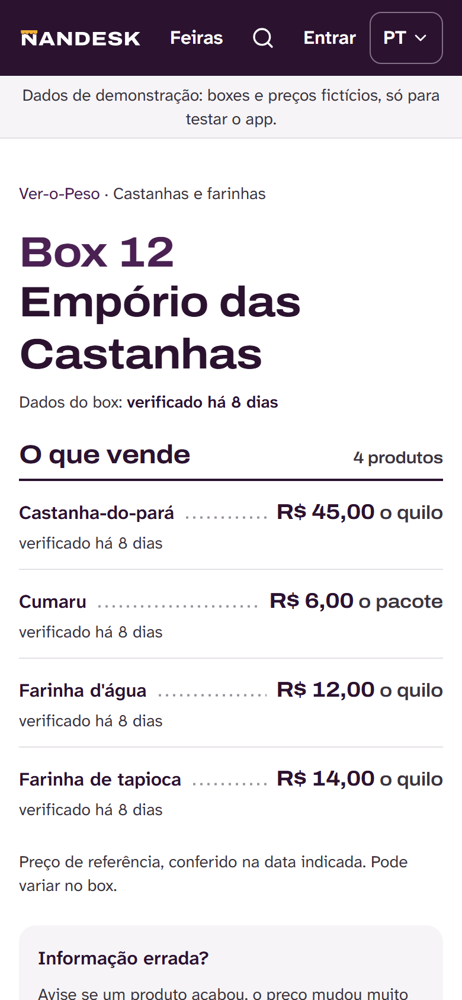
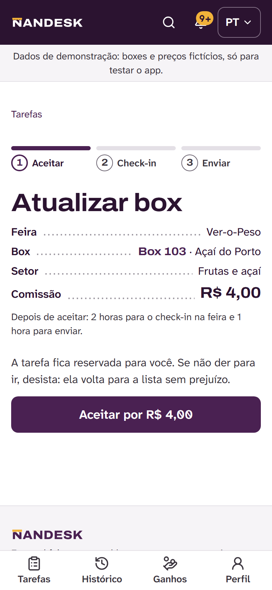
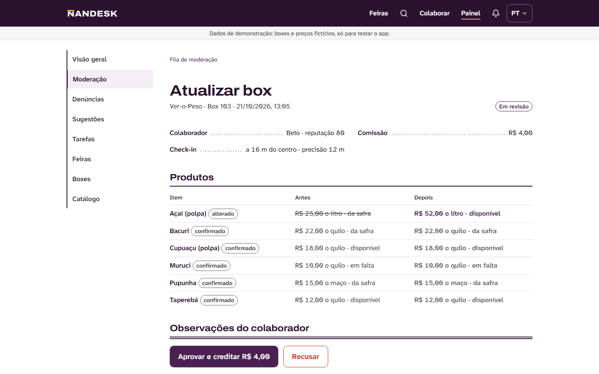
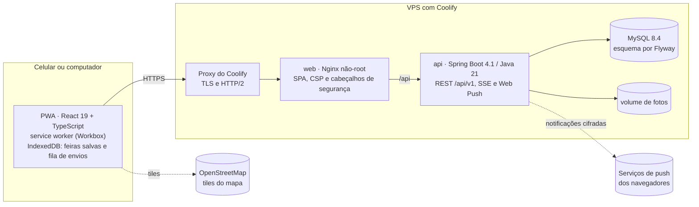

<p align="center">
  
</p>

<p align="center"><strong>Em qual feira e em qual box encontrar o que você procura nas feiras de Belém.</strong></p>

<p align="center">
  <a href="https://nandesk.com.br">nandesk.com.br</a> ·
  <a href="docs/ESPECIFICACAO.md">Especificação</a> ·
  <a href="docs/arquitetura.md">Arquitetura</a> ·
  <a href="docs/runbooks/deploy.md">Deploy</a> ·
  <a href="https://github.com/oadrianops/semana_ubiqua_2026.2/releases/download/v1.2.3/01-Documentacao-de-Solucao-e-Problema.pdf">Solução e Problema (PDF)</a> ·
  <a href="https://github.com/oadrianops/semana_ubiqua_2026.2/releases/download/v1.2.3/02-Documentacao-Tecnica-do-Software.pdf">Documentação Técnica (PDF)</a>
</p>

---

**NANDESK** é um app web instalável (PWA) que mostra em qual feira, setor e box de Belém vende cada produto
(castanha-do-pará, jambu, banho de cheiro, tucupi…), com o **preço de referência e a data em que foi conferido**.
Os dados são mantidos por uma rede de **colaboradores** que vão até a feira, fazem check-in, fotografam e enviam a
atualização, e recebem uma comissão por envio aprovado. O **feirante não precisa operar nada**: ele só autoriza
aparecer. O app foi feito para o celular e para a rede da feira: abre rápido com sinal fraco e funciona sem internet
nas feiras salvas.

Projeto da equipe **Adriano Pinheiro da Silva, Leonardo Farias de Souza e Victor Santiago dos Santos Abreu** para o
Hackathon Semana Ubíqua 2026.2 (UNAMA). Vídeo de pitch: https://youtu.be/1FcXBxfBEEg.

> **Dados reais e de demonstração.** Os boxes 2 e 3 (uma fruteira) e 67 da Feira da 25 foram conferidos na feira em 21/10/2026, com
> termo assinado pelos feirantes. Os demais boxes são fictícios, criados para a banca testar, e aparecem marcados
> como **Exemplo**; o app avisa isso no topo de todas as páginas. Além do Ver-o-Peso e da Feira da 25, o mapa traz
> mais sete feiras de Belém (Cremação, Pedreira, Bandeira Branca, Icoaraci, Benguí, Mercado de São Brás e Praça da
> República) com endereço e horário pesquisados e boxes de exemplo.

## O problema

Belém tem produtos que só existem aqui — castanha-do-pará, jambu, tucupi, maniçoba, banho de cheiro, artesanato de
miriti — espalhados por feiras grandes como o Ver-o-Peso e a Feira da 25, com centenas de boxes. Quem chega não sabe
**em qual box está cada coisa**; o turista ainda esbarra no idioma; e o feirante, que passa o dia no balcão, não tem
tempo nem costume de manter catálogo ou rede social. Na validação em campo, uma feirante contou que muita gente entra
no box **só para perguntar onde comprar o que procura**, em outros boxes. Resultado: quem procura se perde e quem vende
deixa de vender.

## A solução

A NANDESK responde em segundos "em qual feira e em qual box eu encontro isto?", em português, inglês ou espanhol, e
dá visibilidade digital ao feirante sem tirar tempo dele. Quatro decisões sustentam o produto:

1. **O feirante não opera a plataforma.** Os dados são levantados por colaboradores, no modelo de "corrida" de
   aplicativo, e publicados só depois da moderação e com o consentimento do feirante registrado.
2. **Confiança acima de volume.** Todo preço é "de referência" e todo dado mostra quando foi conferido ("verificado há
   N dias"). Dados fictícios aparecem marcados como **Exemplo**.
3. **Feito para a rede da feira.** O app abre do cache, salva a feira inteira no celular para buscar sem sinal e
   guarda os envios dos colaboradores numa fila que segue sozinha quando a rede volta.
4. **Multilíngue e local.** Termos regionais preservados e explicados; a busca entende sinônimos ("brazil nut",
   "castaña de Brasil") e ignora acentos.

Não há pagamento online, por decisão de produto: o app não cobra de quem procura nem de quem vende, e as comissões dos
colaboradores são repassadas por PIX, fora do app, e apenas registradas no extrato.

## Como funciona

**Quem visita a feira** abre o app (sem conta), digita o produto e vê cada feira como uma "pedra de preços": box,
setor, preço de referência, disponibilidade e a data da conferência. Na página do box estão as fotos (com zoom), o que
ele vende, o Instagram quando o feirante quis mostrar e o botão "como chegar". Antes de entrar na feira, dá para
salvar a feira para usar sem internet.

**O colaborador** recebe uma tarefa (atualizar um box, cadastrar um box novo ou verificar uma denúncia) e a cumpre em
três passos — **Aceitar → Fazer check-in → Enviar**. O check-in só vale dentro da cerca da feira (o GPS confirma que
ele está lá); as fotos são comprimidas no aparelho e enviadas uma a uma; sem sinal, o envio espera na fila.

**A moderação** compara o antes e o depois de cada envio, vê as fotos (restritas a ela), os alertas de GPS impreciso e
os conflitos de versão, e aprova ou recusa com motivo. Ao aprovar, os dados entram no ar e a comissão vai para o
extrato do colaborador; a reputação dele sobe ou desce conforme as decisões.

**A administração** mantém feiras, setores, catálogo nos três idiomas, regras de comissão e orçamento, registra os
repasses feitos por PIX e acompanha indicadores e auditoria.

## Validação na feira

Em 21/10/2026 a equipe levou o app à Feira da 25 e cadastrou os dois primeiros boxes reais (CA-5, atas em
[docs/validacao/](docs/validacao/)):

- A responsável por uma fruteira contou que **muita gente entra no box só para perguntar onde comprar, em outros
  boxes, o que procura** — o problema que a busca resolve — e pediu para mostrar o Instagram do box, o que virou
  requisito.
- A feirante de um box de roupas e armarinho disse que não entende de redes sociais e que o projeto seria a única
  forma de apresentar a loja na internet, o que confirma o princípio de que o feirante não precisa operar nada.

## Imagens

| Início (celular) | Busca | Box |
|---|---|---|
|  |  |  |

| Tarefa do colaborador | Moderação (antes e depois) |
|---|---|
|  |  |

## Funcionalidades

**Para quem visita a feira (sem conta)**
- Busca com sugestões, sem acento e com sinônimos em PT, EN e ES ("brazil nut", "castaña de Brasil"), e "você quis dizer".
- Para cada produto: feiras, setores e boxes, com preço de referência e "verificado há N dias".
- Página do box com fotos (principal e galeria), Instagram quando o feirante quis mostrar e marca "Exemplo" nos
  boxes fictícios.
- **Fotos ampliadas** em tela cheia, no celular e no computador: pinça, toque duplo, roda do mouse ou botões para
  aproximar, arrastar para mover, deslizar ou setas para trocar de foto.
- Nove feiras com mapa (OpenStreetMap) e alternativa em lista, horários, "como chegar" e capa com o crédito do autor.
- "Como chegar ao box" quando a posição do box foi conferida em campo.
- **Sem internet:** "Salvar para usar sem internet" guarda a feira no celular; a busca funciona offline e mostra
  a data dos dados.
- "Informação errada?" para avisar sobre um box.
- Instalação como app (Android e iPhone) e 3 idiomas.

**Para colaboradores**
- Tarefas por feira e tipo, ordenáveis pela distância (a posição não é gravada).
- Tarefa em 3 passos: **Aceitar → Fazer check-in → Enviar**. O check-in confere pelo GPS se a pessoa está na feira,
  e os prazos aparecem como barras.
- Fotos comprimidas no aparelho e enviadas uma a uma; sem sinal, o envio fica na fila e segue sozinho.
- Cadastro de box novo com o consentimento do feirante.
- Histórico com o motivo de cada recusa, extrato de comissões, reputação, notificações (no app e push) e perfil com
  chave PIX.

**Para moderação e administração**
- Fila de moderação com antes e depois, conflitos de versão, fotos restritas e alerta de GPS impreciso.
- Denúncias, sugestões de produto, tarefas, feiras (mapa, raio do check-in e foto de capa), catálogo nos 3 idiomas.
- **Box conferido em campo:** cadastro a partir do termo assinado, ofertas com preço de referência e fotos enviadas
  uma a uma; revogar o consentimento tira o box do ar e agenda a remoção das fotos. Um script lança um levantamento
  inteiro pela API (`infra/scripts/importar-campo.mjs`), com nomes e fotos fora do repositório (ADR-0018).
- Regras de comissão, orçamento do mês, saldos e **registro** de repasses (o pagamento é feito por PIX fora do app;
  não há pagamento online), usuários, auditoria e indicadores.

## Tecnologias

| Camada | Tecnologias |
|---|---|
| Backend | Java 21, Spring Boot 4.1 (Web MVC, Security com JWT RS256, Data JPA, Validation, Actuator), Flyway, MySQL 8.4, Caffeine, Bucket4j, springdoc (OpenAPI), Web Push próprio (RFC 8291) |
| Frontend | React 19, TypeScript, Vite 8, PWA (Workbox, `injectManifest`), Tailwind CSS 4, TanStack Query, React Router, i18next, Leaflet, IndexedDB |
| Testes | JUnit 6, AssertJ, Testcontainers, ArchUnit, JaCoCo, Vitest, Testing Library, MSW, Playwright, axe-core, k6 |
| Infra | Docker (imagens não-root), Nginx, Docker Compose, Coolify, GitHub Actions, Prometheus e Grafana |

Versões exatas e justificativas no [ADR-0002](docs/adr/0002-versoes-da-stack.md).

## Arquitetura

Um **monólito modular** em Spring Boot (ADR-0003) atrás de um Nginx que serve o PWA, tudo em contêineres no Coolify.
O detalhamento (contexto, contêineres, módulos e fluxos, no estilo C4) está em [docs/arquitetura.md](docs/arquitetura.md).



**Backend** (`backend/`, pacote `br.com.nandesk`): um módulo por funcionalidade — `market`, `catalog`, `stall`,
`search`, `task`, `submission`, `commission`, `report`, `notification`, `user`, `auth`, `file`, `audit`, `admin` e
`lgpd` — cada um com as camadas `api` (controllers e DTOs), `application` (serviços e transações), `domain`
(entidades e regras puras, testadas uma a uma) e `infra` (repositórios). As fronteiras são verificadas por testes
ArchUnit. Autenticação por JWT RS256 com refresh rotativo em cookie `HttpOnly`; limites de taxa por IP e por conta;
erros no formato Problem Details com códigos de um catálogo único.

**Frontend** (`frontend/`): rotas públicas no pacote inicial e as de conta, colaborador e painel sob demanda;
dados do servidor via TanStack Query, com cliente tipado a partir do contrato OpenAPI; token de acesso só em memória.
O modo offline tem três peças: o service worker guarda o app, o **snapshot** de cada feira salva vai para o
IndexedDB (com busca local sobre ele) e a **fila de envios** (outbox) guarda fotos e dados do colaborador até a rede
voltar, com uma `Idempotency-Key` por foto e por envio para nada chegar duas vezes.

**Dados:** feiras, setores, categorias e produtos (com nomes e sinônimos nos três idiomas), boxes e ofertas com
versão e data da conferência, tarefas, envios (o changeset do colaborador), extrato de comissões imutável e trilha de
auditoria. O esquema só muda por migrações Flyway.

**Entrega:** GitHub Actions roda os testes, a análise de segurança (CodeQL, Trivy, gitleaks e revisão de
dependências) e as jornadas E2E a cada PR; uma tag `vX.Y.Z` publica as imagens no GHCR, e o Coolify faz o deploy
com `docker-compose.prod.yml`.

## Demonstração

- **App:** https://nandesk.com.br
- **Vídeo de pitch:** https://youtu.be/1FcXBxfBEEg (3 min 21 s)
- **Credenciais de teste** (contas do seed de demonstração, sem acesso à administração):

| Papel | E-mail | Senha |
|---|---|---|
| Colaboradora | `ana@nandesk.local` | `demo-nandesk-2026` |
| Colaborador | `beto@nandesk.local` | `demo-nandesk-2026` |
| Moderação | `moderador@nandesk.local` | `demo-nandesk-2026` |

Para testar a tarefa completa no computador, permita a localização e simule a posição do Ver-o-Peso
(−1.4525, −48.5035) nas ferramentas do navegador (DevTools → Sensors). Também é possível criar uma conta nova de
colaborador.

## Como rodar

Pré-requisitos: Docker e Docker Compose. Para desenvolver: JDK 21 e Node 24.

```bash
git clone https://github.com/oadrianops/semana_ubiqua_2026.2.git nandesk
cd nandesk
cp .env.example .env
docker compose --profile app up -d --build     # MySQL, Mailpit, API e web
```

Abra http://localhost:8081 (e-mails em http://localhost:8025). O seed de desenvolvimento cria as contas da tabela
acima com a senha `troque-me-dev`.

**Desenvolvimento com recarga automática:**

```bash
docker compose up -d                                                     # só MySQL e Mailpit
cd backend && ./mvnw spring-boot:run -Dspring-boot.run.profiles=dev      # API em :8080
cd frontend && npm ci && npm run dev                                     # web em :5173
```

**Verificação completa:**

```bash
cd backend && ./mvnw verify      # 143 unitários + 87 integração (MySQL 8.4), JaCoCo, ArchUnit, contrato OpenAPI
cd frontend && npm run ci        # lint, tipos, 105 testes, build e orçamentos de performance
cd frontend && npm run e2e       # jornadas J1 a J8 com Playwright e axe
```

Deploy em produção no Coolify: [docs/runbooks/deploy.md](docs/runbooks/deploy.md).

## Qualidade, medida

| O quê | Resultado |
|---|---|
| Busca encontra os 26 produtos do seed em PT e pelos sinônimos EN/ES (CA-1) | 26/26 |
| Cobertura do backend (linhas) | 91% no total; todos os pacotes de regra ≥ 80% |
| Cobertura do frontend (linhas) | 78,7% |
| JavaScript inicial (gzip) | 147,7 KB (limite 150) |
| Primeira tela no perfil "Feira lotada" (400 ms, 400/150 kbps) | 1,4 s na 1ª visita · 0,9 s na 2ª |
| Rede caindo no meio do envio | 1 upload e 1 envio, sem duplicar (J6) |
| Acessibilidade (axe, "serious"/"critical") | 0 |

## Limitações (honestas)

- **Poucos dados reais.** Só dois boxes da Feira da 25 foram conferidos em campo; os outros 12 são fictícios e
  marcados como exemplo. O Ver-o-Peso ainda não teve visita de validação.
- **Posição da Feira da 25** tirada do OpenStreetMap (entre a Tv. Antônio Baena e a Av. José Bonifácio), ainda não
  conferida por GPS na feira.
- **Fotos** só dos dois boxes reais e da entrada da Feira da 25 (sem pessoas de rosto) e duas capas do Wikimedia
  Commons com licença livre e crédito ([créditos](docs/creditos-imagens.md)). Sem banco de imagens nem imagens geradas
  por IA. Cinco feiras ainda não têm capa.
- **Sete feiras novas** com endereço, posição e horário de fontes públicas que às vezes divergem; conferir em campo.
- **Preço por lote** ("3 por R$ 10,00") ainda não é aceito: vale o preço da unidade (backlog).
- **Comissões ilustrativas.** Não há parceiro financiador; o repasse é apenas registrado (sem pagamento online, por decisão de produto).
- **Mapa interno da feira** (RF-34, Could) não foi feito; o mapa mostra as feiras.
- **E-mail:** sem SMTP configurado, as contas novas entram já verificadas.
- **Push no iPhone** só funciona com o app instalado na tela de início (limitação do iOS).
- Textos legais são rascunhos sem revisão jurídica; traduções EN/ES sem revisão por falantes nativos.
- Testado em Chromium (desktop e emulação de Android). WebKit/iPhone e aparelhos reais ainda não passaram pela matriz da seção 15.5.

## Documentação

- [Especificação](docs/ESPECIFICACAO.md) · [Arquitetura](docs/arquitetura.md) · [ADRs](docs/adr/README.md)
- [Rastreabilidade](docs/rastreabilidade.md) · [Riscos](docs/riscos.md) · [Medição](docs/medicao.md) · [Backlog](docs/backlog.md)
- [API (OpenAPI)](docs/api/openapi.json) · [Design](DESIGN.md) · [Marca](docs/brand.md) · [Referência visual](docs/design/referencia-visual.md)
- [Deploy](docs/runbooks/deploy.md) · [Restauração](docs/runbooks/restore.md) · [Incidentes](docs/runbooks/incidentes.md)
- [Privacidade](docs/legal/politica-de-privacidade.md) · [Termos](docs/legal/termos-de-uso.md) · [Termo do feirante](docs/legal/termo-consentimento-feirante.md)
- [Como contribuir](CONTRIBUTING.md) · [Changelog](CHANGELOG.md)

## Uso de inteligência artificial

Seguindo o item 8.1 do edital: o código, os testes e a documentação deste repositório foram produzidos com apoio do
**Claude Code (modelo Claude Opus 5.5, da Anthropic)**, a partir da especificação escrita pela equipe
(`docs/ESPECIFICACAO.md`). A equipe definiu o problema, o escopo, as regras de negócio e as decisões de produto,
revisou o resultado e responde por ele. Nenhuma imagem do app foi gerada por IA. Os commits feitos com apoio da IA
trazem a linha `Co-Authored-By` correspondente.

## Licença

Código sob a [licença MIT](LICENSE). A marca NANDESK (nome, logo e ícones em `frontend/public/brand/`) não está
coberta pela licença MIT; veja [docs/brand.md](docs/brand.md).
