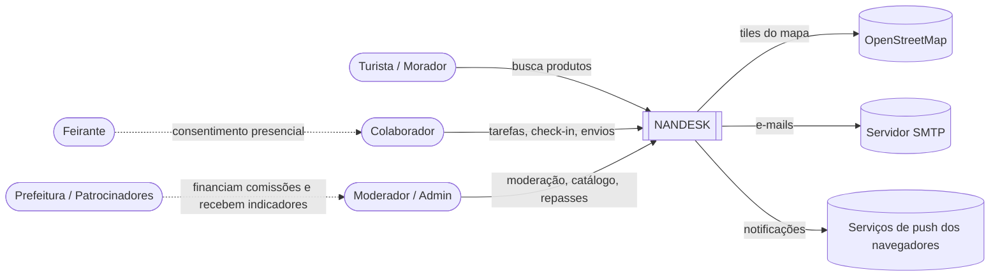
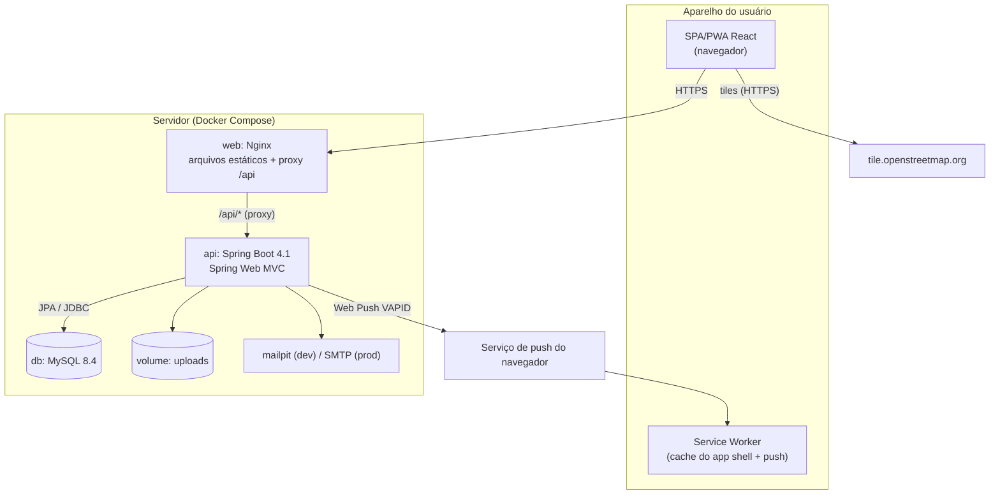
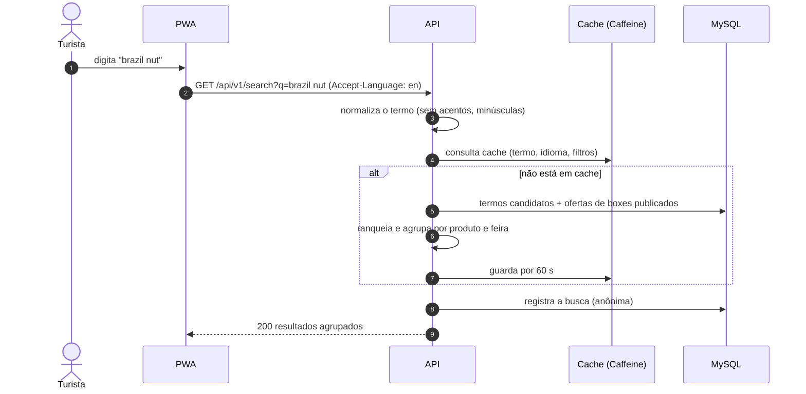
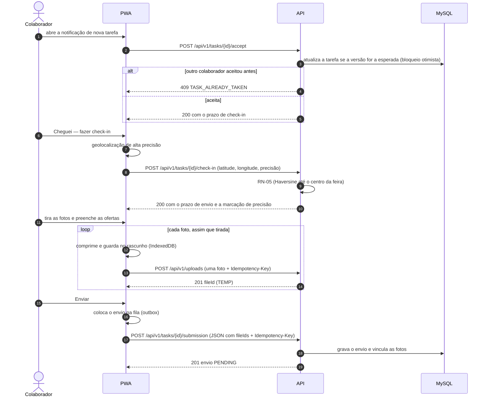
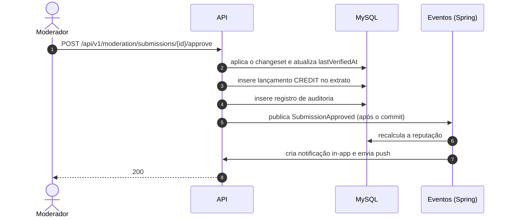
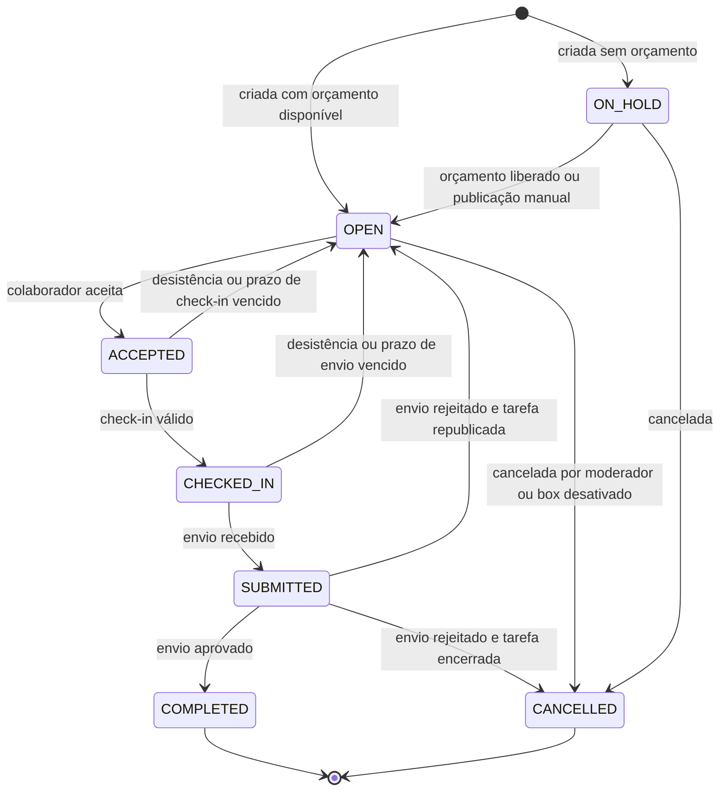
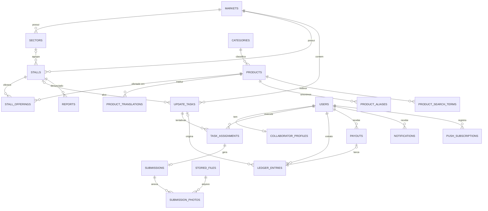

# NANDESK — Especificação de Produto e Engenharia (v1.1)

> Documento-fonte do projeto, escrito para a equipe e para o **Claude Code**. Se você é o Claude Code: leia a seção 0 inteira antes de qualquer ação e consulte as demais seções sob demanda, conforme a fase em andamento (seção 18).

| Campo | Valor |
|---|---|
| Projeto | **NANDESK** — plataforma digital colaborativa das feiras de Belém |
| Nomes técnicos | Repositório `nandesk` · pacote Java `br.com.nandesk` · imagens Docker `nandesk-api` e `nandesk-web` |
| Contexto | Projeto acadêmico — UNAMA, Ciência da Computação (Back-end Frameworks) · tema "Economia local e empreendedorismo" |
| Feiras da v1 | Ver-o-Peso e Feira da 25 |
| Stack definida pela equipe | Spring Boot + Spring Web (API) · React (PWA) · MySQL · OpenStreetMap · Docker |
| Prioridades transversais | App instalável (PWA) excelente no celular · alta performance com rede instável · visual profissional, sem cara de IA |
| Identidade visual | Seção 14.6 · arquivos da marca no pacote `nandesk-brand` (copiar para `frontend/public/brand/`) |
| Idiomas | Documentação e commits: PT-BR · Código: inglês · Interface: PT-BR, EN e ES |
| Versão do documento | 1.1.0 — 19/10/2026 |
| Origem | Documento de escopo da equipe (ideação, requisitos e escopo) + decisões registradas aqui |

## Histórico de versões

| Versão | Data | Alteração | Responsável |
|---|---|---|---|
| 1.0.0 | 19/10/2026 | Primeira versão completa (baseline para implementação) | Equipe |
| 1.1.0 | 19/10/2026 | Nome NANDESK e identidade visual; PWA passa a Must com critérios detalhados (RF-35) e uso sem conexão (RF-36); alta performance e resiliência a oscilações de rede (seção 9.14, RNF-01/02/03, RNF-15); upload de fotos uma a uma e fila de envios (RN-27); direção de design sem "cara de IA" com uso da skill `impeccable` (seção 14.7, RNF-16); novos critérios CA-6 e CA-7 | Equipe |

> Toda mudança de requisito passa pelo controle de mudanças (seção 17.3) e gera uma nova linha aqui.

## Sumário

0. Instruções para o Claude Code
1. Visão do produto
2. Escopo da versão 1
3. Glossário (linguagem ubíqua)
4. Atores, perfis e permissões
5. Requisitos funcionais (RF)
6. Regras de negócio (RN)
7. Requisitos não funcionais (RNF)
8. Stack tecnológica
9. Arquitetura
10. Modelo de dados
11. API REST
12. Segurança
13. Privacidade e LGPD
14. Experiência do usuário, design e acessibilidade
15. Qualidade e testes
16. DevOps: repositório, Docker e CI/CD
17. Engenharia de software e maturidade (CMMI / MPS.BR)
18. Plano de implementação por fases
19. Roadmap pós-v1

Anexos: A (changeset) · B (`.env.example`) · C (modelos de issue e PR) · D (modelo de ADR) · E (modelo de ata de validação) · F (`CLAUDE.md` e regras por caminho)

---

## 0. Instruções para o Claude Code

### 0.1 Regras de trabalho

1. **Implemente por fases** (seção 18), na ordem. Uma fase só termina quando seus critérios de saída forem cumpridos e todas as verificações passarem (`./mvnw verify` no backend e `npm run ci` no frontend).
2. **Comece cada fase com um plano curto** (escopo, migrações, endpoints, telas, testes) e apresente-o ao usuário antes de codificar.
3. **Este documento é a fonte da verdade.** Diante de ambiguidade, contradição ou algo que pareça errado: se for decisão de produto ou de escopo, **pergunte ao usuário**; se for decisão técnica reversível, decida, registre um ADR em `docs/adr/` e siga.
4. **Não implemente itens Won't (v1)** (seção 2.2) — em especial, nada de pagamento online. É decisão de produto, não lacuna.
5. **Versões:** use a última versão estável de cada dependência compatível com o Spring Boot 4.1.x (seção 8). Confirme no start.spring.io, no Maven Central e no npm antes de fixar e registre no ADR-0002. Nunca use versões milestone, RC ou snapshot. Se o Spring Boot 4.2 já tiver saído (previsto para novembro de 2026), mantenha a 4.1.x até existir um patch da 4.2 e decida a migração por ADR.
6. **Teste primeiro as regras de negócio:** para cada RN, escreva o teste (com o ID no nome) antes da implementação.
7. **Rastreabilidade:** cite os IDs (RF, RN, RNF, CA) em commits, PRs e testes (`@Tag("RF-02")` no JUnit; `RF-02` no título do teste no Playwright). Ao fim de cada fase, atualize `docs/rastreabilidade.md`.
8. **Segredos:** nunca no repositório. Use `.env` (ignorado pelo Git) e mantenha `.env.example` atualizado.
9. **Idiomas:** identificadores em inglês; textos de interface somente via i18n (nunca fixos no código); documentação e mensagens de commit em PT-BR.
10. **Ao fim de cada fase:** lint, testes e build verdes; README, CHANGELOG e rastreabilidade atualizados; tag de versão (seção 16.7).
11. **Informações ainda não definidas:** nomes e papéis dos membros da equipe, calendário do semestre e domínio de produção. Pergunte ao usuário quando forem necessários (seções 16.9, 17.1 e 18).
12. **Interface com a skill `impeccable`:** em toda tarefa que crie ou altere tela, carregue a skill `impeccable` (instalada no ambiente local da equipe) e siga a direção de design da seção 14.7. Antes de concluir uma tela, rode a auditoria/crítica da própria skill, corrija o que ela apontar e registre o resultado no PR. Se a skill não estiver disponível, avise o usuário e siga a seção 14.7.
13. **Performance é requisito, não ajuste final:** nenhuma tela é concluída fora dos orçamentos da seção 9.14 (verificados no CI) nem sem funcionar no perfil de rede "Feira lotada".
14. **Referência visual:** a equipe forneceu `file/plumeform_com-site-referencia.html` (cópia do site plumeform.com). Leia-o na Fase 0 para extrair princípios (seção 14.7). **Não copie** código, textos, marca ou layout: é material de terceiros, protegido por direitos autorais.

### 0.2 Arquivos de instrução do projeto (criar na Fase 0)

- Este arquivo fica em `docs/ESPECIFICACAO.md`.
- O pacote `nandesk-brand` (logo, ícones do PWA, favicon e guia de uso) vai para `frontend/public/brand/`; o `README.md` dele vira `docs/brand.md`.
- Crie `CLAUDE.md` na raiz, curto (alvo: menos de 200 linhas), com comandos, estrutura, regras "sempre/nunca" e um mapa de quais seções desta especificação ler para cada tipo de tarefa. **Não importe esta especificação com `@`**: arquivos importados são carregados inteiros em toda sessão, e este documento é longo.
- Crie regras por caminho em `.claude/rules/` com frontmatter `paths`, para que só sejam carregadas quando arquivos correspondentes forem lidos ou editados: `backend.md`, `frontend.md`, `database.md`, `infra.md`.
- Modelos no Anexo F.

### 0.3 Primeiro prompt sugerido

> Leia `docs/ESPECIFICACAO.md`, seções 0, 1, 2, 8, 9, 14, 16 e 18, e carregue a skill `impeccable`. Depois apresente o plano da Fase 0 e as versões exatas que pretende fixar, e aguarde minha aprovação antes de criar os arquivos.

---

## 1. Visão do produto

### 1.1 Problema

- Os feirantes do Ver-o-Peso e da Feira da 25 sustentam suas famílias e oferecem produtos com preços acessíveis e iguarias que só existem no Pará (banho de cheiro, comidas típicas), mas têm pouca ou nenhuma visibilidade digital.
- Quem procura um produto específico (ex.: castanha-do-pará, banho de cheiro) não sabe em qual feira, setor e box encontrá-lo — e há produtos vendidos em uma feira e não na outra.
- Turistas enfrentam, além disso, a barreira do idioma.
- O feirante não tem tempo (e muitas vezes familiaridade com tecnologia) para manter um catálogo digital atualizado.

### 1.2 Solução

A **NANDESK** é um app web instalável (PWA), feito primeiro para o celular, que:

1. Mostra as feiras, seus setores, boxes e produtos, com uma busca que responde "em qual feira e box eu encontro isto?".
2. Funciona em português, inglês e espanhol.
3. Continua útil com sinal fraco ou sem conexão: os dados das feiras ficam salvos no aparelho e os envios dos colaboradores entram numa fila que segue sozinha quando a rede volta.
4. Mantém os dados atualizados por uma rede de **colaboradores** da comunidade, num modelo inspirado em aplicativos de corrida: a plataforma publica **tarefas** (cadastrar um box, atualizar os produtos de um box, verificar uma denúncia); o colaborador recebe a notificação, aceita se quiser, vai até a feira, faz o check-in e envia a atualização com fotos; após a moderação, recebe uma comissão — que pode, se quiser, gastar nas próprias feiras.
5. É viabilizada por parcerias com a prefeitura e com a iniciativa privada, que custeiam as comissões.

### 1.3 Objetivos

| ID | Objetivo | Indicador (v1) |
|---|---|---|
| OBJ-1 | Dar visibilidade digital aos feirantes | Boxes publicados com consentimento; % com foto |
| OBJ-2 | Facilitar encontrar produtos | % de buscas com resultado; tempo até encontrar |
| OBJ-3 | Manter dados confiáveis sem ocupar o feirante | % de boxes verificados nos últimos 30 dias |
| OBJ-4 | Gerar renda complementar e girar a economia local | Comissões repassadas/mês; colaboradores ativos |
| OBJ-5 | Atender turistas | % de acessos em EN/ES; buscas em EN/ES com resultado |

### 1.4 Princípios de produto (inegociáveis)

- **P1 — O feirante não opera a plataforma.** Não precisa de conta, celular nem tempo: quem atualiza é a rede de colaboradores, enquanto o feirante faz o que sabe de melhor. Qualquer funcionalidade que exija ação recorrente do feirante está fora da v1.
- **P2 — Sem pagamento online.** Motivos: (a) taxas de intermediação reduziriam a renda do feirante, indo contra o objetivo do projeto; (b) feirantes e clientes já preferem e confiam no pagamento em dinheiro; (c) evita que o feirante tenha de operar a plataforma. A venda continua acontecendo presencialmente, como já funciona. A plataforma apenas **registra** as comissões dos colaboradores; o repasse é feito por fora (ex.: PIX feito pelo administrador do programa) e lançado no sistema.
- **P3 — Confiança acima de volume.** Todo dado público mostra quando foi verificado; nada entra sem moderação; preços são "de referência".
- **P4 — Feito para o celular e para a rede da feira.** Celular, sol forte, uma mão ocupada e plano de dados limitado. As feiras são ambientes fechados e lotados: muita gente disputando a mesma antena e sinal que oscila entre 4G, 3G e nada. O app abre do cache, mostra o que já tem e nunca fica travado esperando a rede (seções 9.13 e 9.14).
- **P5 — Multilíngue desde o primeiro dia.** PT-BR, EN e ES.
- **P6 — Privacidade por padrão (LGPD).** Coletar o mínimo; localização só no check-in; consentimento do feirante para aparecer.
- **P7 — Profissional e humano, sem cara de IA.** Interface com identidade própria, conteúdo real e texto específico; nada de padrões genéricos de template gerado (seção 14.7).

### 1.5 Públicos e proposta de valor

| Público | Necessidade | O que a plataforma entrega |
|---|---|---|
| Turista (nacional ou estrangeiro) | Encontrar iguarias e entender o que são, no seu idioma | Busca multilíngue, explicação dos produtos típicos, localização das feiras, "como chegar" |
| Morador de Belém | Saber onde comprar um produto específico | Busca por produto com feira, setor e box |
| Feirante | Visibilidade sem trabalho extra | Box publicado e atualizado pela comunidade |
| Colaborador | Renda complementar flexível | Tarefas sob demanda, comissão por tarefa aprovada, extrato |
| Prefeitura e patrocinadores | Fortalecer a economia local e o turismo | Indicadores de uso e de atualização; transparência dos repasses |

### 1.6 Stakeholders

| Stakeholder | Interesse | Influência | Como envolver |
|---|---|---|---|
| Feirantes | Visibilidade, não perder tempo, controle sobre a própria exposição | Alta (fonte de requisitos e do consentimento) | Entrevistas na feira e validação do protótipo (seção 17.7) |
| Colaboradores | Renda, fluxo simples | Média | Teste de campo do fluxo de tarefa |
| Turistas e moradores | Encontrar produtos | Média | Teste de usabilidade da busca |
| Prefeitura de Belém | Política pública para feiras e turismo; possível financiadora | Alta | Apresentação do projeto e conversa sobre parceria (se possível, com o prefeito) |
| Iniciativa privada | Patrocínio e visibilidade de marca | Média | Proposta de patrocínio do orçamento de comissões |
| Equipe e professor | Aprendizado e avaliação | Alta | Sprints, revisões e entregas |

---

## 2. Escopo da versão 1

### 2.1 Dentro do escopo

- Cadastro de feiras, setores, boxes e produtos (catálogo com traduções PT/EN/ES).
- Busca por produto com localização (feira, setor e box).
- Páginas públicas de feira, box e produto; mapa das feiras com OpenStreetMap.
- Fluxo de colaboração tipo "corrida": notificação → aceite → check-in no local → envio da atualização → moderação → comissão.
- Extrato de comissões do colaborador e registro dos repasses feitos fora da plataforma.
- Moderação de envios e painel administrativo.
- Interface em PT-BR, EN e ES.
- Perfil básico do box e do feirante, com consentimento.
- PWA instalável de alta qualidade no Android e no iPhone, com uso sem conexão dos dados das feiras e fila de envios, e notificações push (derivados de "site ou aplicativo", da notificação do fluxo de colaboração e da prioridade de performance com rede instável).
- Identidade visual NANDESK aplicada em toda a interface (seção 14.6).

### 2.2 Fora do escopo (Won't — v1)

| Item | Motivo |
|---|---|
| Pagamento online, carteira digital ou integração com meios de pagamento | Decisão de produto (P2) |
| Delivery ou reserva de produtos | Exigiria ação do feirante (P1) e logística própria |
| Feiras de outros municípios | Foco em validar o modelo em Belém |
| Programa de fidelidade para clientes | Fora do problema central |
| App de gestão de vendas ou estoque para o feirante | Contraria P1 |
| Apps nativos publicados em lojas | O PWA atende a v1 |
| Download de mapas para uso offline | Proibido pela política de uso dos tiles do OpenStreetMap (seção 9.6) |

Os itens fora do escopo não estão descartados: ficam registrados para versões futuras (seção 19), exceto o pagamento online, que só pode ser reavaliado junto com os feirantes.

### 2.3 Premissas

- Feirantes e colaboradores possuem smartphone próprio ou têm acesso a um.
- Prefeitura e/ou iniciativa privada apoiam o custeio das comissões.
- Feirantes concordam em ter seus boxes cadastrados publicamente (consentimento registrado — RN-13).
- Há sinal de celular, ainda que instável, nas feiras.

### 2.4 Restrições

- Prazo do semestre letivo; equipe de estudantes com dedicação parcial.
- Stack definida pela equipe: Spring Boot + Spring Web, React, MySQL, OpenStreetMap, Docker.
- Orçamento de infraestrutura próximo de zero: ambiente local ou um único VPS para a demonstração; serviços gratuitos ou self-hosted.
- A viabilidade financeira das comissões depende de parceria: o sistema precisa funcionar também com comissão zero (modo voluntário).
- Rede móvel ruim no local de uso: ambientes fechados e lotados, com conexão lenta, intermitente ou ausente. Toda funcionalidade é desenhada para esse cenário, não para o Wi-Fi do laboratório.

### 2.5 Critérios de aceite do projeto (v1)

| ID | Critério | Como verificar |
|---|---|---|
| CA-1 | A busca retorna corretamente feira e box para pelo menos 20 produtos típicos cadastrados de teste | Teste de integração parametrizado com os produtos do seed + jornada E2E J1 |
| CA-2 | O colaborador completa notificação → aceite → cadastro em campo em até 3 passos (Aceitar, Fazer check-in, Enviar) | Jornada E2E J2 com geolocalização simulada + teste de campo |
| CA-3 | A interface funciona em PT, EN e ES sem texto quebrado ou não traduzido | Teste de paridade de chaves i18n + jornada E2E J4 |
| CA-4 | Ver-o-Peso e Feira da 25 estão representadas no protótipo/demo | Seed + revisão manual |
| CA-5 | O protótipo foi validado com pelo menos 1 feirante real, com o feedback registrado | Ata em `docs/validacao/` (seção 17.7) |
| CA-6 | O app instala no Android e no iPhone e funciona sem conexão: com o modo avião ligado, abre pela tela inicial, mostra a feira salva e guarda um envio que é entregue sozinho quando a rede volta | Jornadas E2E J6 e J7 + teste nos aparelhos da seção 15.5 |
| CA-7 | No perfil de rede "Feira lotada" (seção 9.14), a página inicial mostra conteúdo útil em até 3 s na primeira visita e em até 1 s nas seguintes | Jornada E2E J8 com emulação de rede + Lighthouse mobile |

---

## 3. Glossário (linguagem ubíqua)

| Termo (PT) | Nome no código | Definição |
|---|---|---|
| Feira | `Market` | Feira ou mercado público (ex.: Ver-o-Peso), com localização e raio de check-in |
| Setor | `Sector` | Área temática dentro da feira (ex.: setor das ervas) |
| Box | `Stall` | Ponto de venda identificado por um código dentro da feira |
| Feirante | `vendor*` (campos do box) | Pessoa que trabalha no box. **Não é usuário** na v1 |
| Categoria | `Category` | Agrupamento de produtos (ex.: Ervas e banhos de cheiro) |
| Produto | `Product` | Item canônico do catálogo, com traduções e sinônimos (ex.: castanha-do-pará) |
| Oferta | `StallOffering` | Produto vendido em um box, com preço de referência e disponibilidade |
| Colaborador | `Collaborator` (usuário com papel `COLLABORATOR`) | Pessoa da comunidade que executa tarefas |
| Tarefa ("corrida") | `UpdateTask` | Trabalho de campo publicado pela plataforma |
| Tentativa | `TaskAssignment` | Cada vez que um colaborador aceita uma tarefa (com check-in e resultado) |
| Check-in | `CheckIn` | Confirmação de presença na feira por geolocalização |
| Envio | `Submission` | Alterações propostas + fotos, enviadas ao fim da tarefa |
| Changeset | `ChangeSet` | Estrutura JSON com as alterações propostas (Anexo A) |
| Moderação | `Moderation` | Revisão humana de um envio |
| Comissão | `Commission` | Valor devido ao colaborador por tarefa aprovada |
| Lançamento | `LedgerEntry` | Registro imutável de crédito, repasse, estorno ou ajuste no extrato |
| Repasse | `Payout` | Pagamento feito fora da plataforma e registrado nela |
| Denúncia | `Report` | Aviso de informação incorreta feito pelo público |
| Verificado em | `lastVerifiedAt` | Data da última aprovação que confirmou os dados de um box ou oferta |
| Snapshot da feira | `MarketSnapshot` | Pacote compacto com setores, boxes, ofertas e produtos de uma feira, salvo no aparelho para uso sem conexão (RF-36) |
| Versão dos dados da feira | `dataVersion` | Número que aumenta a cada mudança publicada numa feira; identifica o snapshot (ETag) |
| Fila de envios | `Outbox` | Lista, no aparelho, de envios e fotos aguardando sinal para seguir (seção 9.13) |
| App shell | — | HTML, JS, CSS, fontes e ícones guardados pelo service worker para o app abrir sem rede |

---

## 4. Atores, perfis e permissões

### 4.1 Perfis

- **Visitante** (anônimo): consulta feiras, boxes, produtos e a busca; envia denúncias.
- **Colaborador** (`ROLE_COLLABORATOR`): tudo do visitante + tarefas, envios, extrato e perfil.
- **Moderador** (`ROLE_MODERATOR`): revisa envios, denúncias e sugestões de catálogo; edita feiras, boxes e catálogo; cria tarefas. Não modera o próprio envio (RN-11).
- **Administrador** (`ROLE_ADMIN`): tudo do moderador + usuários, regras de comissão, repasses, orçamento, auditoria e configurações.
- **Feirante**: não é usuário na v1 (P1). Seus dados são registrados por colaboradores e moderadores, com consentimento.
- **Sistema** (jobs agendados): cria tarefas por desatualização, expira reservas e aplica as regras de retenção de dados.

Hierarquia de papéis no Spring Security: `ADMIN > MODERATOR > COLLABORATOR`.

### 4.2 Matriz de permissões

| Recurso / ação | Visitante | Colaborador | Moderador | Admin |
|---|:-:|:-:|:-:|:-:|
| Ver feiras, boxes, produtos e busca | ✓ | ✓ | ✓ | ✓ |
| Denunciar informação incorreta | ✓ | ✓ | ✓ | ✓ |
| Ver e aceitar tarefas, fazer check-in e enviar | – | ✓ | ✓ | ✓ |
| Ver o próprio extrato | – | ✓ | ✓ | ✓ |
| Moderar envios, denúncias e sugestões | – | – | ✓ | ✓ |
| Gerenciar feiras, setores, boxes e catálogo | – | – | ✓ | ✓ |
| Criar e cancelar tarefas manualmente | – | – | ✓ | ✓ |
| Regras de comissão, orçamento e repasses | – | – | – | ✓ |
| Usuários e papéis | – | – | – | ✓ |
| Indicadores | – | – | leitura | ✓ |
| Trilha de auditoria | – | – | – | ✓ |

---

## 5. Requisitos funcionais (RF)

Os RFs abaixo **decompõem** os requisitos do documento de escopo. A coluna "Origem" rastreia cada RF: **DE** = documento de escopo da equipe; **DER** = derivado de um princípio, RNF ou regra; **ENT** = entrevista com stakeholder (preencher após a validação — seção 17.7).

Os critérios de aceite estão em Gherkin (português) como especificação. Implemente-os como testes JUnit ou Playwright com o mesmo texto no nome; Cucumber não é obrigatório.

### 5.1 Resumo

| ID | Requisito | MoSCoW | Origem | Fase |
|---|---|---|---|---|
| RF-01 | Listar feiras e exibi-las no mapa | Must | DE: cadastro de feira | 1 |
| RF-02 | Buscar produto e ver em qual feira, setor e box encontrar | Must | DE: busca | 1 |
| RF-03 | Ver detalhes do box | Must | DE: cadastro de box | 1 |
| RF-04 | Ver página do produto (o que é + onde encontrar) | Should | DER: P5, turistas | 1 |
| RF-05 | Navegar por categorias | Should | DER: busca | 1 |
| RF-06 | Alternar idioma (PT-BR, EN, ES) | Should¹ | DE: idiomas | 1 |
| RF-07 | Denunciar informação incorreta | Should | DER: P3 | 4 |
| RF-08 | Cadastrar-se como colaborador | Must | DE: colaboração | 2 |
| RF-09 | Autenticar (login, renovação de sessão, logout) | Must | DER: segurança | 2 |
| RF-10 | Verificar e-mail e redefinir senha | Should | DER: segurança | 2 |
| RF-11 | Gerenciar perfil (dados, chave PIX, idioma, feiras de interesse) | Must | DE: comissão | 2 |
| RF-12 | Exportar meus dados e excluir minha conta (LGPD) | Should | DER: P6 | 5 |
| RF-13 | Criar tarefas (manual e automática por desatualização) | Must (manual) · Should (automática) | DE: colaboração | 3 |
| RF-14 | Notificar colaboradores sobre tarefas e eventos | Must | DE: colaboração | 3 |
| RF-15 | Listar tarefas disponíveis (lista e mapa, por distância) | Must | DE: colaboração | 3 |
| RF-16 | Aceitar tarefa | Must | DE: colaboração | 3 |
| RF-17 | Fazer check-in na feira | Must | DE: colaboração | 3 |
| RF-18 | Enviar atualização com fotos | Must | DE: colaboração | 3 |
| RF-19 | Desistir da tarefa e expirar reserva | Must | DER: RN-02 | 3 |
| RF-20 | Histórico de tarefas do colaborador | Should | DER | 3 |
| RF-21 | Fila de moderação com comparação antes/depois | Must | DER: P3 | 4 |
| RF-22 | Aprovar ou rejeitar envio | Must | DER: P3 | 4 |
| RF-23 | Reputação do colaborador | Should | DE: reputação | 4 |
| RF-24 | Sugerir novo produto para o catálogo | Should | DER | 4 |
| RF-25 | Regras de comissão por tipo de tarefa | Must | DE: comissão | 4 |
| RF-26 | Extrato e saldo do colaborador | Must | DE: comissão | 4 |
| RF-27 | Registrar repasse feito fora da plataforma | Must | DE: comissão + P2 | 4 |
| RF-28 | Orçamento mensal do programa | Should | DE: restrição financeira | 4 |
| RF-29 | Gerenciar feiras, setores e boxes (com consentimento) | Must | DE: cadastro | 1 (seed) · 5 (telas) |
| RF-30 | Gerenciar catálogo (categorias, produtos, traduções, sinônimos) | Must | DE: cadastro + idiomas | 1 (seed) · 5 (telas) |
| RF-31 | Gerenciar usuários e papéis | Must | DER | 5 |
| RF-32 | Painel de indicadores | Should | DER: objetivos | 5 |
| RF-33 | Trilha de auditoria | Must | DER: rastreabilidade | 4 |
| RF-34 | Mapa interno da feira com posição dos boxes | Could | DE: mapa interativo | 6 |
| RF-35 | App instalável (PWA) de alta qualidade | Must² | DE: "site ou aplicativo" + pedido da equipe | 1, 3 e 6 |
| RF-36 | Usar os dados das feiras sem conexão | Must | DER: P4 + pedido da equipe (rede instável) | 1 |

¹ RF-06 permanece Should, como no documento de escopo, mas é pré-requisito do CA-3 e custa muito menos se feito desde o início; por isso entra na Fase 1.

² Elevado de Should para Must na versão 1.1.0, a pedido da equipe: o app precisa funcionar muito bem no celular como PWA.

### 5.2 Vitrine pública

#### RF-01 — Listar feiras e exibi-las no mapa
**Must · Fase 1 · Todos os perfis**

- Lista de feiras ativas com nome, descrição curta traduzida, endereço, horário de funcionamento, quantidade de boxes publicados e foto de capa.
- Mapa (OpenStreetMap via Leaflet) com um marcador por feira; tocar no marcador abre um resumo com link para a página da feira.
- Página da feira: descrição, horários, botão "Como chegar" (abre o app de mapas do aparelho — seção 9.6), setores e lista de boxes publicados (filtro por setor, paginação).
- Todo conteúdo de mapa tem alternativa em lista (RNF-07).

```gherkin
Funcionalidade: Feiras
  Cenário: ver as feiras da v1
    Dado que existem as feiras ativas "Ver-o-Peso" e "Feira da 25"
    Quando acesso a página de feiras
    Então vejo 2 feiras na lista e 2 marcadores no mapa
    E o mapa exibe a atribuição "© OpenStreetMap contributors"

  Cenário: feira inativa não aparece
    Dado uma feira inativa
    Quando acesso a página de feiras
    Então ela não aparece na lista nem no mapa
```

#### RF-02 — Buscar produto
**Must · Fase 1 · Todos os perfis**

**História.** Como turista visitando Belém, quero pesquisar "castanha-do-pará" (ou "Brazil nut") e ver em qual feira, setor e box encontrar, para não perder tempo andando sem rumo.

- Campo de busca em destaque na página inicial e no topo das páginas públicas.
- Encontra produtos por nome, tradução ou sinônimo, em qualquer dos três idiomas; ignora acentos, maiúsculas e hífens ("acai" encontra "Açaí"; "castanha do para" encontra "Castanha-do-pará").
- Resultado agrupado por produto → feira → boxes, com setor, código e nome do box, preço de referência e unidade, disponibilidade e "verificado há N dias".
- Filtros: feira, categoria e "somente disponíveis". Ordenação por relevância (seção 9.10); dentro de cada produto, boxes verificados mais recentemente primeiro.
- Sugestões enquanto digita, a partir de 2 caracteres, com espera de 250 ms entre teclas (Should).
- Sem resultados: mensagem amigável, categorias populares e, se houver, "Você quis dizer…?" (Could).
- Só aparecem boxes ativos com consentimento concedido (RN-13).
- Cada busca gera um registro anônimo (termo normalizado, idioma, nº de resultados — sem IP e sem usuário) para os indicadores (RF-32).

```gherkin
Funcionalidade: Busca de produtos
  Contexto:
    Dado o produto "Castanha-do-pará" com sinônimo em inglês "Brazil nut"
    E o box "12" do setor "Castanhas e farinhas" do "Ver-o-Peso" oferece esse produto

  Cenário: busca em inglês
    Dado que o idioma selecionado é inglês
    Quando busco "brazil nut"
    Então vejo o produto "Brazil nut" com o box "12" do "Ver-o-Peso"

  Cenário: busca sem acento
    Quando busco "castanha do para"
    Então vejo o produto "Castanha-do-pará"

  Cenário: box sem consentimento não aparece
    Dado que o consentimento do box "12" foi revogado
    Quando busco "castanha"
    Então o box "12" não aparece nos resultados
```

#### RF-03 — Ver detalhes do box
**Must · Fase 1 · Todos os perfis**

- Mostra feira, setor, código, nome do box, foto, nome do feirante (somente com consentimento específico — RN-14) e as ofertas: produto (traduzido), preço de referência e unidade (RN-15), disponibilidade e data da última verificação.
- Aviso "as informações podem estar desatualizadas" quando a última verificação passar de 60 dias (RN-12).
- Botão "Informação errada?" (RF-07).
- Box inativo ou sem consentimento responde "não encontrado" (RN-13).

```gherkin
  Cenário: box verificado há mais de 60 dias
    Dado um box verificado pela última vez há 61 dias
    Quando abro a página do box
    Então vejo o aviso de informações possivelmente desatualizadas
```

#### RF-04 — Ver página do produto
**Should · Fase 1 · Todos os perfis**

- Nome e descrição traduzidos (o que é e como se consome ou usa — sem alegações de saúde, seção 14.4), categoria, meses de safra quando sazonal, e a lista de onde encontrar (feira → setor → box).

#### RF-05 — Navegar por categorias
**Should · Fase 1 · Todos os perfis**

- A página inicial lista as categorias com ícone e nome traduzido; a página da categoria lista seus produtos, cada um com o número de boxes que o oferecem.

#### RF-06 — Alternar idioma
**Should¹ · Fase 1 · Todos os perfis**

- Seletor de idioma visível em todas as páginas (PT-BR, EN, ES).
- Idioma inicial detectado pelo navegador; a escolha fica salva no aparelho (visitante) ou no perfil (usuário logado — RF-11).
- A API recebe o idioma por `Accept-Language` e devolve o conteúdo traduzido, com fallback para PT-BR (RN-19).
- `<html lang>` acompanha o idioma; datas, números e moeda são formatados pelo idioma (a moeda é sempre BRL).

```gherkin
  Cenário: trocar para espanhol
    Dado que estou na página de um box em português
    Quando seleciono "Español"
    Então todos os textos da interface aparecem em espanhol
    E nenhuma chave de tradução crua, como "stall.offerings.title", é exibida
```

#### RF-07 — Denunciar informação incorreta
**Should · Fase 4 · Todos os perfis**

- No box (e em cada oferta), o visitante escolhe o motivo — produto não encontrado, preço muito diferente, box fechado ou mudou de lugar, outro — e pode escrever um comentário de até 500 caracteres.
- Permitido sem login, com limitação de taxa e campo-armadilha (honeypot) contra robôs (RN-16).
- Denúncias acumuladas geram tarefa de verificação (RN-16).

### 5.3 Conta do colaborador

#### RF-08 — Cadastrar-se como colaborador
**Must · Fase 2 · Visitante**

- Campos: nome, e-mail, senha e idioma preferido; aceite obrigatório dos Termos de Uso e da Política de Privacidade (versão registrada); declaração obrigatória de ter 18 anos ou mais (as tarefas são remuneradas).
- Política de senha conforme RNF-04 e seção 12.1. E-mail único, comparado sem diferenciar maiúsculas.
- Com RF-10 implementado, a conta nasce `PENDING_VERIFICATION` e só aceita tarefas após confirmar o e-mail.

```gherkin
  Cenário: cadastro sem aceitar os termos
    Quando envio o cadastro sem marcar o aceite dos termos
    Então vejo o erro "É preciso aceitar os Termos de Uso e a Política de Privacidade"
    E nenhuma conta é criada
```

#### RF-09 — Autenticar
**Must · Fase 2 · Colaborador, Moderador, Admin**

- Login por e-mail e senha; sessão com token de acesso curto e token de renovação em cookie seguro (seção 12.1); renovação silenciosa; logout encerra a sessão no servidor.
- Erro de login sempre genérico ("e-mail ou senha inválidos"); bloqueio progressivo após tentativas falhas (seção 12.1).

#### RF-10 — Verificar e-mail e redefinir senha
**Should · Fase 2**

- Link de verificação de uso único, válido por 24 h; redefinição de senha com link de uso único, válido por 30 min, que encerra todas as sessões ativas. Em desenvolvimento, os e-mails são capturados pelo Mailpit.

#### RF-11 — Gerenciar perfil
**Must · Fase 2 · Colaborador**

- Editar nome, telefone (opcional), idioma, chave PIX (tipo + valor, guardada criptografada e exibida mascarada — seção 13), feiras de interesse (definem quem recebe notificações de tarefas — RF-14) e preferências de notificação.
- A tela recomenda a chave PIX aleatória, que expõe menos dados pessoais.

#### RF-12 — Exportar meus dados e excluir minha conta
**Should · Fase 5 · Colaborador**

- Exportação em JSON com perfil, tarefas, envios (sem fotos de terceiros), extrato e consentimentos aceitos.
- Exclusão conforme RN-20.

### 5.4 Colaboração ("corridas")

#### RF-13 — Criar tarefas
**Must (manual) · Should (automática) · Fase 3 · Moderador, Admin, Sistema**

- Manual: tipo (`NEW_STALL`, `UPDATE_STALL` ou `VERIFY_REPORT`), feira, box (exceto em `NEW_STALL`), setor sugerido, instruções e prioridade. O valor da comissão vem da regra vigente (RN-07).
- Automática: um job diário cria `UPDATE_STALL` para boxes desatualizados (RN-12); denúncias acumuladas criam `VERIFY_REPORT` (RN-16).
- Respeita uma tarefa ativa por box (RN-25) e o orçamento (RN-10).

```gherkin
  Cenário: tarefa automática por desatualização
    Dado um box verificado há 31 dias e sem tarefa ativa
    Quando o job diário de frescor executa
    Então existe uma tarefa "UPDATE_STALL" aberta para esse box

  Cenário: não duplica tarefa
    Dado um box com uma tarefa "UPDATE_STALL" aceita
    Quando o job diário de frescor executa
    Então nenhuma nova tarefa é criada para esse box
```

#### RF-14 — Notificar colaboradores
**Must · Fase 3 · Colaborador**

- Quando uma tarefa é publicada, os colaboradores ativos inscritos na feira recebem: (a) notificação no app (sino com contador, atualizado em tempo real enquanto o app está aberto) e (b) notificação push no celular ou navegador, quando suportada e autorizada (seção 9.8).
- Antispam: no máximo 1 push de "novas tarefas" por feira a cada 10 minutos por colaborador; as demais ficam só no app.
- Horário de silêncio para push (padrão 22h–6h, America/Belem); as notificações in-app continuam sendo registradas.
- Também geram notificação: envio aprovado ou rejeitado, repasse registrado e reserva prestes a expirar (15 min antes).
- Tocar na notificação abre a tarefa (início do passo 1 do CA-2).

```gherkin
  Cenário: só inscritos são notificados
    Dado a colaboradora "Ana", inscrita no "Ver-o-Peso"
    E o colaborador "Beto", inscrito apenas na "Feira da 25"
    Quando uma tarefa do "Ver-o-Peso" é publicada
    Então "Ana" recebe a notificação e "Beto" não
```

#### RF-15 — Listar tarefas disponíveis
**Must · Fase 3 · Colaborador**

- Lista e mapa das tarefas `OPEN`, com tipo, feira, setor, box, valor da comissão e prazos.
- Filtros por feira e tipo. Se o colaborador permitir, a posição atual serve só para ordenar por distância e não é gravada (RN-21).
- Colaborador abaixo da reputação mínima vê o motivo e não consegue aceitar (RN-17).

#### RF-16 — Aceitar tarefa
**Must · Fase 3 · Colaborador — passo 1 de 3**

- Botão "Aceitar". Aplica RN-01, RN-03, RN-04 e RN-17 e mostra o prazo para o check-in (RN-02).

```gherkin
  Cenário: dois colaboradores aceitam ao mesmo tempo
    Dado uma tarefa aberta
    Quando "Ana" e "Beto" tocam em "Aceitar" simultaneamente
    Então exatamente um deles fica com a tarefa
    E o outro vê "Esta tarefa acabou de ser aceita por outra pessoa"
```

#### RF-17 — Fazer check-in na feira
**Must · Fase 3 · Colaborador — passo 2 de 3**

- Botão "Cheguei — fazer check-in": obtém a localização de alta precisão (tempo limite de 20 s), valida conforme RN-05, grava posição e precisão, libera o formulário de envio e inicia o prazo de envio (RN-02).
- Falhas de GPS mostram orientação clara: ativar a localização, ir para uma área aberta, tentar de novo.

```gherkin
  Cenário: check-in fora da feira
    Dado uma tarefa aceita no "Ver-o-Peso", com raio de 250 m
    Quando faço check-in a 2 km da feira com precisão de 20 m
    Então vejo "Você precisa estar na feira para fazer o check-in"
    E a tarefa continua aceita

  Cenário: check-in com precisão baixa
    Quando faço check-in a 300 m do centro da feira com precisão de 180 m
    Então o check-in é aceito com a marcação "baixa precisão" para o moderador
```

#### RF-18 — Enviar atualização com fotos
**Must · Fase 3 · Colaborador — passo 3 de 3**

- Formulário conforme o tipo da tarefa:
  - `NEW_STALL`: código do box, setor, nome do box, nome do feirante (opcional), consentimentos (aparecer na plataforma; exibir o nome), forma do consentimento, ofertas e foto do box. Sem consentimento para aparecer, o envio não é permitido.
  - `UPDATE_STALL`: para cada oferta, confirmar, alterar preço/unidade/disponibilidade ou remover; adicionar ofertas (produto do catálogo ou sugestão nova — RF-24).
  - `VERIFY_REPORT`: confirmar ou negar o problema denunciado e corrigir os dados.
- Fotos: de 1 a 5 (RN-06), câmera traseira por padrão, compressão no aparelho e envio **uma a uma, assim que tiradas** (RN-27), para não depender de uma conexão longa e estável. Cada foto mostra seu estado: "enviando", "enviada" ou "aguardando sinal".
- O rascunho (dados + fotos) fica salvo no aparelho a cada alteração. Ao tocar em "Enviar", o envio entra na fila (seção 9.13) e segue sozinho quando houver sinal; a chave de idempotência garante que repetir não duplica (RNF-03).
- Depois do envio: "Recebido. Você recebe um aviso quando for revisado." Sem sinal: "Na fila. Será enviado quando houver sinal; pode fechar o app."

```gherkin
  Cenário: reenvio após queda de conexão
    Dado que enviei uma atualização e a conexão caiu antes da resposta
    Quando o app reenvia com a mesma chave de idempotência
    Então existe um único envio registrado para a tarefa
```

#### RF-19 — Desistir e expirar reserva
**Must · Fase 3 · Colaborador, Sistema**

- "Desistir" devolve a tarefa para `OPEN`. Antes do check-in, não afeta a reputação; depois do check-in, conta como expirada (RN-17).
- Reservas vencidas expiram automaticamente (RN-02), e o colaborador é avisado 15 minutos antes.

#### RF-20 — Histórico de tarefas
**Should · Fase 3 · Colaborador**

- Lista das tarefas do colaborador com situação, datas, valor e, quando houver, motivo de rejeição.

### 5.5 Moderação e qualidade dos dados

#### RF-21 — Fila de moderação
**Must · Fase 4 · Moderador**

- Lista de envios `PENDING`, do mais antigo para o mais novo, filtrável por feira e tipo.
- Detalhe com comparação antes/depois por campo e por oferta, fotos ampliáveis, dados do check-in (distância até a feira, precisão, marcação de baixa precisão), alerta de foto repetida (mesmo hash usado em outro envio) e reputação do colaborador.

#### RF-22 — Aprovar ou rejeitar envio
**Must · Fase 4 · Moderador**

- **Aprovar:** aplica as alterações numa única transação, atualiza a data de verificação, credita a comissão (RN-07) e registra a auditoria (RF-33); depois do commit, atualiza a reputação e notifica o colaborador.
- **Aprovar com ajustes** (Should): o moderador corrige campos antes de aprovar; os dois conjuntos (enviado e final) ficam registrados.
- **Rejeitar:** motivo obrigatório (foto ilegível, dados inconsistentes, fora da feira, privacidade, duplicado, outro) + comentário; a tarefa volta para `OPEN` ou é cancelada, a critério do moderador.
- **Conflito:** se o box mudou depois do envio, a tela destaca o conflito (RN-26).
- Ninguém modera o próprio envio (RN-11).

```gherkin
  Cenário: aprovação credita comissão
    Dado um envio pendente de "Ana" para uma tarefa com comissão de R$ 4,00
    Quando o moderador aprova o envio
    Então o saldo de "Ana" aumenta R$ 4,00
    E as ofertas do box refletem o envio
    E "Ana" recebe a notificação de aprovação

  Cenário: rejeição não credita
    Quando o moderador rejeita o envio com o motivo "foto ilegível"
    Então o saldo de "Ana" não muda
```

#### RF-23 — Reputação do colaborador
**Should · Fase 4 · Colaborador, Moderador**

- Pontuação de 0 a 100 calculada conforme RN-17, visível ao colaborador (com explicação de como subir) e ao moderador.

#### RF-24 — Sugerir novo produto
**Should · Fase 4 · Colaborador, Moderador**

- No envio, se o produto não existe no catálogo, o colaborador sugere nome em PT-BR, categoria e foto; a sugestão segue RN-18. O moderador pode aprovar a sugestão ou mesclá-la com um produto existente (o nome sugerido vira sinônimo).

### 5.6 Comissões e repasses

#### RF-25 — Regras de comissão
**Must · Fase 4 · Admin**

- O admin define o valor por tipo de tarefa, com início de vigência; valor ≥ R$ 0,00 (zero = modo voluntário); o histórico de regras é preservado.

#### RF-26 — Extrato e saldo
**Must · Fase 4 · Colaborador (próprio), Admin**

- Lançamentos com data, tipo, tarefa, valor e saldo acumulado; saldo atual e total já repassado. Exportação CSV (Could).
- Estornos e ajustes são feitos pelo admin com justificativa (RN-08).

#### RF-27 — Registrar repasse
**Must · Fase 4 · Admin**

- O admin vê os colaboradores com saldo ≥ mínimo (RN-09), consulta a chave PIX (acesso auditado) e registra o repasse feito fora da plataforma: valor, data, método (PIX, transferência, dinheiro, outro) e referência do comprovante. Isso gera um lançamento `PAYOUT` e notifica o colaborador.
- A plataforma **não executa** pagamentos (P2). Os aspectos fiscais dos repasses devem ser definidos com os parceiros e estão fora do escopo técnico.

#### RF-28 — Orçamento do programa
**Should · Fase 4 · Admin**

- Orçamento mensal por patrocinador; painel com valor comprometido (tarefas publicadas ainda não concluídas), realizado (comissões creditadas) e disponível; aplica RN-10.

### 5.7 Administração

#### RF-29 — Gerenciar feiras, setores e boxes
**Must · Fase 1 (seed) e Fase 5 (telas) · Moderador, Admin**

- Feiras: posicionamento no mapa (clicar define latitude e longitude) e raio de check-in exibido como círculo; descrição e horários traduzidos.
- Setores com traduções. Boxes com código único por feira, setor, nome, nome do feirante, consentimentos (situação, data, forma e quem registrou) e situação.
- Desativar o box ou revogar o consentimento oculta o box e cancela suas tarefas ativas (RN-13).

#### RF-30 — Gerenciar catálogo
**Must · Fase 1 (seed) e Fase 5 (telas) · Moderador, Admin**

- Categorias e produtos com traduções (PT-BR obrigatório; EN e ES com indicador de completude), sinônimos por idioma, unidade padrão, meses de safra e imagem.
- Mesclar produtos duplicados: ofertas e sinônimos migram para o produto mantido.

#### RF-31 — Gerenciar usuários
**Must · Fase 5 · Admin**

- Buscar usuários, alterar papel, suspender e reativar (a suspensão cancela as reservas ativas).

#### RF-32 — Painel de indicadores
**Should · Fase 5 · Moderador (leitura), Admin**

- Boxes publicados; % verificados nos últimos 30 dias; tarefas por situação; tempo médio de moderação; taxa de aprovação; comissões creditadas e repassadas no mês; orçamento; buscas por dia; termos mais buscados sem resultado; acessos por idioma; colaboradores ativos no mês.

#### RF-33 — Trilha de auditoria
**Must · Fase 4 · Admin**

- Registra quem fez o quê e quando em: aprovação e rejeição de envios, alterações de box e catálogo, consentimentos, regras de comissão, repasses, estornos e ajustes, papéis e suspensões, exclusão de conta e consulta de chave PIX. Somente leitura; sem dados sensíveis em claro; retenção mínima de 1 ano.

#### RF-34 — Mapa interno da feira
**Could · Fase 6 · Todos os perfis**

- Posicionar setores e boxes sobre o mapa da feira. Depende de levantamento em campo; só entra se sobrar tempo.

#### RF-35 — App instalável (PWA) de alta qualidade
**Must · Fases 1 (base), 3 (push) e 6 (auditoria em aparelhos) · Todos os perfis**

- Instalável no Android (Chrome) e no iPhone (Safari, "Adicionar à Tela de Início"); abre em tela cheia (`display: standalone`) com ícone, nome e cores da marca (seção 14.6).
- **Manifesto:** `name` "NANDESK: feiras de Belém", `short_name` "NANDESK", `id` e `start_url` "/", `scope` "/", `display` "standalone", `orientation` "portrait", `theme_color` `#4A2152`, `background_color` `#FFFFFF`, `lang` "pt-BR", `categories` ["shopping", "travel", "food"], ícones `any`, `maskable` e `monochrome` (pasta `brand/png/`), `screenshots` nos formatos estreito e largo, e atalhos (`shortcuts`) para "Buscar" e "Minhas tarefas".
- **iPhone:** `apple-touch-icon` de 180 px, `<meta name="theme-color">` e instrução própria de instalação, porque o Safari não mostra convite automático.
- **Convite de instalação** com botão "Instalar" (evento `beforeinstallprompt` no Chromium), mostrado só depois de uso real (ex.: segunda visita ou depois de uma busca com resultado), fácil de dispensar e lembrado. Nunca na primeira tela da primeira visita.
- **Abre na hora** depois da primeira visita: o app shell vem do cache, sem tela branca (RNF-15).
- **Sem conexão:** funciona para o que já foi salvo (RF-36) e mostra claramente quando está offline.
- **Atualização:** aviso "Nova versão disponível" com o botão "Atualizar"; nunca troca de versão no meio de um envio.
- **Jeito de app:** respeita as áreas seguras (notch e barra de gestos); campos com fonte ≥ 16 px (o iPhone não dá zoom sozinho); sem "puxar para atualizar" acidental sobre o mapa; navegação inferior para colaboradores; botão voltar do Android funcionando em todas as rotas.
- **Push:** depende do service worker; no iPhone, só com o app instalado na tela inicial (iOS 16.4+).

```gherkin
  Cenário: abrir sem internet depois de instalado
    Dado que instalei o app e abri o "Ver-o-Peso" com internet
    Quando abro o app pela tela inicial com o modo avião ligado
    Então vejo a página inicial e o "Ver-o-Peso" com os dados salvos
    E vejo o aviso "Sem conexão. Mostrando dados salvos em 19/10 às 15:40."
```

#### RF-36 — Usar os dados das feiras sem conexão
**Must · Fase 1 · Todos os perfis**

- Ao abrir uma feira, o app guarda o snapshot dela no aparelho: setores, boxes publicados, ofertas, produtos no idioma escolhido e datas de verificação (seção 9.13).
- A pessoa pode marcar uma feira como "Salvar para usar sem internet"; as feiras salvas são atualizadas em segundo plano sempre que houver sinal.
- Sem rede: navegação pelas feiras salvas e **busca local** nelas, com a mesma normalização da busca do servidor (acentos, maiúsculas, hífens).
- Toda tela com dados salvos mostra quando eles foram atualizados; acima do limite, avisa que podem estar desatualizados (RN-28).
- Tiles do mapa não são salvos (seção 9.6): sem rede, o mapa mostra só o que o navegador já tinha em cache, e a lista continua funcionando.

```gherkin
  Cenário: buscar sem internet
    Dado que salvei o "Ver-o-Peso" para usar sem internet
    E estou sem conexão
    Quando busco "jambu"
    Então vejo os boxes do "Ver-o-Peso" que vendem jambu
    E vejo que o resultado vem dos dados salvos e quando eles foram atualizados
```

---

## 6. Regras de negócio (RN)

Os valores da coluna "Padrão" são configuráveis (propriedades `app.*` — seção 16.5). Cada RN deve ter pelo menos um teste unitário com o ID no nome.

| ID | Regra | Padrão |
|---|---|---|
| RN-01 | **Exclusividade da tarefa.** Uma tarefa só pode estar atribuída a um colaborador por vez. Aceites simultâneos são resolvidos por bloqueio otimista (`version`): o primeiro vence; o outro recebe `TASK_ALREADY_TAKEN` (409). | — |
| RN-02 | **Prazos da reserva.** Após aceitar, o colaborador tem um prazo para fazer o check-in; após o check-in, um prazo para enviar. Vencido qualquer prazo, a reserva expira, a tarefa volta para `OPEN` e a tentativa conta como expirada. Aviso 15 min antes do vencimento. | check-in: 2 h · envio: 1 h · aviso: 15 min |
| RN-03 | **Tarefas simultâneas.** Um colaborador pode ter no máximo N tarefas aceitas (`ACCEPTED` ou `CHECKED_IN`) ao mesmo tempo. | N = 2 |
| RN-04 | **Limite diário.** Um colaborador pode fazer no máximo N envios por dia civil (America/Belem). | N = 15 |
| RN-05 | **Validação do check-in.** É válido se `distância(posição informada, centro da feira) ≤ raio da feira + min(precisão informada, 100 m)`, com distância calculada pela fórmula de Haversine. Precisão pior que 100 m: aceito, mas marcado `LOW_ACCURACY` para o moderador. Fora do limite: `CHECKIN_OUT_OF_RANGE` (422). O geofence é da **feira**, não do box, porque o GPS dentro dos mercados é impreciso. | raio: 250 m (por feira) |
| RN-06 | **Fotos.** Cada envio tem de 1 a 5 fotos. O app converte e comprime para JPEG (lado maior ≤ 1600 px, alvo ≤ 300 KB) antes de enviar; o servidor aceita só JPEG e PNG (verificados pelo conteúdo, não pela extensão), até 5 MB cada, e recodifica para JPEG com lado maior ≤ 1600 px, removendo metadados (inclusive GPS), além de gerar miniatura de 400 px. As fotos sobem uma a uma (RN-27). | 1–5 fotos · 5 MB · 1600 px |
| RN-07 | **Valor da comissão.** É copiado da regra vigente no momento da criação da tarefa e exibido antes do aceite. Só é creditado quando o envio é aprovado; rejeição não gera crédito. | — |
| RN-08 | **Extrato imutável.** Lançamentos são somente inseridos, nunca alterados ou apagados. Correções são feitas por lançamentos de estorno (`REVERSAL`) ou ajuste (`ADJUSTMENT`), com justificativa obrigatória e auditoria. | — |
| RN-09 | **Saldo e repasse.** Os lançamentos têm sinal (crédito e ajuste positivo: +; repasse, estorno e ajuste negativo: −) e o saldo é a soma deles. Um repasse não pode exceder o saldo e precisa respeitar o valor mínimo. | mínimo: R$ 10,00 |
| RN-10 | **Orçamento.** Se houver orçamento cadastrado para o mês, uma tarefa só é publicada (`OPEN`) se `orçamento − comprometido − realizado ≥ comissão`; senão fica `ON_HOLD` até haver orçamento ou até ser publicada manualmente com comissão zero (modo voluntário). Sem orçamento cadastrado para o mês, não há teto. | — |
| RN-11 | **Segregação de funções.** Ninguém modera o próprio envio nem registra repasse para si mesmo. | — |
| RN-12 | **Frescor dos dados.** "Verificado em" é a data da última aprovação que confirmou os dados do box. Box sem verificação há mais de 30 dias recebe uma tarefa `UPDATE_STALL` automática; acima de 60 dias, a página mostra o aviso de possível desatualização. | 30 d · 60 d |
| RN-13 | **Consentimento do feirante.** Um box só é público com consentimento concedido, registrado com data, forma (verbal ou termo assinado) e quem registrou. A revogação — pedida a qualquer colaborador, moderador ou pelo contato público do projeto — oculta o box imediatamente, cancela suas tarefas ativas e agenda a remoção das fotos. | remoção das fotos: 30 d |
| RN-14 | **Nome do feirante.** O nome da pessoa só é exibido com consentimento específico para isso; por padrão aparecem apenas o nome e o código do box. | — |
| RN-15 | **Preço de referência.** Preço é opcional e sempre "de referência": exibido com unidade, data da verificação e o aviso "pode variar". | — |
| RN-16 | **Denúncias.** N denúncias sobre o mesmo box em uma janela de tempo geram uma tarefa `VERIFY_REPORT` (se não houver tarefa ativa para o box). Denúncias anônimas são limitadas por IP; o IP é usado só para essa limitação e não é gravado. | N = 3 · janela: 7 d · 5 denúncias/h por IP |
| RN-17 | **Reputação.** `round(100 × A / (A + R + 0,5 × E))` sobre os últimos N resultados do colaborador (A = aprovados, R = rejeitados, E = expirados ou desistências após o check-in). Com menos de 5 resultados, vale o valor inicial. Abaixo do mínimo, o colaborador não aceita novas tarefas até a revisão de um moderador. | N = 20 · inicial: 80 · mínimo: 40 |
| RN-18 | **Sugestão de produto.** Produto sugerido por colaborador entra como `PENDING` e só fica visível depois da aprovação do moderador, com nome em PT-BR; EN e ES podem ser preenchidos depois. | — |
| RN-19 | **Idioma.** O conteúdo é servido no idioma pedido, com fallback para PT-BR. A interface nunca exibe uma chave de tradução crua. | — |
| RN-20 | **Exclusão de conta.** O pedido bloqueia o login imediatamente (`DELETION_PENDING`) e cancela reservas ativas. Se houver saldo, o admin é avisado para fazer o repasse final; zerado o saldo (ou vencido o prazo), os dados pessoais são anonimizados. Lançamentos financeiros e auditoria permanecem, com referência anonimizada. | prazo: 30 d |
| RN-21 | **Localização do colaborador.** É coletada só no check-in (gravada) e, se o colaborador permitir, para ordenar a lista de tarefas (não gravada). As coordenadas do check-in são apagadas após o prazo de retenção; ficam só a distância calculada e a marcação de precisão. | 90 d |
| RN-22 | **Privacidade nas fotos.** Fotos não devem mostrar pessoas identificáveis sem consentimento; o moderador rejeita com o motivo `PRIVACY`. Fotos de evidência de envios aprovados são apagadas após a retenção (a foto do box promovida a pública permanece); fotos de envios rejeitados, após 30 dias. | evidências: 90 d · rejeitadas: 30 d |
| RN-23 | **Datas e fuso.** Datas e horas são gravadas em UTC (`Instant`) e exibidas no fuso America/Belem; "dia" nos limites diários é o dia civil de Belém. | — |
| RN-24 | **Dinheiro.** BRL com `BigDecimal` e `DECIMAL(10,2)`, arredondamento HALF_EVEN; na API, valores como string decimal (`"12.50"`). | — |
| RN-25 | **Uma tarefa ativa por box.** Cada box tem no máximo uma tarefa em `ON_HOLD`, `OPEN`, `ACCEPTED`, `CHECKED_IN` ou `SUBMITTED`. | — |
| RN-26 | **Conflito na aprovação.** Se o box ou uma oferta mudou desde o envio (versão diferente da registrada no changeset), o moderador vê o conflito campo a campo e decide entre aplicar, ajustar ou rejeitar como desatualizado. | — |
| RN-27 | **Uploads temporários.** Cada foto é enviada separadamente, assim que tirada, com uma chave gerada no aparelho (`clientUploadId`, usada como `Idempotency-Key`), e fica `TEMP` até ser vinculada a um envio. Reenviar a mesma chave devolve o mesmo arquivo. Uma foto só pode ser vinculada pelo próprio dono e a um único envio. Fotos `TEMP` não vinculadas são apagadas após o prazo. | prazo: 24 h |
| RN-28 | **Dados salvos no aparelho.** Toda informação vinda do snapshot mostra a data da última atualização; acima do limite, a interface avisa que pode estar desatualizada e tenta atualizar quando houver sinal. | aviso: 7 d |

---

## 7. Requisitos não funcionais (RNF)

| ID | Categoria | Requisito e meta | Verificação | Origem |
|---|---|---|---|---|
| RNF-01 | Desempenho do servidor | p95 ≤ 300 ms na busca e ≤ 200 ms nas páginas públicas e no snapshot (com ETag/304), com 100 usuários simultâneos sustentados e pico de 300 por 1 min (catálogo com 2.000 ofertas); erro < 0,5% | k6 (seção 15.5) | DE: "buscas em até 2 s" + alta performance |
| RNF-02 | Desempenho no celular | Core Web Vitals no p75 medido em campo: LCP ≤ 2,5 s, INP ≤ 200 ms, CLS ≤ 0,1. Lighthouse mobile: Desempenho ≥ 90, Acessibilidade ≥ 95, Boas práticas ≥ 95. Orçamentos de tamanho da seção 9.14. Layout funcional a partir de 360 px | Lighthouse CI, size-limit no CI e medição de campo (web-vitals) | DE: "funcionar bem em celular" + alta performance |
| RNF-03 | Resiliência a oscilações de rede | No perfil "Feira lotada" (seção 9.14): conteúdo útil na página inicial em ≤ 3 s na 1ª visita e ≤ 1 s nas seguintes; nenhuma tela trava esperando a rede; nenhum envio se perde (fila + idempotência); quedas de até 10 s não exigem ação da pessoa; fotos ≤ 300 KB após compressão | E2E com perfis de rede e quedas simuladas (J6, J8) + teste de campo | DE: "conexão instável" + pedido da equipe |
| RNF-04 | Segurança | OWASP Top 10 e OWASP ASVS nível 1 (autenticação no nível 2); HTTPS em produção; 0 vulnerabilidades críticas ou altas abertas com correção disponível | Testes de segurança, CodeQL, Trivy, revisão na Fase 6 | DER |
| RNF-05 | Privacidade | LGPD (seção 13): minimização, base legal por dado, criptografia da chave PIX, retenção automatizada, direitos do titular | Checklist LGPD na Fase 6 | DE: LGPD |
| RNF-06 | Disponibilidade e recuperação | Meta de 99% ao mês em produção; reinício automático; backup diário; RPO ≤ 24 h e RTO ≤ 4 h; restauração testada mensalmente | Monitoramento + teste de restauração | DER |
| RNF-07 | Acessibilidade | WCAG 2.2 nível AA; alternativa em lista para todo mapa; 0 violações "serious" ou "critical" no axe | axe nos E2E + teste manual com leitor de tela | DER (inclusão) |
| RNF-08 | Internacionalização | 100% dos textos de interface externalizados; as mesmas chaves nos 3 idiomas; formatos por idioma; conteúdo com fallback PT-BR | Teste de paridade de chaves + lint | DE: idiomas |
| RNF-09 | Manutenibilidade | Cobertura e quality gates da seção 15.6; regras de arquitetura (ArchUnit); complexidade ciclomática ≤ 10 por método | CI | DER |
| RNF-10 | Observabilidade | Logs estruturados (JSON em produção) com `requestId`; métricas Prometheus técnicas e de negócio; health e readiness | Revisão + painel | DER |
| RNF-11 | Implantação | Ambiente completo com um comando (`docker compose --profile app up`) em ≤ 10 min após clonar; configuração 100% por variáveis de ambiente | Teste em máquina limpa | DE: Docker |
| RNF-12 | Usabilidade | Turista encontra um produto em ≤ 3 interações a partir da página inicial; fluxo do colaborador em 3 passos; legível ao sol (alto contraste, fonte ≥ 16 px, alvos de toque ≥ 44 px) | Teste de usabilidade (seção 17.7) | DE: CA-2 |
| RNF-13 | Compatibilidade | Últimas 2 versões de Chrome, Edge, Firefox e Safari; Chrome no Android 10+; Safari no iOS 16.4+ (push só com o app instalado) | E2E (Chromium e WebKit) + teste manual | DER |
| RNF-14 | Escalabilidade | API stateless, permitindo várias réplicas; se houver mais de uma réplica, jobs protegidos contra execução duplicada (ShedLock) e tickets de SSE em armazenamento compartilhado | Revisão de arquitetura | DER |
| RNF-15 | Experiência de app (PWA) | Instalável e em modo app no Android e no iPhone; abre pela tela inicial em ≤ 1,5 s (inicialização a quente) num Android intermediário; funciona sem conexão conforme RF-36; atende aos critérios de instalação do Chrome; nenhum elemento escondido pelas áreas seguras no modo instalado | Matriz de aparelhos (seção 15.5) + painel Application do DevTools | Pedido da equipe |
| RNF-16 | Design profissional | Interface segue a direção da seção 14.7 (nenhum padrão da lista "evitar"), usa só os tokens da marca e passa na revisão de design e na auditoria da skill `impeccable` | Checklist de design no PR + revisão do PO | Pedido da equipe |

---

## 8. Stack tecnológica

Versões conferidas em 19/10/2026. "Do Boot" = versão gerenciada pelo BOM do Spring Boot. Para tudo o mais, use a última estável compatível e registre no ADR-0002.

### 8.1 Visão geral

| Camada | Tecnologia | Versão-alvo | Por quê |
|---|---|---|---|
| Linguagem do backend | Java (Eclipse Temurin) | 21 LTS | LTS suportada por todo o tooling (Lombok, MapStruct, JaCoCo, Testcontainers) |
| Framework do backend | Spring Boot | 4.1.x (último patch) | Linha atual. A 3.5 saiu do suporte open source em 30/06/2026 e a 4.0 sai em 31/12/2026 |
| API | Spring Web (Spring MVC) | do Boot | Definida pela equipe; REST síncrono, simples de testar |
| Persistência | Spring Data JPA + Hibernate | do Boot | Produtividade e padrão de mercado |
| Banco de dados | MySQL | 8.4 LTS | Definido pela equipe; versão de suporte longo |
| Migrações | Flyway | do Boot | Versionamento do schema (gerência de configuração) |
| Segurança | Spring Security + OAuth2 Resource Server (JWT) | do Boot | Padrão Spring para APIs stateless |
| Documentação da API | springdoc-openapi | 3.x compatível com o Boot 4.1 | OpenAPI 3.1 + Swagger UI |
| Frontend | React + TypeScript | React 19 · TypeScript estável | Definido pela equipe; tipagem forte |
| Build do frontend | Vite | estável atual | Rápido; padrão do ecossistema React |
| Mapa | Leaflet + react-leaflet | Leaflet 1.9 · react-leaflet 5 | Integração madura com OpenStreetMap; o react-leaflet 5 exige React 19 |
| Tiles | OpenStreetMap (`tile.openstreetmap.org`) | — | Definido pela equipe; ver a política de uso na seção 9.6 |
| Contêineres | Docker Engine + Docker Compose v2 | estáveis atuais | Definido pela equipe; ambiente reproduzível |
| Servidor web | Nginx (imagem não-root) | stable | Serve o SPA e faz proxy da API |
| Runtime de build | Node.js | 24 LTS | LTS ativa |
| CI/CD | GitHub Actions + GitHub Container Registry | — | Integrado ao repositório |

### 8.2 Backend — dependências

| Dependência | Uso | Prioridade |
|---|---|---|
| `spring-boot-starter-webmvc` | Spring Web (MVC) — no Boot 4 substitui o antigo `spring-boot-starter-web` | Must |
| `spring-boot-starter-validation` | Bean Validation | Must |
| `spring-boot-starter-data-jpa` + `com.mysql:mysql-connector-j` | Persistência | Must |
| `spring-boot-starter-flyway` + `org.flywaydb:flyway-mysql` | Migrações (no Boot 4, `flyway-core` sozinho não ativa a autoconfiguração) | Must |
| `spring-boot-starter-security` + `spring-boot-starter-security-oauth2-resource-server` | Validação de JWT; emissão com `NimbusJwtEncoder` | Must |
| `spring-boot-starter-actuator` + `micrometer-registry-prometheus` | Health e métricas | Must |
| `spring-boot-starter-cache` + Caffeine | Cache da busca, tickets de SSE | Must |
| `spring-boot-starter-mail` | E-mails de verificação e senha | Should |
| `springdoc-openapi-starter-webmvc-ui` (3.x) | OpenAPI + Swagger UI | Must |
| MapStruct | Mapeamento DTO ↔ entidade (com Lombok, incluir `lombok-mapstruct-binding` na ordem dos annotation processors) | Must |
| Lombok | Opcional e restrito (seção 9.3) | Could |
| Bucket4j | Limitação de taxa | Must |
| Thumbnailator (ou ImageIO puro) | Redimensionar e recodificar imagens | Must |
| Biblioteca de Web Push (VAPID) | Push — escolher por ADR na Fase 3 (seção 9.8) | Must |
| Apache Commons Text | "Você quis dizer…?" (similaridade de termos) | Could |
| `spring-boot-starter-test` + `spring-boot-starter-webmvc-test`, `-security-test`, `-data-jpa-test`, `-flyway-test` | Testes por módulo (padrão do Boot 4) | Must |
| Testcontainers (MySQL + JUnit Jupiter) com `@ServiceConnection` | Integração com MySQL real | Must |
| ArchUnit · AssertJ · Awaitility | Regras de arquitetura · asserções · testes assíncronos | Must |

Plugins Maven: Spotless (palantir-java-format), JaCoCo (com `check` de cobertura), Surefire (unitários) + Failsafe (`*IT`), Maven Enforcer (Java 21, versão mínima do Maven, sem dependências duplicadas); SpotBugs (Could).

### 8.3 Frontend — dependências

| Dependência | Uso |
|---|---|
| `react`, `react-dom` (19), `typescript` (modo strict) | Base |
| `react-router` (v7, modo declarativo) | Rotas |
| `@tanstack/react-query` (v5) | Estado de servidor e cache |
| `react-hook-form` + `zod` + `@hookform/resolvers` | Formulários e validação |
| `i18next` + `react-i18next` + `i18next-browser-languagedetector` | Internacionalização |
| `leaflet` + `react-leaflet` (5) + `@types/leaflet` | Mapa |
| `tailwindcss` (v4, plugin do Vite) + shadcn/ui (Radix) + `lucide-react` + `sonner` | Interface acessível, ícones, avisos |
| `@tanstack/react-table` | Tabelas do painel administrativo |
| `openapi-typescript` (dev) + `openapi-fetch` | Cliente da API tipado a partir do OpenAPI |
| `vite-plugin-pwa` (estratégia `injectManifest`, por causa do push) | PWA |
| `idb-keyval` | Rascunhos com fotos no IndexedDB |
| `browser-image-compression` (ou utilitário próprio com canvas) | Compressão de fotos no aparelho |
| `@fontsource-variable/archivo` + `@fontsource/atkinson-hyperlegible-next` | Fontes da marca, auto-hospedadas (seção 14.6) |
| `@tanstack/react-query-persist-client` + `@tanstack/query-async-storage-persister` | Cache de consultas persistido no IndexedDB, para uso sem conexão (seção 9.13) |
| `web-vitals` | Medição de LCP, INP e CLS em campo (seção 9.14) |
| Dev: `size-limit` (+ `@size-limit/preset-app`) e `@lhci/cli` | Orçamentos de tamanho e Lighthouse no CI |
| Dev: `@vite-pwa/assets-generator` (Could) | Regerar os ícones do PWA a partir do SVG da marca |
| Dev/teste: `vitest`, `@testing-library/react`, `@testing-library/user-event`, `@testing-library/jest-dom`, `msw` (v2), `@playwright/test`, `@axe-core/playwright` | Testes |
| Lint: `eslint` (flat config) + `typescript-eslint` + `eslint-plugin-react-hooks` + `eslint-plugin-jsx-a11y` + `eslint-plugin-i18next` (Should) + `prettier` (+ ordenação de classes do Tailwind) | Qualidade |

### 8.4 Infraestrutura, qualidade e gestão

- **Ambiente:** Docker Compose com perfis (seção 16.2); Nginx; Mailpit (e-mail em dev); Prometheus + Grafana (perfil `observability`, Should); Caddy para TLS em produção, ou uma plataforma self-hosted equivalente (ex.: Coolify).
- **GitHub:** Actions, Container Registry (GHCR), Dependabot, CodeQL, proteção de branch, Projects, modelos de issue/PR, Environments com aprovação para produção.
- **Segurança e qualidade:** Trivy (imagens e arquivos), Gitleaks (segredos), SonarQube Cloud (antigo SonarCloud; quality gate — Should), k6 (carga), OWASP ZAP baseline (Could).
- **Documentação:** Markdown + Mermaid; ADRs no formato MADR; OpenAPI versionado em `docs/api/openapi.json`; arquivos `.http` para testes manuais da API.

### 8.5 Notas de compatibilidade (Spring Boot 4.x)

1. **Starters modulares.** Use `spring-boot-starter-webmvc` (não `-web`), `spring-boot-starter-flyway` e `spring-boot-starter-security-oauth2-resource-server`; cada starter tem seu par de teste (`*-test`). Não use os starters "classic": eles existem só para facilitar migrações.
2. **Jackson 3** é o padrão (pacotes `tools.jackson.*`; as anotações continuam em `com.fasterxml.jackson.annotation`). Não misture com Jackson 2 nem copie exemplos antigos de `ObjectMapper` sem adaptar.
3. **Spring Security 7:** configuração só com a DSL de lambdas.
4. **Testes:** use `@MockitoBean` e `@MockitoSpyBean` (o `@MockBean` do Boot foi descontinuado).
5. **springdoc-openapi:** linha 3.x. Escolha a release cujas notas confirmem compatibilidade com a versão exata do Boot 4.1 usada; releases que miram o Boot 4.0 podem falhar com o 4.1.
6. **Boot 4.2** (previsto para novembro de 2026): não atualize no meio de uma fase; avalie em ADR quando sair o primeiro patch.
7. Gere o projeto pelo start.spring.io (Maven, Java 21, Boot 4.1.x) e confira os nomes dos starters gerados contra a tabela 8.2.

### 8.6 O que não usar

- H2 ou outro banco "de mentira" nos testes — use Testcontainers com MySQL.
- `spring.jpa.hibernate.ddl-auto` diferente de `validate` — o schema é só do Flyway.
- `@Data`, `@EqualsAndHashCode` ou `@ToString` do Lombok em entidades JPA.
- `double` ou `float` para dinheiro.
- Token de acesso em `localStorage` ou `sessionStorage`.
- Google Maps JavaScript API ou SDKs de mapa proprietários (decisão: OpenStreetMap).
- Qualquer SDK ou gateway de pagamento (P2).
- Bibliotecas de UI sem acessibilidade, jQuery, moment.js (use `Intl`).
- Analytics de terceiros que rastreiam usuários — métricas só no servidor e anônimas.
- Versões milestone, RC ou snapshot.
- Kits de componentes pesados (MUI, Ant Design e afins), bibliotecas de animação para efeito decorativo e carrosséis.
- Fontes servidas por CDN de terceiros em produção — auto-hospedar via Fontsource.
- Scripts de terceiros (widgets de chat, testes A/B, pixels): pesam na rede da feira e rastreiam.
- Imagens sem `width`/`height` declarados (causam saltos de layout) ou maiores do que a tela precisa.

---

## 9. Arquitetura

### 9.1 Contexto (C4 — nível 1)



O feirante não usa o sistema (P1): interage presencialmente com colaboradores e moderadores, que registram seus dados e consentimentos.

### 9.2 Contêineres (C4 — nível 2)



- Um único backend (monólito modular) e um único banco: a escala da v1 não justifica microsserviços.
- Em produção, SPA e API ficam na mesma origem (Nginx), o que dispensa CORS.
- A porta de gestão do Actuator (`/actuator/prometheus`, readiness) fica só na rede interna dos contêineres.

### 9.3 Backend

**Módulos (package-by-feature):**

```text
backend/src/main/java/br/com/nandesk/
├── NandeskApplication.java
├── shared/        # config, security, web (erros, paginação, requestId), i18n, storage, geo, crypto, time
├── auth/          # cadastro, login, tokens, verificação de e-mail, senha
├── user/          # usuários, perfis de colaborador, inscrições em feiras, LGPD (exportação/exclusão)
├── market/        # feiras e setores (+ traduções)
├── stall/         # boxes, ofertas, consentimentos
├── catalog/       # categorias, produtos, traduções, sinônimos, termos de busca
├── search/        # busca, sugestões, registros de busca
├── task/          # tarefas, tentativas, check-in, jobs de expiração e frescor
├── submission/    # envios, fotos, moderação, aplicação do changeset
├── commission/    # regras, extrato, repasses, orçamento, reputação
├── report/        # denúncias
├── notification/  # notificações in-app, SSE, push
├── audit/         # trilha de auditoria
└── admin/         # indicadores (consultas de leitura agregadas)
```

**Camadas dentro de cada módulo:**

```text
<modulo>/
├── api/           # @RestController, DTOs de request/response (records), mappers MapStruct
├── application/   # serviços de caso de uso (@Service, @Transactional), eventos publicados
├── domain/        # entidades JPA, enums, value objects, políticas puras (sem Spring)
└── infra/         # repositórios Spring Data, adaptadores (storage, push, e-mail)
```

**Regras (verificadas com ArchUnit):**

- `api` depende de `application`, nunca de repositórios.
- `domain` não depende de `api`, `application` nem de Spring Web.
- Um módulo não acessa o `infra` de outro; a comunicação entre módulos é por serviços de `application` ou por eventos.
- Não há ciclos entre módulos.
- Controllers nunca devolvem entidades — só DTOs.

**Convenções:**

- Injeção por construtor (campos `final`); nada de `@Autowired` em campo.
- `@Transactional` nos serviços de `application` (`readOnly = true` em consultas); nunca em controllers.
- Regras de negócio como métodos puros em políticas testáveis (`CheckInPolicy`, `ReputationCalculator`, `CommissionCalculator`, `LedgerBalance`, `SearchNormalizer`, `SearchRanking`), cada uma testada pelo ID da RN.
- Efeitos colaterais (notificação, push, reputação) por eventos de domínio com `@TransactionalEventListener(phase = AFTER_COMMIT)`; o push é assíncrono (`@Async` com executor limitado).
- Erros: exceções de negócio com `ErrorCode` convertidas por `@RestControllerAdvice` em `ProblemDetail` (RFC 9457), com `detail` traduzido via `MessageSource` (seção 11.4).
- Validação: Bean Validation nos DTOs + validações de negócio nos serviços; mensagens em `messages*.properties` (pt_BR, en, es).
- Configuração: records `@ConfigurationProperties(prefix = "app")` com `@Validated` (seção 16.5).
- Tempo: injetar `java.time.Clock` (bean) e nunca chamar `Instant.now()` diretamente — prazos e jobs ficam testáveis.
- Entidades: `FetchType.LAZY` por padrão; `@EntityGraph` ou fetch join nas listagens para evitar N+1; `spring.jpa.open-in-view=false`; `@Version` onde há edição concorrente; `equals`/`hashCode` pelo id, conforme as recomendações do Hibernate.
- Lombok, se usado: só `@Getter`, `@Setter` e `@NoArgsConstructor(access = PROTECTED)` em entidades; DTOs são records.
- IDs: `Long` interno; `publicId` (UUID) exposto na API.
- Logs: SLF4J; nunca registrar tokens, senhas, chave PIX ou e-mail completo.

### 9.4 Frontend

```text
frontend/src/
├── app/            # App.tsx, router.tsx, providers.tsx, queryClient.ts
├── features/
│   ├── search/  markets/  stalls/  products/  categories/
│   ├── auth/  profile/  notifications/
│   ├── tasks/  submissions/  earnings/
│   └── admin/ (dashboard, moderation, reports, catalog, markets, stalls, tasks, commissions, payouts, budgets, users, audit)
├── shared/
│   ├── api/        # client.ts (openapi-fetch + middlewares), schema.d.ts (gerado)
│   ├── ui/         # componentes shadcn/ui
│   ├── map/        # MapView, marcadores, atribuição, link "como chegar"
│   ├── i18n/       # config.ts, locales/{pt-BR,en,es}/<namespace>.json
│   ├── lib/        # format.ts (moeda, data, tempo relativo), geo.ts, image-compress.ts, idempotency.ts
│   ├── pwa/        # registro do service worker, convite de instalação, inscrição de push
│   ├── offline/    # snapshots das feiras, busca local, fila de envios (outbox), estado da rede
│   ├── perf/       # envio das métricas web-vitals
│   └── hooks/
├── sw.ts           # service worker (injectManifest): precache do app shell, cache de imagens, push, notificationclick
└── test/           # setup, handlers do MSW, fábricas de dados
```

- **Estado:** dados do servidor só via TanStack Query (chaves por feature; invalidação após mutações); estado de interface com `useState`/`useReducer`; contexto de autenticação para a sessão. Sem Redux.
- **API:** tipos gerados de `docs/api/openapi.json` (`npm run api:generate`); cliente `openapi-fetch` com middlewares para `Authorization`, `Accept-Language` e renovação de sessão (401 → uma única renovação em andamento → repete a requisição uma vez).
- **Rotas:** públicas carregadas de imediato; colaborador e admin com `React.lazy` e `ProtectedRoute` por papel; o mapa também é carregado sob demanda.
- **i18n:** chaves em inglês com pontos (`stall.offerings.title`); pluralização do i18next; formatadores `Intl` com `timeZone: "America/Belem"` e moeda BRL.
- **Formulários:** React Hook Form + Zod, com esquemas que espelham a validação do backend e mensagens traduzidas.
- **Estilo:** Tailwind v4 + shadcn/ui; tokens de design em variáveis CSS, tema claro e tema de alto contraste; mobile-first.
- **Configuração em tempo de execução:** `window.__APP_CONFIG__`, carregada de `/config.js` (URL da API, URL e atribuição dos tiles, chave pública VAPID, e-mail de contato) — uma única imagem serve todos os ambientes (seção 16.3).
- **Erros:** error boundary por rota; avisos (toasts) para erros de mutação, exibindo o `detail` do Problem Details, que já vem traduzido.
- **Offline e rede:** cache de consultas persistido no IndexedDB, snapshots das feiras, fila de envios e estados de rede na interface (seção 9.13); orçamentos e técnicas de performance (seção 9.14).
- **Visual:** tokens e fontes da marca (seção 14.6), direção de design da seção 14.7 e skill `impeccable` em toda tela.

### 9.5 Fluxos principais

**Busca (RF-02):**



**Tarefa ponta a ponta (RF-16 a RF-18 — CA-2):**



**Moderação → comissão → notificação (RF-22):**



### 9.6 Mapa e OpenStreetMap

Regras derivadas da política de uso dos tiles da OpenStreetMap Foundation (verificar a versão vigente em `operations.osmfoundation.org/policies/tiles/`):

- URL dos tiles: `https://tile.openstreetmap.org/{z}/{x}/{y}.png` (sempre HTTPS). **Não fixe no código:** use a configuração em tempo de execução (`mapTileUrl`) para trocar de provedor sem novo build.
- Atribuição "© OpenStreetMap contributors" sempre visível no mapa (controle de atribuição do Leaflet), com link para `https://www.openstreetmap.org/copyright`; nunca escondida.
- O navegador precisa enviar o cabeçalho `Referer`: **não use** `Referrer-Policy: no-referrer`; use `strict-origin-when-cross-origin`.
- Não envie cabeçalhos `no-cache` nas requisições de tiles; deixe o cache do navegador funcionar.
- **Proibido:** pré-carregar ou baixar tiles em massa, "baixar mapa para usar offline" ou interceptar e guardar tiles no service worker. O service worker não deve tocar nas requisições de tiles.
- Recomendado: link "Reportar problema no mapa" para `https://www.openstreetmap.org/fixthemap` e um e-mail de contato publicado no site.
- O serviço de tiles não tem garantia de disponibilidade e pode bloquear acessos que violem a política. Para produção com tráfego real, avalie em ADR um provedor de tiles baseado em OSM ou tiles próprios — por isso a URL é configurável.
- Leaflet com Vite: corrija os ícones padrão dos marcadores (importe as imagens do pacote ou use `L.divIcon` com SVG).
- O componente de mapa é carregado sob demanda e sempre acompanhado de uma alternativa em lista. Nas telas em que o mapa não é o essencial, ele só carrega quando a pessoa toca em "Ver no mapa" (economiza rede e bateria).
- Os **dados da API** podem ser salvos para uso sem conexão (seção 9.13); os **tiles do mapa não**.
- "Como chegar": link de rotas `https://www.google.com/maps/dir/?api=1&destination=<lat>,<lng>`, que abre o app de mapas do aparelho e dispensa chave de API (o formato do link também fica configurável).

### 9.7 Ciclo de vida da tarefa



| De → Para | Quem dispara | Regras |
|---|---|---|
| (nova) → `OPEN` / `ON_HOLD` | Moderador, admin ou sistema | RN-07, RN-10, RN-25 |
| `OPEN` → `ACCEPTED` | Colaborador | RN-01, RN-03, RN-04, RN-17 |
| `ACCEPTED` → `CHECKED_IN` | Colaborador | RN-05 |
| `ACCEPTED`/`CHECKED_IN` → `OPEN` | Colaborador (desistência) ou job de expiração | RN-02, RN-17 |
| `CHECKED_IN` → `SUBMITTED` | Colaborador | RN-04, RN-06 |
| `SUBMITTED` → `COMPLETED` | Moderador (aprovação) | RN-07, RN-11, RN-26 |
| `SUBMITTED` → `OPEN` / `CANCELLED` | Moderador (rejeição) | RN-11, RN-22 |
| `OPEN`/`ON_HOLD` → `CANCELLED` | Moderador, admin ou sistema (box desativado) | RN-13 |

Cada aceite cria uma linha em `task_assignments` (tentativa) com check-in e resultado (`RELEASED`, `EXPIRED`, `APPROVED`, `REJECTED`); a reputação (RN-17) é calculada sobre esses resultados. Transições inválidas lançam `TASK_NOT_AVAILABLE` (409). A máquina de estados fica em uma classe de domínio própria, com teste para cada transição válida e inválida.

### 9.8 Notificações em tempo real e push

- **In-app (fonte da verdade):** tabela `notifications` com chave de tradução + parâmetros, gravada na mesma transação do evento; o texto é montado no idioma atual do usuário.
- **Tempo real com o app aberto:** Server-Sent Events. Como o `EventSource` do navegador não envia cabeçalhos, o app pede um ticket de uso único (`POST /api/v1/me/notifications/stream-ticket`, válido por 60 s, guardado no Caffeine) e abre `GET /api/v1/me/notifications/stream?ticket=…`. Heartbeat a cada 25 s; reconexão automática; fallback para consulta a cada 60 s. No Nginx, desligue o buffering dessa rota (seção 16.4).
- **Push com o app fechado:** Web Push com chaves VAPID (variáveis de ambiente). O app registra a inscrição em `POST /api/v1/me/push-subscriptions`; o servidor envia pelo serviço de push do navegador; o service worker trata `push` (mostra a notificação) e `notificationclick` (abre a tarefa). Respostas 404/410 do serviço de push removem a inscrição.
- **Biblioteca de push no backend:** escolher por ADR-0010 na Fase 3, comparando uma biblioteca Java de Web Push (VAPID) e o Firebase Cloud Messaging. Critérios: manutenção ativa, compatibilidade com Java 21, dependências, privacidade e necessidade de conta de terceiros.
- **iPhone:** push só funciona com o PWA instalado na tela inicial (iOS 16.4+); a interface explica isso ao colaborador.
- **Regras:** antispam e horário de silêncio de RF-14. O push é "melhor esforço": se falhar, a notificação in-app continua registrada.

### 9.9 Arquivos e imagens

- Interface `FileStorage` (`store`, `load`, `delete`) com a implementação `LocalFileStorage` (diretório `/data/uploads`, montado como volume Docker). Um adaptador S3-compatível pode vir depois, sem mudar o restante (ADR-0009).
- Chaves de armazenamento: `{area}/{yyyy}/{MM}/{uuid}.jpg` e `{uuid}_thumb.jpg`, com `area` ∈ `submissions`, `stalls`, `products`. Metadados na tabela `stored_files` (seção 10.3).
- **Upload em duas etapas (RN-27):** (1) `POST /api/v1/uploads` recebe **uma** foto por chamada, com `Idempotency-Key` = `clientUploadId` gerado no aparelho, grava o arquivo como `TEMP` e devolve o `fileId`; repetir a chamada com a mesma chave devolve o mesmo `fileId`. (2) O envio (`POST /tasks/{id}/submission`) é um JSON pequeno que referencia os `fileId`s; ao gravá-lo, a API vincula as fotos (`ATTACHED`) na mesma transação. Assim, uma queda de sinal só obriga a reenviar a foto que faltou.
- **Pipeline de upload (RN-06):** tamanho ≤ 5 MB → tipo detectado pelo conteúdo (assinatura JPEG/PNG) → decodificação → dimensões entre 320 e 12.000 px (proteção contra "bombas" de descompressão) → redimensiona para lado maior ≤ 1600 px → recodifica em JPEG (qualidade ~0,82), o que descarta EXIF e GPS → miniatura de 400 px → SHA-256 dos bytes originais (detecção de foto repetida).
- **Entrega:** `GET /api/v1/files/{publicId}` (e `?variant=thumb`). Arquivos `PUBLIC` (foto do box publicada, imagem de produto) saem com `Cache-Control: public, max-age=31536000, immutable`; arquivos `RESTRICTED` (evidências) só para o dono e para moderadores, sem cache público.
- **Retenção:** evidências aprovadas, 90 dias; rejeitadas, 30 dias; fotos de box com consentimento revogado, 30 dias (RN-13, RN-22) — aplicada pelo `RetentionJob`.

### 9.10 Busca

Decisão (ADR-0007): na v1, a busca usa uma tabela de termos normalizados no próprio MySQL, sem motor de busca externo.

- **Tabela `product_search_terms`:** uma linha por nome traduzido e por sinônimo, em cada idioma, com o termo original e o `normalized_term`. É mantida pela aplicação sempre que o catálogo muda.
- **Normalização (`SearchNormalizer`):** `trim` → minúsculas → remoção de acentos (Unicode NFD sem marcas diacríticas) → hífens e pontuação viram espaço → espaços repetidos viram um só. Ex.: "Castanha-do-Pará" → "castanha do para".
- **Consulta:** busca termos candidatos com `normalized_term LIKE 'q%'` (usa o índice) e `LIKE '%token%'` para cada palavra da consulta, até 200 candidatos; o ranqueamento é feito em Java.
- **Pontuação (`SearchRanking`):** termo igual à consulta = 100; começa com a consulta = 80; alguma palavra começa com a consulta = 60; contém = 40; +10 se o termo é do idioma pedido. Desempate: mais boxes com oferta disponível, depois nome em ordem alfabética.
- **Resultado:** produtos ativos com ofertas em boxes ativos e com consentimento concedido, agrupados por produto → feira → boxes, paginados por produto.
- **Cache:** Caffeine com TTL de 60 s por (termo normalizado, idioma, filtros), invalidado quando catálogo ou ofertas mudam.
- **Por que não FULLTEXT do InnoDB:** com poucos milhares de termos, `LIKE` sobre a coluna normalizada atende o RNF-01 com folga; além disso, o índice FULLTEXT do InnoDB só enxerga dados já confirmados (commit), o que complica testes transacionais. Reavaliar (FULLTEXT ou Meilisearch) se o volume crescer.
- **"Você quis dizer…?"** (Could): com zero resultados, sugerir até 3 termos com similaridade Jaro-Winkler ≥ 0,88 (Apache Commons Text).

### 9.11 Jobs agendados

Agendamento com `@Scheduled` no fuso America/Belem. Com mais de uma réplica da API, adicionar ShedLock (RNF-14).

| Job | Quando | O que faz | Regras |
|---|---|---|---|
| `ExpireReservationsJob` | A cada 5 min | Expira reservas vencidas e avisa 15 min antes do vencimento | RN-02, RF-19 |
| `StaleStallsJob` | Diário, 06:00 | Cria `UPDATE_STALL` para boxes desatualizados | RN-12, RN-25 |
| `PublishOnHoldTasksJob` | De hora em hora | Publica tarefas `ON_HOLD` quando há orçamento | RN-10 |
| `RetentionJob` | Diário, 03:00 | Apaga coordenadas de check-in, fotos vencidas, registros de busca antigos, tokens expirados e notificações lidas antigas | RN-21, RN-22, seção 13.1 |
| `AnonymizationJob` | Diário, 04:00 | Conclui exclusões de conta pendentes (sem saldo ou com prazo vencido) | RN-20 |
| `OrphanUploadsJob` | De hora em hora | Apaga fotos `TEMP` não vinculadas a um envio após o prazo | RN-27 |

### 9.12 Decisões arquiteturais iniciais (ADRs)

Registre cada uma em `docs/adr/` no formato do Anexo D já na Fase 0 (as de push e de tiles em produção podem ficar como "proposto" até a fase correspondente).

| ADR | Decisão |
|---|---|
| ADR-0001 | Monorepo com backend, frontend, infra e docs |
| ADR-0002 | Versões da stack (Java 21, Spring Boot 4.1.x, MySQL 8.4, React 19, Node 24…) |
| ADR-0003 | Monólito modular por funcionalidade, com regras ArchUnit |
| ADR-0004 | Autenticação stateless com JWT próprio (RS256) + refresh token rotativo em cookie |
| ADR-0005 | Sem pagamento online: comissões em extrato e repasses feitos fora da plataforma |
| ADR-0006 | OpenStreetMap + Leaflet, com URL de tiles configurável |
| ADR-0007 | Busca com termos normalizados no MySQL (sem motor externo na v1) |
| ADR-0008 | Geofence no nível da feira, não do box |
| ADR-0009 | Fotos em volume local, atrás da interface `FileStorage` |
| ADR-0010 | Notificações: in-app + SSE + Web Push (biblioteca escolhida na Fase 3) |
| ADR-0011 | PWA em vez de apps nativos |
| ADR-0012 | Changeset JSON moderado em vez de edição direta dos dados públicos |
| ADR-0013 | Offline-first: snapshot por feira com ETag por `dataVersion` e cache persistido no aparelho |
| ADR-0014 | Upload de fotos uma a uma, idempotente, antes do envio (em vez de um único multipart) |
| ADR-0015 | Orçamentos de performance e perfis de rede ("Feira lotada") como critério de aceite no CI |

### 9.13 PWA e funcionamento offline

Princípio: o app **abre do cache e atualiza em segundo plano**. A rede melhora o que já está na tela; nunca é condição para a tela aparecer.

**O que fica onde:**

| Recurso | Onde fica | Estratégia | Observação |
|---|---|---|---|
| App shell (HTML, JS, CSS, fontes, ícones) | Precache do service worker | Cache primeiro; renovado a cada versão | Versão nova só ativa depois do toque em "Atualizar" |
| Navegação entre rotas do SPA | Precache (`index.html`) | Servida do cache | Funciona sem rede |
| Snapshot da feira (`GET /markets/{slug}/snapshot`) | IndexedDB, pelo cache persistido do TanStack Query | Mostra o salvo na hora e revalida com `If-None-Match` | Salvo para a feira aberta e para as "feiras salvas" |
| Demais `GET` públicos da API | Cache do TanStack Query persistido no IndexedDB | Mostra o salvo e revalida (`staleTime` 5 min; `gcTime` 7 dias) | `networkMode: "offlineFirst"` |
| Imagens (`/api/v1/files/*`) | Cache do service worker | Cache primeiro; até 300 itens, 30 dias | Só o que a pessoa já viu |
| Dados pessoais (`/me/**`, tarefas, extrato) | Memória | Rede primeiro | **Nunca** no cache do service worker |
| Rascunhos e fila de envios | IndexedDB (`drafts`, `outbox`) | — | Fotos guardadas como `Blob` |
| Tiles do mapa | Cache HTTP do navegador | — | **Não interceptar** (seção 9.6) |

**Snapshot da feira:** setores, boxes publicados, ofertas, produtos (nome no idioma pedido e termos normalizados para a busca local), datas de verificação e `dataVersion`. Orçamento: ≤ 150 KB com gzip por feira. A busca offline roda no aparelho com a mesma normalização da busca do servidor (seção 9.10); os casos de teste ficam num arquivo compartilhado (`contracts/search-normalization-cases.json`) usado pelos testes do backend e do frontend, para as duas implementações não divergirem.

**Fila de envios (outbox):** cada envio passa por `DRAFT → QUEUED → UPLOADING_PHOTOS → SUBMITTING → SENT`, com `RETRY_WAIT` (tenta de novo sozinho) e `NEEDS_ACTION` (ex.: reserva expirada — a pessoa decide). A fila anda quando: o navegador avisa que voltou a conexão (`online`), o app é aberto, a cada 30 s com o app aberto, e por Background Sync onde houver suporte (Chromium). A idempotência (RN-27 e `Idempotency-Key` do envio) garante que repetir nunca duplica. A interface mostra o estado de cada item ("Na fila: 2 envios aguardando sinal").

**Estados de rede na interface:**
- Sem conexão: faixa discreta "Sem conexão. Mostrando dados salvos em 19/10 às 15:40."
- Conexão lenta (requisição passou do tempo-limite): "Conexão lenta. Carregando o essencial primeiro." — e as imagens grandes ficam para depois.
- Voltou a conexão: a fila anda sozinha; um aviso curto confirma o que foi enviado.

**Instalação e armazenamento:** manifesto e ícones conforme RF-35. Depois da instalação, ou quando a pessoa salva uma feira, o app pede armazenamento persistente (`navigator.storage.persist()`). Mesmo assim, o sistema (sobretudo no iPhone) pode apagar dados de sites pouco usados: o app precisa funcionar com cache vazio e baixar o essencial de novo quando houver sinal.

**Atualização do app:** `vite-plugin-pwa` com `registerType: "prompt"` e estratégia `injectManifest`. Nada de ativar versão nova automaticamente enquanto houver item da fila em andamento.

### 9.14 Performance e resiliência de rede

Contexto: as feiras são ambientes fechados e lotados; muitas pessoas no mesmo lugar disputam a mesma antena, e a conexão oscila entre 4G, 3G e nenhuma. Meta: **nenhuma tela trava esperando a rede**.

**Perfis de rede para os testes** (emulados no Playwright via Chrome DevTools Protocol; as quedas, alternando `context.setOffline`):

| Perfil | Latência (RTT) | Download | Upload | Quedas |
|---|---|---|---|---|
| 4G bom | 50 ms | 9 Mbps | 3 Mbps | — |
| Feira lotada | 400 ms | 400 kbps | 150 kbps | 3 a 10 s sem rede a cada ~30 s |
| Sem rede | — | — | — | Offline o tempo todo |

**Orçamentos do frontend** (verificados no CI com size-limit e Lighthouse CI):

| Item | Limite |
|---|---|
| JavaScript inicial da rota pública (gzip) | ≤ 150 KB |
| JavaScript de cada rota carregada sob demanda (gzip) | ≤ 80 KB |
| CSS total (gzip) | ≤ 30 KB |
| Fontes | 2 famílias, WOFF2, subconjunto latino, ≤ 120 KB no total; `font-display: swap`; pré-carregar só a fonte do texto |
| Página inicial, primeira visita (transferência total) | ≤ 400 KB |
| Página inicial, visitas seguintes (rede) | ≤ 30 KB — o resto vem do cache |
| Miniaturas em listas | ≤ 30 KB cada (400 px), sempre com `width` e `height` |
| Snapshot de uma feira (gzip) | ≤ 150 KB |

**Metas de campo** (p75, celulares, medidas com `web-vitals`): LCP ≤ 2,5 s, INP ≤ 200 ms, CLS ≤ 0,1 (RNF-02).

**Técnicas obrigatórias — frontend:**
- Divisão de código por rota; mapa, painel administrativo e câmera carregados sob demanda.
- Dados pedidos em paralelo com o código da rota (sem cascata de requisições).
- TanStack Query com `networkMode: "offlineFirst"`, `staleTime` adequado e deduplicação.
- Tempo-limite de 8 s para `GET` e de 30 s por foto; novas tentativas com espera exponencial e variação aleatória (*jitter*), no máximo 3, **só** em operações idempotentes.
- Esqueletos de carregamento com tamanho fixo (sem saltos de layout).
- Imagens com `srcset` (miniatura e completa), `loading="lazy"` e `decoding="async"`; `fetchpriority="high"` só no elemento principal da tela.
- Com `Save-Data` ativo ou conexão lenta (Network Information API, onde existir), carregar só miniaturas.
- Busca local com espera entre teclas e filtragem em `startTransition`, para não travar a digitação (INP).
- Fotos comprimidas no aparelho (≤ 300 KB) e enviadas uma a uma (RN-27).

**Técnicas obrigatórias — backend:**
- `GET` públicos com `ETag` e `Cache-Control` (ex.: `public, max-age=60, stale-while-revalidate=600`): a revalidação devolve `304` sem corpo.
- Snapshot com `ETag` derivado de `markets.data_version`: o `If-None-Match` é respondido sem montar o snapshot; o conteúdo fica no Caffeine por (feira, idioma, versão).
- JSON comprimido com gzip (Nginx); DTOs enxutos, só com os campos usados pela tela; paginação.
- Índices da seção 10; nada de N+1; cache Caffeine da busca.
- Pool de conexões (HikariCP) dimensionado e com tempo-limite de 3 s para obter conexão; tempo-limite nas chamadas externas (SMTP, push).
- p95 por endpoint exposto ao Prometheus (seção 16.10).

**Infraestrutura:** HTTP/2 no Nginx; HTTP/3 em produção pelo proxy reverso (seção 16.9); TLS 1.3; arquivos estáticos pré-comprimidos no build e servidos com `gzip_static`; cache longo para arquivos com hash.

**Medição de campo:** a biblioteca `web-vitals` envia LCP, INP, CLS e TTFB de 10% das sessões, sem dados pessoais, para `POST /api/v1/telemetry/web-vitals`; a API transforma em métricas Prometheus por rota e tipo de conexão (sem gravar no banco).

**Carga:** k6 com 100 usuários sustentados e pico de 300 por 1 min (o "sábado de manhã" no Ver-o-Peso) — metas do RNF-01.

---

## 10. Modelo de dados

### 10.1 Convenções

- InnoDB; charset `utf8mb4` e collation `utf8mb4_0900_ai_ci` no servidor, nas tabelas e na conexão.
- Tabelas em inglês, `snake_case` e no plural; colunas em `snake_case`.
- Chave primária `id BIGINT AUTO_INCREMENT`. Entidades expostas na API têm `public_id CHAR(36)` único (UUID gerado em Java, mapeado com `@JdbcTypeCode(SqlTypes.CHAR)`); a API nunca expõe `id`.
- `created_at` e `updated_at` em `DATETIME(6)`, sempre UTC (servidor MySQL com `default-time-zone=+00:00` e `hibernate.jdbc.time_zone=UTC`).
- `version INT NOT NULL DEFAULT 0` (`@Version`) nas entidades com edição concorrente.
- Enums como `VARCHAR` (`@Enumerated(EnumType.STRING)`), nunca ordinais.
- Nomes: `fk_<tabela>_<referência>`, `idx_<tabela>_<colunas>`, `uk_<tabela>_<colunas>`.
- Sem `ON DELETE CASCADE` em dados de negócio: desativação por `status`/`active`.
- Colunas `JSON` (changeset, parâmetros, antes/depois) validadas na aplicação e mapeadas com `@JdbcTypeCode(SqlTypes.JSON)`.
- Traduções em `<entidade>_translations` com `id` próprio e `UNIQUE (<entidade>_id, locale)`; locales: `pt-BR`, `en`, `es`.
- Flyway: `V<n>__<descricao>.sql` (ex.: `V3__tasks_and_assignments.sql`). Migração aplicada na `main` nunca é editada; mudanças em produção seguem expandir → migrar → contrair.
- `spring.jpa.hibernate.ddl-auto=validate` em todos os perfis: o teste de integração quebra se entidade e schema divergirem.

### 10.2 Diagrama entidade-relacionamento (principais entidades)



### 10.3 Dicionário de dados

Notação: `PK` chave primária · `FK` chave estrangeira · `UK` única · `NN` não nulo · `AI` auto incremento. Todas as tabelas com `created_at`/`updated_at` seguem 10.1.

**Identidade e conta**

```text
users
  id                     BIGINT PK AI
  public_id              CHAR(36) NN UK
  name                   VARCHAR(120) NN
  email                  VARCHAR(254) NN UK          -- gravado em minúsculas
  password_hash          VARCHAR(100) NN
  phone                  VARCHAR(20) NULL
  role                   VARCHAR(20) NN              -- COLLABORATOR | MODERATOR | ADMIN
  status                 VARCHAR(30) NN              -- PENDING_VERIFICATION | ACTIVE | SUSPENDED | DELETION_PENDING | ANONYMIZED
  preferred_locale       VARCHAR(10) NN DEFAULT 'pt-BR'
  email_verified_at      DATETIME(6) NULL
  terms_version          VARCHAR(20) NN
  terms_accepted_at      DATETIME(6) NN
  adult_declared_at      DATETIME(6) NN
  deletion_requested_at  DATETIME(6) NULL
  last_login_at          DATETIME(6) NULL
  created_at, updated_at, version

collaborator_profiles                                  -- 1:1 com users
  user_id                BIGINT PK FK→users
  pix_key_type           VARCHAR(20) NULL            -- RANDOM | EMAIL | PHONE | CPF
  pix_key_encrypted      VARBINARY(512) NULL         -- AES-256-GCM: versão da chave + nonce + texto cifrado
  pix_key_masked         VARCHAR(60) NULL            -- só para exibição
  reputation_score       TINYINT UNSIGNED NN DEFAULT 80
  push_enabled           BOOLEAN NN DEFAULT TRUE
  updated_at

collaborator_market_subscriptions                      -- feiras de interesse (RF-11, RF-14)
  id PK · user_id FK→users · market_id FK→markets · created_at
  UK (user_id, market_id)

refresh_tokens
  id PK · user_id FK→users NN
  family_id              CHAR(36) NN                 -- cadeia de rotação (detecção de reuso)
  token_hash             CHAR(64) NN UK              -- SHA-256 do token
  expires_at             DATETIME(6) NN
  revoked_at             DATETIME(6) NULL
  replaced_by_id         BIGINT NULL FK→refresh_tokens
  user_agent             VARCHAR(255) NULL
  created_at
  INDEX (user_id, revoked_at)

one_time_tokens                                        -- verificação de e-mail e redefinição de senha
  id PK · user_id FK→users · purpose VARCHAR(30) NN (EMAIL_VERIFICATION | PASSWORD_RESET)
  token_hash CHAR(64) NN UK · expires_at NN · used_at NULL · created_at
```

**Feiras, boxes e catálogo**

```text
markets
  id PK · public_id UK · slug VARCHAR(80) NN UK
  name                   VARCHAR(120) NN             -- nome próprio, igual nos três idiomas
  address                VARCHAR(255) NN
  latitude, longitude    DECIMAL(9,6) NN             -- centro usado no geofence (RN-05)
  geofence_radius_m      INT NN DEFAULT 250
  opening_hours          JSON NULL                   -- [{"days":["MON","TUE"],"opens":"05:00","closes":"18:00"}]
  cover_file_id          BIGINT NULL FK→stored_files
  active                 BOOLEAN NN DEFAULT TRUE
  data_version           BIGINT NN DEFAULT 0         -- +1 a cada mudança publicada em setores, boxes ou ofertas da feira (ETag do snapshot)
  created_at, updated_at, version

market_translations
  id PK · market_id FK · locale NN · description TEXT NN · how_to_get_there TEXT NULL
  UK (market_id, locale)

sectors
  id PK · public_id UK · market_id FK NN · slug VARCHAR(80) NN · sort_order INT NN DEFAULT 0 · active BOOLEAN NN
  UK (market_id, slug)

sector_translations
  id PK · sector_id FK · locale NN · name VARCHAR(120) NN · UK (sector_id, locale)

stalls
  id PK · public_id UK
  market_id              BIGINT NN FK→markets
  sector_id              BIGINT NULL FK→sectors
  code                   VARCHAR(20) NN              -- número/código do box na feira
  display_name           VARCHAR(120) NULL
  vendor_name            VARCHAR(120) NULL           -- exibido só com show_vendor_name (RN-14)
  show_vendor_name       BOOLEAN NN DEFAULT FALSE
  photo_file_id          BIGINT NULL FK→stored_files
  latitude, longitude    DECIMAL(9,6) NULL           -- aproximado; só para RF-34
  status                 VARCHAR(20) NN              -- ACTIVE | INACTIVE
  consent_status         VARCHAR(20) NN              -- GRANTED | REVOKED
  consent_method         VARCHAR(20) NN              -- VERBAL | SIGNED_FORM
  consent_recorded_at    DATETIME(6) NN
  consent_recorded_by    BIGINT NN FK→users
  consent_revoked_at     DATETIME(6) NULL
  last_verified_at       DATETIME(6) NULL
  created_at, updated_at, version
  UK (market_id, code) · INDEX (market_id, status, consent_status) · INDEX (last_verified_at)

categories
  id PK · public_id UK · slug UK · icon VARCHAR(50) NN · sort_order INT NN · active BOOLEAN NN
category_translations
  id PK · category_id FK · locale NN · name VARCHAR(120) NN · UK (category_id, locale)

products
  id PK · public_id UK · slug VARCHAR(120) NN UK
  category_id            BIGINT NN FK→categories
  default_unit           VARCHAR(20) NN              -- KG | UNIT | LITER | BUNCH | PORTION | PACKAGE | BOTTLE | DOZEN
  season_months          JSON NULL                   -- meses de safra, ex.: [1,2,3]
  image_file_id          BIGINT NULL FK→stored_files
  status                 VARCHAR(20) NN              -- ACTIVE | PENDING | MERGED | INACTIVE
  merged_into_id         BIGINT NULL FK→products
  suggested_by           BIGINT NULL FK→users
  created_at, updated_at, version

product_translations
  id PK · product_id FK · locale NN · name VARCHAR(120) NN · description TEXT NULL
  UK (product_id, locale)

product_aliases                                        -- sinônimos ("castanha-do-brasil", "brazil nuts")
  id PK · product_id FK · locale NN · alias VARCHAR(120) NN · UK (product_id, locale, alias)

product_search_terms                                   -- mantida pela aplicação (seção 9.10)
  id PK · product_id FK · locale NN
  term VARCHAR(120) NN · normalized_term VARCHAR(120) NN · source VARCHAR(10) NN (NAME | ALIAS)
  UK (product_id, locale, normalized_term) · INDEX (normalized_term)

stall_offerings
  id PK · public_id UK · stall_id FK NN · product_id FK NN
  reference_price        DECIMAL(10,2) NULL          -- RN-15
  price_unit             VARCHAR(20) NULL
  availability           VARCHAR(20) NN              -- AVAILABLE | OUT_OF_STOCK | SEASONAL
  last_verified_at       DATETIME(6) NN
  created_at, updated_at, version
  UK (stall_id, product_id) · INDEX (product_id, availability)

stored_files
  id PK · public_id UK
  storage_key VARCHAR(255) NN UK · thumbnail_key VARCHAR(255) NN
  content_type VARCHAR(50) NN · size_bytes INT NN · width INT NN · height INT NN
  original_sha256        CHAR(64) NN                 -- detecta foto repetida
  visibility             VARCHAR(20) NN              -- PUBLIC | RESTRICTED
  status                 VARCHAR(20) NN              -- TEMP (enviado, sem vínculo) | ATTACHED (RN-27)
  client_upload_id       CHAR(36) NULL               -- chave gerada no aparelho (Idempotency-Key do upload)
  owner_user_id          BIGINT NULL FK→users
  delete_after           DATETIME(6) NULL            -- retenção (RetentionJob) e expiração de TEMP (OrphanUploadsJob)
  created_at
  UK (owner_user_id, client_upload_id) · INDEX (original_sha256) · INDEX (status, delete_after)
```

**Tarefas, envios e denúncias**

```text
update_tasks
  id PK · public_id UK
  type                   VARCHAR(20) NN              -- NEW_STALL | UPDATE_STALL | VERIFY_REPORT
  status                 VARCHAR(20) NN              -- ON_HOLD | OPEN | ACCEPTED | CHECKED_IN | SUBMITTED | COMPLETED | CANCELLED
  origin                 VARCHAR(20) NN              -- MANUAL | STALE_DATA | REPORTS
  market_id              BIGINT NN FK→markets
  stall_id               BIGINT NULL FK→stalls       -- NULL em NEW_STALL
  suggested_sector_id    BIGINT NULL FK→sectors
  instructions           VARCHAR(500) NULL
  priority               TINYINT NN DEFAULT 2
  commission_amount      DECIMAL(10,2) NN            -- cópia da regra vigente (RN-07)
  created_by             BIGINT NULL FK→users        -- NULL = sistema
  cancel_reason          VARCHAR(255) NULL
  published_at, closed_at DATETIME(6) NULL
  created_at, updated_at, version                    -- version = bloqueio otimista (RN-01)
  active_stall_id        BIGINT GENERATED ALWAYS AS (IF(status IN ('ON_HOLD','OPEN','ACCEPTED','CHECKED_IN','SUBMITTED'), stall_id, NULL)) STORED
  UK (active_stall_id)                               -- garantia no banco da RN-25 (não mapear na entidade)
  INDEX (status, market_id) · INDEX (stall_id, status)

task_assignments                                       -- cada aceite é uma tentativa
  id PK · task_id FK NN · collaborator_id FK→users NN
  accepted_at            DATETIME(6) NN
  checkin_deadline_at    DATETIME(6) NN
  checked_in_at, submission_deadline_at DATETIME(6) NULL
  checkin_latitude, checkin_longitude DECIMAL(9,6) NULL   -- apagadas após 90 d (RN-21)
  checkin_accuracy_m, checkin_distance_m INT NULL
  checkin_flag           VARCHAR(20) NULL            -- LOW_ACCURACY
  outcome                VARCHAR(20) NULL            -- RELEASED | EXPIRED | APPROVED | REJECTED (NULL = em andamento)
  outcome_at             DATETIME(6) NULL
  created_at
  active_task_id         BIGINT GENERATED ALWAYS AS (IF(outcome IS NULL, task_id, NULL)) STORED
  UK (active_task_id)                                -- garantia no banco da RN-01 (não mapear na entidade)
  INDEX (collaborator_id, outcome)

submissions
  id PK · public_id UK
  task_id FK NN · assignment_id BIGINT NN UK FK→task_assignments · collaborator_id FK→users NN
  changeset              JSON NN                     -- Anexo A
  final_changeset        JSON NULL                   -- quando aprovado com ajustes
  status                 VARCHAR(20) NN              -- PENDING | APPROVED | REJECTED
  idempotency_key        CHAR(36) NN
  request_hash           CHAR(64) NN                 -- SHA-256 do changeset + hashes das fotos
  reviewed_by            BIGINT NULL FK→users
  reviewed_at            DATETIME(6) NULL
  rejection_reason       VARCHAR(30) NULL            -- ILLEGIBLE_PHOTO | INCONSISTENT_DATA | OUT_OF_MARKET | PRIVACY | DUPLICATE | OTHER
  review_comment         VARCHAR(500) NULL
  created_at, updated_at, version
  UK (collaborator_id, idempotency_key) · INDEX (status, created_at)

submission_photos
  id PK · submission_id FK NN · file_id FK→stored_files NN
  role                   VARCHAR(20) NN              -- STALL | OFFERING | SUGGESTION | EVIDENCE
  product_slug           VARCHAR(120) NULL
  sort_order             INT NN

reports
  id PK · public_id UK · stall_id FK NN · product_id FK NULL
  reason                 VARCHAR(30) NN              -- PRODUCT_NOT_FOUND | PRICE_MISMATCH | STALL_CLOSED_OR_MOVED | OTHER
  comment                VARCHAR(500) NULL
  reporter_user_id       BIGINT NULL FK→users
  status                 VARCHAR(20) NN              -- OPEN | TASK_CREATED | RESOLVED | DISMISSED
  task_id                BIGINT NULL FK→update_tasks
  created_at · resolved_at NULL
  INDEX (stall_id, created_at)
```

**Comissões, notificações, auditoria e busca**

```text
commission_rules
  id PK · task_type VARCHAR(20) NN · amount DECIMAL(10,2) NN CHECK (amount >= 0)
  valid_from DATETIME(6) NN · valid_to DATETIME(6) NULL · created_by FK→users · created_at
  INDEX (task_type, valid_from)

ledger_entries                                         -- somente INSERT (RN-08)
  id PK · public_id UK
  collaborator_id        BIGINT NN FK→users
  entry_type             VARCHAR(20) NN              -- CREDIT | PAYOUT | REVERSAL | ADJUSTMENT
  amount                 DECIMAL(10,2) NN            -- com sinal (RN-09)
  task_id                BIGINT NULL FK→update_tasks
  payout_id              BIGINT NULL FK→payouts
  reverses_entry_id      BIGINT NULL FK→ledger_entries
  description            VARCHAR(255) NN
  created_by             BIGINT NULL FK→users        -- NULL = sistema
  created_at             DATETIME(6) NN
  INDEX (collaborator_id, created_at)

payouts
  id PK · public_id UK · collaborator_id FK NN
  amount                 DECIMAL(10,2) NN CHECK (amount > 0)
  method                 VARCHAR(20) NN              -- PIX | TRANSFER | CASH | OTHER
  external_reference     VARCHAR(120) NULL
  paid_at DATETIME(6) NN · registered_by FK→users NN · notes VARCHAR(255) NULL · created_at

program_budgets
  id PK · period CHAR(7) NN (AAAA-MM) · sponsor_name VARCHAR(120) NN
  amount DECIMAL(12,2) NN CHECK (amount >= 0) · created_by FK · created_at
  UK (period, sponsor_name)

notifications
  id PK · public_id UK · user_id FK NN
  type                   VARCHAR(40) NN              -- NEW_TASKS | SUBMISSION_APPROVED | SUBMISSION_REJECTED | PAYOUT_REGISTERED | RESERVATION_EXPIRING
  message_key VARCHAR(80) NN · params JSON NULL · link VARCHAR(255) NULL
  read_at DATETIME(6) NULL · created_at
  INDEX (user_id, read_at, created_at)

push_subscriptions
  id PK · user_id FK NN
  endpoint TEXT NN · endpoint_hash CHAR(64) NN UK   -- o endpoint é longo demais para índice único
  p256dh VARCHAR(255) NN · auth VARCHAR(255) NN · user_agent VARCHAR(255) NULL
  last_success_at NULL · failure_count INT NN DEFAULT 0 · created_at

audit_log
  id PK · actor_user_id BIGINT NULL FK→users
  action VARCHAR(60) NN · entity_type VARCHAR(40) NN · entity_id VARCHAR(36) NN
  before_data, after_data JSON NULL                  -- sem dados sensíveis em claro
  request_id VARCHAR(36) NULL · created_at
  INDEX (entity_type, entity_id) · INDEX (actor_user_id, created_at)

search_logs                                            -- anônimo; retenção de 180 d
  id PK · query_normalized VARCHAR(120) NN · locale VARCHAR(10) NN · results_count INT NN
  market_filter VARCHAR(80) NULL · created_at
  INDEX (created_at) · INDEX (results_count, query_normalized)
```

> As colunas geradas `active_stall_id` e `active_task_id` são uma segunda barreira, no banco, para RN-25 e RN-01 (índices únicos aceitam vários `NULL`). A aplicação continua validando as regras antes e traduz a violação de unicidade no código de erro correspondente.
>
> `markets.data_version` é incrementado na mesma transação que publica a mudança (aprovação de envio, edição pelo painel, revogação de consentimento), para o ETag do snapshot nunca ficar à frente nem atrás dos dados.

### 10.4 Dados iniciais (seed de desenvolvimento)

- O seed fica em `backend/src/main/resources/seed/dev-seed.json` e é carregado por um `DevSeedRunner` (`@Profile("dev")`) que usa os serviços de domínio, é idempotente (busca por `slug`/código antes de inserir) e lê senhas de `SEED_DEFAULT_PASSWORD`. **Nunca roda em produção.**
- O teste do CA-1 reutiliza o mesmo arquivo.
- Traduções e setores abaixo são **sugestões para desenvolvimento**: revise com feirantes e falantes nativos antes de publicar. Descrições de produtos devem ser curtas, factuais, sem alegações de saúde e marcadas `TODO-revisar`.

**Feiras**

| Slug | Nome | Coordenadas |
|---|---|---|
| `ver-o-peso` | Ver-o-Peso | Aproximadamente −1,4525, −48,5035 — confirmar no painel (RF-29) |
| `feira-da-25` | Feira da 25 | A definir pela equipe no painel; no seed, posição provisória marcada `TODO` |

Centro padrão do mapa: Belém (aprox. −1,455, −48,49), zoom 14.

**Setores (ilustrativos — confirmar em campo)**

- Ver-o-Peso: Ervas e banhos de cheiro · Castanhas e farinhas · Frutas e açaí · Peixes · Refeições e comidas típicas · Artesanato.
- Feira da 25: Hortifrúti · Peixes e carnes · Mercearia e farinhas · Refeições.

**Categorias**

| Slug | PT-BR | EN | ES |
|---|---|---|---|
| `ervas-e-banhos` | Ervas e banhos de cheiro | Herbs and scented baths | Hierbas y baños aromáticos |
| `castanhas-e-sementes` | Castanhas e sementes | Nuts and seeds | Nueces y semillas |
| `frutas-e-polpas` | Frutas e polpas | Fruits and pulps | Frutas y pulpas |
| `farinhas-e-mandioca` | Farinhas e derivados da mandioca | Cassava flours and products | Harinas y derivados de la yuca |
| `temperos-e-molhos` | Temperos e molhos | Seasonings and sauces | Condimentos y salsas |
| `oleos-e-essencias` | Óleos e essências | Oils and essences | Aceites y esencias |
| `comidas-tipicas` | Comidas típicas | Traditional food | Comidas típicas |
| `peixes-e-mariscos` | Peixes e mariscos | Fish and seafood | Pescados y mariscos |
| `artesanato` | Artesanato | Handicrafts | Artesanía |

**Produtos (≥ 20, exigido pelo CA-1)**

| # | PT-BR | EN | ES | Categoria | Sinônimos sugeridos |
|---|---|---|---|---|---|
| 1 | Castanha-do-pará | Brazil nut | Nuez de Brasil | castanhas-e-sementes | castanha-do-brasil; brazil nuts; castaña de Brasil |
| 2 | Açaí (polpa) | Açaí pulp | Pulpa de asaí | frutas-e-polpas | acai; asai |
| 3 | Banho de cheiro | Scented herbal bath | Baño aromático de hierbas | ervas-e-banhos | banho-de-cheiro; herbal bath; baño de olor |
| 4 | Priprioca | Priprioca (aromatic root) | Priprioca (raíz aromática) | ervas-e-banhos | — |
| 5 | Patchouli | Patchouli | Pachulí | ervas-e-banhos | patchouly |
| 6 | Cumaru | Tonka bean | Haba tonka | castanhas-e-sementes | cumarú |
| 7 | Tucupi | Tucupi (cassava broth) | Tucupí (caldo de yuca) | temperos-e-molhos | — |
| 8 | Jambu | Jambu (toothache plant) | Jambú | temperos-e-molhos | paracress |
| 9 | Farinha d'água | Cassava flour (farinha d'água) | Harina de yuca (farinha d'água) | farinhas-e-mandioca | farinha de mandioca |
| 10 | Farinha de tapioca | Tapioca flour | Harina de tapioca | farinhas-e-mandioca | — |
| 11 | Goma de tapioca | Tapioca starch | Almidón de yuca | farinhas-e-mandioca | polvilho |
| 12 | Cupuaçu (polpa) | Cupuaçu pulp | Pulpa de cupuazú | frutas-e-polpas | cupuacu |
| 13 | Bacuri | Bacuri fruit | Bacurí | frutas-e-polpas | — |
| 14 | Pupunha | Peach palm fruit | Pejibaye (chontaduro) | frutas-e-polpas | — |
| 15 | Taperebá | Yellow mombin | Jobo | frutas-e-polpas | cajá |
| 16 | Muruci | Nance fruit | Nance | frutas-e-polpas | — |
| 17 | Óleo de andiroba | Andiroba oil | Aceite de andiroba | oleos-e-essencias | — |
| 18 | Óleo de copaíba | Copaiba oil | Aceite de copaiba | oleos-e-essencias | — |
| 19 | Maniçoba | Maniçoba (traditional dish) | Maniçoba (plato típico) | comidas-tipicas | — |
| 20 | Tacacá | Tacacá (traditional soup) | Tacacá (sopa típica) | comidas-tipicas | — |
| 21 | Pato no tucupi | Duck in tucupi | Pato en tucupí | comidas-tipicas | — |
| 22 | Filhote | Filhote catfish | Bagre filhote | peixes-e-mariscos | piraíba |
| 23 | Pirarucu seco | Dried pirarucu | Paiche seco | peixes-e-mariscos | pirarucu |
| 24 | Camarão regional | Regional shrimp | Camarón regional | peixes-e-mariscos | — |
| 25 | Brinquedo de miriti | Miriti toy | Juguete de miriti | artesanato | — |
| 26 | Cerâmica marajoara | Marajoara pottery | Cerámica marajoara | artesanato | — |

**Boxes e ofertas:** cerca de 12 boxes (8 no Ver-o-Peso, 4 na Feira da 25), cobrindo todos os produtos acima. Alguns produtos devem existir em **apenas uma** das feiras (ex.: banho de cheiro só no Ver-o-Peso), para demonstrar o valor da busca. Variar preços, disponibilidade (incluir `SEASONAL` e `OUT_OF_STOCK`) e datas de verificação (incluir um box verificado há mais de 60 dias, para o aviso de RN-12).

**Usuários (somente dev):** `admin@nandesk.local` (ADMIN), `moderador@nandesk.local` (MODERATOR), `ana@nandesk.local` (COLLABORATOR, inscrita no Ver-o-Peso) e `beto@nandesk.local` (COLLABORATOR, inscrito só na Feira da 25) — os mesmos personagens dos cenários Gherkin. Senha: `SEED_DEFAULT_PASSWORD`.

**Regras de comissão (valores ilustrativos — os reais dependem dos parceiros):** `NEW_STALL` R$ 8,00 · `UPDATE_STALL` R$ 4,00 · `VERIFY_REPORT` R$ 3,00.

---

## 11. API REST

### 11.1 Convenções

- **Base:** `/api/v1`. JSON UTF-8, campos em `camelCase`. Mudança incompatível = nova versão (`/api/v2`).
- **Identificadores:** UUID (`publicId`) ou `slug`; nunca o `id` interno.
- **Datas:** ISO-8601 em UTC (`2026-10-19T18:37:00Z`); a interface converte para America/Belem.
- **Dinheiro:** `{ "amount": "12.50", "currency": "BRL" }`, com `amount` como string decimal (RN-24).
- **Idioma:** `Accept-Language` (`pt-BR`, `en`, `es`); a resposta informa `Content-Language`. Sem cabeçalho, PT-BR.
- **Paginação:** `?page=0&size=20&sort=createdAt,desc` (tamanho máximo 100). Resposta:
  `{ "items": [...], "page": 0, "size": 20, "totalItems": 135, "totalPages": 7 }` — DTO próprio; nunca serializar `PageImpl` diretamente.
- **Erros:** RFC 9457 (Problem Details, `application/problem+json`) com os campos extras `code` (código de negócio estável — 11.4), `errors` (lista de campos inválidos) e `requestId`. `title` e `detail` vêm traduzidos.
- **Concorrência em edições administrativas:** o corpo inclui `version`; divergência → `STALE_VERSION` (409).
- **Idempotência:** `Idempotency-Key` (UUID gerado no aparelho) obrigatório em `POST /uploads` e `POST /tasks/{id}/submission`. Mesma chave + mesmo conteúdo → devolve o recurso já criado (201 com o mesmo corpo); mesma chave + conteúdo diferente → `IDEMPOTENCY_KEY_REUSED` (422).
- **Cache HTTP:** `GET` públicos com `ETag` e `Cache-Control` (seção 9.14); o cliente revalida com `If-None-Match` e recebe `304` sem corpo. Respostas de `/me/**`, moderação e administração: `Cache-Control: no-store`.
- **Compressão:** respostas JSON acima de 1 KB comprimidas com gzip (no Nginx).
- **Limitação de taxa:** 429 com `Retry-After` (limites na seção 12.3).
- **Rastreio:** cabeçalho `X-Request-Id` aceito e sempre devolvido; o mesmo valor aparece nos logs e no Problem Details.
- **Documentação:** `/v3/api-docs` e `/swagger-ui.html` ativos em dev; em produção, desligados ou restritos a admin. O contrato é versionado em `docs/api/openapi.json` (seção 15.2).

### 11.2 Endpoints

Perfil mínimo exigido; a hierarquia de papéis vale (seção 4.1).

**Público**

| Método | Caminho | Descrição | RF |
|---|---|---|---|
| GET | `/markets` | Feiras ativas | RF-01 |
| GET | `/markets/{slug}` | Detalhe da feira com setores | RF-01 |
| GET | `/markets/{slug}/stalls` | Boxes publicados (`sector`, `page`, `size`) | RF-01 |
| GET | `/markets/{slug}/snapshot` | Snapshot da feira para uso sem conexão (`ETag` = `dataVersion`; idioma por `Accept-Language`) | RF-36 |
| GET | `/stalls/{publicId}` | Box com ofertas | RF-03 |
| GET | `/search` | Busca (`q`, `market`, `category`, `availableOnly`, `page`, `size`) | RF-02 |
| GET | `/search/suggestions` | Sugestões (`q`; até 8) | RF-02 |
| GET | `/categories` | Categorias | RF-05 |
| GET | `/categories/{slug}/products` | Produtos da categoria | RF-05 |
| GET | `/products/{slug}` | Produto e onde encontrar | RF-04 |
| POST | `/reports` | Denúncia (login opcional) | RF-07 |
| GET | `/files/{publicId}` | Imagem (`variant=thumb`); acesso conforme seção 9.9 | RF-03 |
| POST | `/telemetry/web-vitals` | Métricas de desempenho anônimas e amostradas (LCP, INP, CLS, TTFB) | RNF-02 |

**Autenticação**

| Método | Caminho | Descrição | RF |
|---|---|---|---|
| POST | `/auth/register` | Cadastro de colaborador | RF-08 |
| POST | `/auth/login` | Login → token de acesso no corpo + cookie de renovação | RF-09 |
| POST | `/auth/refresh` | Renova a sessão (usa o cookie) | RF-09 |
| POST | `/auth/logout` | Encerra a sessão | RF-09 |
| POST | `/auth/verify-email` | Confirma o e-mail (token) | RF-10 |
| POST | `/auth/verify-email/resend` | Reenvia a confirmação | RF-10 |
| POST | `/auth/password/forgot` | Solicita redefinição (resposta sempre 202) | RF-10 |
| POST | `/auth/password/reset` | Redefine a senha | RF-10 |

**Conta (autenticado)**

| Método | Caminho | Descrição | RF |
|---|---|---|---|
| GET / PATCH | `/me` | Meus dados; atualizar nome, telefone e idioma | RF-11 |
| PUT | `/me/pix-key` | Definir ou trocar a chave PIX | RF-11 |
| GET / PUT | `/me/market-subscriptions` | Feiras de interesse | RF-11 |
| GET | `/me/export` | Exportar meus dados (JSON) | RF-12 |
| POST | `/me/deletion-request` | Pedir exclusão da conta | RF-12 |
| GET | `/me/notifications` | Notificações (paginado) | RF-14 |
| POST | `/me/notifications/read` | Marcar como lidas (`ids` ou `all`) | RF-14 |
| POST | `/me/notifications/stream-ticket` | Ticket de uso único para o SSE | RF-14 |
| GET | `/me/notifications/stream?ticket=` | Stream SSE | RF-14 |
| POST / DELETE | `/me/push-subscriptions[/{id}]` | Registrar ou remover inscrição de push | RF-14 |

**Colaborador**

| Método | Caminho | Descrição | RF |
|---|---|---|---|
| GET | `/tasks/available` | Tarefas abertas (`market`, `type`, `lat`, `lng` opcionais) | RF-15 |
| GET | `/tasks/{publicId}` | Detalhe da tarefa | RF-15 |
| POST | `/tasks/{publicId}/accept` | Aceitar | RF-16 |
| POST | `/tasks/{publicId}/check-in` | Check-in (`latitude`, `longitude`, `accuracyMeters`) | RF-17 |
| POST | `/uploads` | Envia **uma** foto (multipart, campo `file`) com `Idempotency-Key` = `clientUploadId` → `fileId` (`TEMP`) | RF-18 |
| POST | `/tasks/{publicId}/submission` | Envio: JSON do changeset com os `fileId` das fotos + `Idempotency-Key` | RF-18 |
| POST | `/tasks/{publicId}/release` | Desistir | RF-19 |
| GET | `/me/tasks` | Histórico (`status`) | RF-20 |
| GET | `/me/ledger` | Extrato e saldo | RF-26 |
| GET | `/me/reputation` | Reputação e explicação | RF-23 |
| GET | `/catalog/products/lookup?q=` | Busca no catálogo para o formulário de envio | RF-18 |

**Moderação** (MODERATOR)

| Método | Caminho | Descrição | RF |
|---|---|---|---|
| GET | `/moderation/submissions` | Fila (`status`, `market`, `type`) | RF-21 |
| GET | `/moderation/submissions/{publicId}` | Detalhe com diff, check-in e alertas | RF-21 |
| POST | `/moderation/submissions/{publicId}/approve` | Aprovar (`finalChangeSet` opcional) | RF-22 |
| POST | `/moderation/submissions/{publicId}/reject` | Rejeitar (`reason`, `comment`, `reopenTask`) | RF-22 |
| GET | `/moderation/reports` | Denúncias | RF-07 |
| POST | `/moderation/reports/{publicId}/dismiss` | Descartar denúncia | RF-07 |
| GET | `/moderation/product-suggestions` | Sugestões de produto | RF-24 |
| POST | `/moderation/product-suggestions/{publicId}/approve` | Aprovar sugestão | RF-24 |
| POST | `/moderation/product-suggestions/{publicId}/merge` | Mesclar (`targetProductSlug`) | RF-24 |
| POST | `/moderation/tasks` | Criar tarefa manual | RF-13 |
| POST | `/moderation/tasks/{publicId}/cancel` | Cancelar tarefa | RF-13 |

**Administração**

| Método | Caminho | Perfil | Descrição | RF |
|---|---|---|---|---|
| CRUD | `/admin/markets`, `/admin/markets/{id}/sectors` | MODERATOR | Feiras e setores | RF-29 |
| CRUD | `/admin/stalls` (+ consentimento) | MODERATOR | Boxes | RF-29 |
| CRUD | `/admin/categories`, `/admin/products` (+ traduções e sinônimos); POST `/admin/products/{slug}/merge` | MODERATOR | Catálogo | RF-30 |
| GET / POST | `/admin/commission-rules` | ADMIN | Regras de comissão | RF-25 |
| GET | `/admin/balances` | ADMIN | Saldos ≥ mínimo | RF-27 |
| GET | `/admin/collaborators/{publicId}/pix-key` | ADMIN | Chave PIX (acesso auditado) | RF-27 |
| POST | `/admin/payouts` | ADMIN | Registrar repasse | RF-27 |
| POST | `/admin/ledger-adjustments` | ADMIN | Estorno ou ajuste com justificativa | RF-26 |
| CRUD | `/admin/budgets` | ADMIN | Orçamentos | RF-28 |
| GET / PATCH | `/admin/users[/{publicId}]` | ADMIN | Usuários, papéis, suspensão | RF-31 |
| GET | `/admin/metrics/overview` | MODERATOR (leitura) | Indicadores | RF-32 |
| GET | `/admin/audit-log` | ADMIN | Auditoria (filtros) | RF-33 |

**Operação:** `/actuator/health` (público, sem detalhes); `/actuator/health/liveness`, `/actuator/health/readiness` e `/actuator/prometheus` só na porta de gestão interna.

### 11.3 Exemplos de payload

**`GET /api/v1/search?q=brazil%20nut` com `Accept-Language: en`**

```json
{
  "query": "brazil nut",
  "locale": "en",
  "items": [
    {
      "product": {
        "slug": "castanha-do-para",
        "name": "Brazil nut",
        "category": { "slug": "castanhas-e-sementes", "name": "Nuts and seeds" },
        "imageUrl": "/api/v1/files/3f6c2a1e-7b1d-4c0e-9a55-1d2e3f4a5b6c?variant=thumb"
      },
      "markets": [
        {
          "market": { "slug": "ver-o-peso", "name": "Ver-o-Peso" },
          "stalls": [
            {
              "publicId": "8b1e2c4d-5f60-4a71-8b92-a3b4c5d6e7f8",
              "code": "12",
              "name": "Empório das Castanhas",
              "sector": "Nuts and flours",
              "price": { "amount": "45.00", "currency": "BRL" },
              "priceUnit": "KG",
              "availability": "AVAILABLE",
              "lastVerifiedAt": "2026-10-12T13:20:00Z"
            }
          ]
        }
      ]
    }
  ],
  "page": 0,
  "size": 20,
  "totalItems": 1,
  "totalPages": 1
}
```

**`POST /api/v1/tasks/{publicId}/accept` → 200**

```json
{
  "taskId": "7c2d9e10-1a2b-4c3d-8e9f-0a1b2c3d4e5f",
  "status": "ACCEPTED",
  "commission": { "amount": "4.00", "currency": "BRL" },
  "checkinDeadlineAt": "2026-10-19T20:37:00Z"
}
```

**`POST /api/v1/tasks/{publicId}/check-in`**

```json
{ "latitude": -1.452610, "longitude": -48.503310, "accuracyMeters": 35 }
```

Resposta 200:

```json
{
  "status": "CHECKED_IN",
  "distanceMeters": 42,
  "flag": null,
  "submissionDeadlineAt": "2026-10-19T19:45:00Z"
}
```

**Erro (Problem Details) — 409 em aceite concorrente**

```json
{
  "type": "https://nandesk.example/errors/task-already-taken",
  "title": "Tarefa indisponível",
  "status": 409,
  "detail": "Esta tarefa acabou de ser aceita por outra pessoa.",
  "instance": "/api/v1/tasks/7c2d9e10-1a2b-4c3d-8e9f-0a1b2c3d4e5f/accept",
  "code": "TASK_ALREADY_TAKEN",
  "requestId": "4f1d2c9e-6a7b-4c8d-9e0f-1a2b3c4d5e6f"
}
```

**`POST /api/v1/uploads`** (multipart, campo `file`; cabeçalho `Idempotency-Key: 0f8c2b6e-…`) → 201

```json
{
  "fileId": "c1d2e3f4-a5b6-4c7d-8e9f-0a1b2c3d4e5f",
  "status": "TEMP",
  "width": 1600,
  "height": 1200,
  "expiresAt": "2026-10-20T18:37:00Z"
}
```

O formato completo do changeset de envio está no Anexo A.

### 11.4 Catálogo de códigos de erro

| Código | HTTP | Quando |
|---|---|---|
| `VALIDATION_ERROR` | 400 | Campos inválidos (detalhes em `errors`) |
| `UNAUTHENTICATED` | 401 | Sem token ou token expirado |
| `INVALID_CREDENTIALS` | 401 | Login inválido (mensagem genérica) |
| `FORBIDDEN` | 403 | Papel sem permissão ou recurso de outro usuário |
| `ACCOUNT_NOT_VERIFIED` | 403 | Ação exige e-mail verificado |
| `ACCOUNT_SUSPENDED` | 403 | Conta suspensa |
| `SELF_MODERATION_FORBIDDEN` | 403 | RN-11 |
| `NOT_FOUND` | 404 | Recurso inexistente ou não público |
| `EMAIL_ALREADY_REGISTERED` | 409 | Cadastro com e-mail existente (com limitação de taxa) |
| `TASK_ALREADY_TAKEN` | 409 | RN-01 |
| `TASK_NOT_AVAILABLE` | 409 | Transição de estado inválida (seção 9.7) |
| `RESERVATION_EXPIRED` | 409 | RN-02 |
| `CHECKIN_REQUIRED` | 409 | Envio sem check-in |
| `SUBMISSION_CONFLICT` | 409 | RN-26 |
| `STALE_VERSION` | 409 | Edição concorrente (campo `version`) |
| `PAYLOAD_TOO_LARGE` | 413 | Upload acima do limite |
| `ACTIVE_TASK_LIMIT_REACHED` | 422 | RN-03 |
| `DAILY_SUBMISSION_LIMIT_REACHED` | 422 | RN-04 |
| `REPUTATION_TOO_LOW` | 422 | RN-17 |
| `CHECKIN_OUT_OF_RANGE` | 422 | RN-05 |
| `INVALID_PHOTO` | 422 | RN-06 |
| `IDEMPOTENCY_KEY_REUSED` | 422 | Mesma chave com conteúdo diferente |
| `UPLOAD_NOT_AVAILABLE` | 422 | Foto inexistente, de outra pessoa, já vinculada ou expirada (RN-27) |
| `CONSENT_REQUIRED` | 422 | `NEW_STALL` sem consentimento para publicar (RF-18) |
| `INSUFFICIENT_BALANCE` | 422 | RN-09 |
| `PAYOUT_BELOW_MINIMUM` | 422 | RN-09 |
| `BUDGET_EXHAUSTED` | 422 | RN-10 (publicação manual com comissão) |
| `RATE_LIMITED` | 429 | Limite de taxa (com `Retry-After`) |
| `ACCOUNT_LOCKED_TEMPORARILY` | 429 | Muitas tentativas de login |
| `INTERNAL_ERROR` | 500 | Erro inesperado — sem detalhes internos na resposta |

Cada código tem uma mensagem em `messages*.properties` nos três idiomas e um teste que verifica status HTTP e `code`.

---

## 12. Segurança

### 12.1 Autenticação e sessão

- **Token de acesso:** JWT assinado com RS256, validade de 15 min. Claims: `iss`, `aud`, `sub` (= `publicId` do usuário), `roles`, `iat`, `exp`, `jti`. Emitido com `NimbusJwtEncoder`; validado pelo OAuth2 Resource Server (`JwtAuthenticationConverter` lendo `roles` com prefixo `ROLE_`). Chaves RSA (≥ 2048 bits) em arquivos PEM indicados por variáveis de ambiente; `kid` no cabeçalho para permitir rotação.
- **Token de renovação:** 256 bits aleatórios (Base64URL), guardado só como hash SHA-256. Validade de 7 dias, renovada a cada uso até o máximo absoluto de 30 dias desde o login. **Rotação a cada uso**: o token usado é revogado e substituído; se um token já revogado for reapresentado (sinal de roubo), toda a família de tokens daquele login é revogada e o evento vai para a auditoria.
- **Cookie de renovação:** `nd_refresh`, `HttpOnly`, `Secure` em produção, `SameSite=Strict`, `Path=/api/v1/auth`.
- **Frontend:** token de acesso só em memória; ao abrir o app, chama `/auth/refresh` para restaurar a sessão; em 401, faz uma única renovação e repete a requisição uma vez; se a renovação falhar, sai da sessão e leva ao login com `returnTo`.
- **CSRF:** as rotas com `Authorization: Bearer` não usam cookie e não são vulneráveis a CSRF. `/auth/refresh` e `/auth/logout` (que usam o cookie) ficam protegidas por `SameSite=Strict` e checagem do cabeçalho `Origin` contra a origem permitida.
- **Senhas:** BCrypt (custo 12) via `DelegatingPasswordEncoder`. Mínimo de 8 e máximo de 128 caracteres; bloqueio das 10 mil senhas mais comuns (lista local); sem regras forçadas de composição, conforme NIST SP 800-63B. Troca ou redefinição revoga todas as sessões.
- **Tentativas de login:** depois de 5 falhas numa conta, espera progressiva (1, 2, 4… min); até 20 tentativas por hora por IP; mensagens sempre genéricas.

### 12.2 Autorização

- Regras por prefixo de URL (`/api/v1/moderation/**` → MODERATOR, `/api/v1/admin/**` conforme a tabela 11.2) + `@PreAuthorize` nos serviços sensíveis; hierarquia `ADMIN > MODERATOR > COLLABORATOR`.
- **Checagem de dono (contra IDOR):** colaborador só vê as próprias tentativas, envios, extrato, notificações e inscrições. Toda rota `/me/**` e toda ação de tarefa valida o dono no serviço.
- Teste parametrizado "endpoint × papel" garante a matriz da seção 4.2.

### 12.3 Proteções da API

| Rota | Limite |
|---|---|
| `POST /auth/login` | 5/min por IP + espera progressiva por conta |
| `POST /auth/register` | 3/h por IP |
| `POST /auth/password/forgot` | 3/h por IP e por e-mail |
| `GET /search`, `/search/suggestions` | 60/min por IP |
| `POST /reports` | 5/h por IP (RN-16) |
| Envios | RN-04 |
| `POST /uploads` | 30/min por usuário |
| `POST /telemetry/web-vitals` | 10/min por IP |
| Demais rotas autenticadas | 300/min por usuário |

- **IP real:** confie em `X-Forwarded-For` apenas quando vier do Nginx (configurar os cabeçalhos de proxy no Spring); nunca de requisições diretas.
- **Entrada:** Bean Validation em todos os DTOs; tamanho máximo nos textos; paginação limitada a 100; DTOs específicos por caso de uso (sem atribuição em massa).
- **Saída:** o React já escapa o texto; **proibido** `dangerouslySetInnerHTML`.
- **SQL:** só JPA/consultas parametrizadas; nada de concatenar strings em consultas.
- **Multipart:** uma foto por requisição, limite de 6 MB (Spring e Nginx).

### 12.4 Uploads

Pipeline da seção 9.9: tipo detectado pelo conteúdo, limites de tamanho e de dimensão, recodificação (remove EXIF/GPS e qualquer conteúdo embutido), nomes gerados pelo servidor (UUID), diretório fora da raiz web e entrega com `Content-Type` correto e `X-Content-Type-Options: nosniff`.

### 12.5 Cabeçalhos e transporte

- HTTPS obrigatório em produção (TLS no proxy reverso) + `Strict-Transport-Security: max-age=31536000; includeSubDomains`.
- `Content-Security-Policy` inicial (ajustar se o provedor de tiles mudar):
  `default-src 'self'; script-src 'self'; style-src 'self' 'unsafe-inline'; img-src 'self' data: blob: https://tile.openstreetmap.org; connect-src 'self'; font-src 'self'; worker-src 'self'; manifest-src 'self'; frame-ancestors 'none'; base-uri 'self'; form-action 'self'`
- `X-Content-Type-Options: nosniff` · `Referrer-Policy: strict-origin-when-cross-origin` (nunca `no-referrer` — seção 9.6) · `Permissions-Policy: geolocation=(self), camera=(self), microphone=()`.
- `/config.js` é servido como script de mesma origem, compatível com a CSP.

### 12.6 Segredos e dependências

- Segredos só em variáveis de ambiente ou arquivos montados (chaves JWT); `.env` no `.gitignore`; Gitleaks no CI.
- Chave AES da chave PIX (`APP_CRYPTO_PIX_KEY`, 32 bytes em Base64) com identificador de versão gravado junto do texto cifrado, para permitir rotação.
- Dependabot (Maven, npm, Docker, GitHub Actions); CodeQL (Java e TypeScript); Trivy nas imagens; política: 0 vulnerabilidades críticas ou altas com correção disponível.
- Imagens Docker sem root, sem segredos embutidos; usuário do banco da aplicação sem privilégios administrativos.

### 12.7 Principais ameaças

| Ameaça | Exemplo | Mitigação |
|---|---|---|
| Fraude de envio | Colaborador inventa dados sem ir à feira | Geofence, fotos obrigatórias, alerta de foto repetida, moderação, reputação, limites diários |
| Roubo de conta | Credential stuffing | Limitação de taxa, senhas comuns bloqueadas, espera progressiva, rotação de refresh com detecção de reuso |
| IDOR | Ler o extrato de outro colaborador | Checagem de dono em toda rota `/me` e de tarefa; testes |
| Vazamento de dados | Chave PIX exposta | Criptografia em repouso, acesso só de admin e auditado, mascaramento nos logs |
| Upload malicioso | Arquivo disfarçado de imagem; bomba de descompressão | Detecção pelo conteúdo, limites, recodificação |
| Spam | Denúncias em massa | Limitação de taxa, honeypot, limiar de denúncias |
| Negação de serviço | Rajadas de busca | Limitação de taxa, cache, paginação máxima |
| Raspagem | Cópia do catálogo | Limitação de taxa; o catálogo é público por natureza (risco aceito) |

---

## 13. Privacidade e LGPD

> Este documento não substitui orientação jurídica. Antes de um lançamento público, revise termos, política de privacidade e este inventário com alguém da área.

### 13.1 Inventário de dados pessoais

| Dado | Titular | Finalidade | Base legal (LGPD, art. 7º) | Retenção | Proteção |
|---|---|---|---|---|---|
| Nome, e-mail, telefone | Colaborador | Conta, comunicação, tarefas | Execução de contrato (V) | Enquanto a conta existir; anonimização na exclusão (RN-20) | Acesso por papel |
| Senha | Colaborador | Autenticação | Execução de contrato (V) | Enquanto a conta existir | Hash BCrypt |
| Chave PIX | Colaborador | Repasse de comissões | Execução de contrato (V) | Enquanto houver relação + o necessário para obrigações legais | AES-256-GCM; acesso de admin auditado; exibição mascarada |
| Localização no check-in | Colaborador | Comprovar presença e prevenir fraude | Legítimo interesse (IX) / execução de contrato (V) | 90 dias (RN-21) | Visível só para moderação |
| Fotos de envio | Colaborador (autor) e eventuais terceiros | Comprovação e publicação do box | Execução de contrato (V); consentimento do feirante para publicar (I) | Evidências: 90 d; rejeitadas: 30 d (RN-22) | EXIF removido; RN-22 |
| Nome do feirante, nome e foto do box | Feirante | Publicação do box | Consentimento (I) | Até a revogação (+30 d para remover fotos) | Registro do consentimento (RN-13) |
| Registros de acesso (IP, data/hora) | Usuários | Segurança | Legítimo interesse (IX) / obrigação legal (II) | Definir com orientação jurídica (o Marco Civil da Internet, art. 15, prevê guarda de 6 meses para provedores de aplicação constituídos como pessoa jurídica com fins econômicos) | Acesso restrito |
| Termos de busca | — (anonimizado) | Indicadores | Não é dado pessoal (sem IP e sem usuário) | 180 dias | — |

### 13.2 Direitos do titular (LGPD, art. 18)

- Confirmação e acesso: exportação em JSON (RF-12).
- Correção: edição de perfil (RF-11).
- Eliminação/anonimização: RF-12 e RN-20.
- Portabilidade: a mesma exportação em formato aberto (JSON).
- Revogação do consentimento: feirante, a qualquer momento (RN-13).
- Canal: e-mail de contato do encarregado na Política de Privacidade (definir).

### 13.3 Consentimento do feirante

- Termo simples de uma página (rascunho em `docs/legal/termo-consentimento-feirante.md`), em linguagem clara, com opções separadas: (a) publicar o box e seus produtos; (b) exibir o nome do feirante; (c) usar fotos do box.
- Registro digital do consentimento no envio `NEW_STALL` ou pelo painel (RN-13): forma (verbal ou termo assinado), data e quem registrou.
- Página pública "Sou feirante" explicando como o box aparece e como pedir a remoção, com contato do projeto.

### 13.4 Práticas obrigatórias

- Privacidade desde a concepção e por padrão: coletar o mínimo e só pelo tempo necessário.
- Sem rastreadores ou analytics de terceiros.
- Logs sem dados pessoais (e-mail mascarado `a***@d***.com`; nunca token, senha ou chave PIX).
- Dados de produção nunca copiados para desenvolvimento.
- Retenções aplicadas automaticamente pelo `RetentionJob`.
- Este inventário é o registro das operações de tratamento: atualize-o sempre que surgir um novo dado pessoal.

---

## 14. Experiência do usuário, design e acessibilidade

### 14.1 Princípios

- Mobile-first, a partir de 360 px de largura; uso com uma mão (ações principais na metade de baixo da tela).
- Legível ao sol: alto contraste, fonte base ≥ 16 px, alvos de toque ≥ 44 px.
- Textos curtos e diretos; ícones sempre acompanhados de rótulo.
- Feedback imediato: skeletons no carregamento, estados vazios e de erro amigáveis, aviso de "sem conexão".
- Leve: imagens em miniatura nas listas, carregamento sob demanda, mapa só quando solicitado.
- **Comportamento de app instalado:** `viewport-fit=cover` com `env(safe-area-inset-*)` em cabeçalho e navegação inferior; alturas de tela com `dvh` (não `vh`); campos com fonte ≥ 16 px; `overscroll-behavior` contido no mapa e nas listas roláveis; resposta visual imediata ao toque (estado `:active`); nada de `user-scalable=no` (o zoom é direito de acessibilidade).
- **Toda tela tem quatro estados desenhados:** carregando, vazio, erro e sem conexão (com dados salvos ou sem eles).

### 14.2 Telas e rotas

Rotas em inglês, neutras para os três idiomas.

| Área | Tela | Rota |
|---|---|---|
| Pública | Início (busca em destaque, categorias, feiras) | `/` |
| Pública | Resultados da busca (lista + alternância para mapa) | `/search?q=` |
| Pública | Feiras · Feira | `/markets` · `/markets/:slug` |
| Pública | Box | `/stalls/:publicId` |
| Pública | Produto · Categoria | `/products/:slug` · `/categories/:slug` |
| Pública | Sobre (projeto, parceiros, como colaborar) · Sou feirante · Privacidade · Termos | `/about` · `/for-vendors` · `/privacy` · `/terms` |
| Conta | Entrar · Cadastro · Verificar e-mail · Esqueci a senha · Redefinir senha | `/login` · `/signup` · `/verify-email` · `/forgot-password` · `/reset-password` |
| Colaborador | Tarefas disponíveis (lista/mapa, ativar notificações) | `/collaborate` |
| Colaborador | Tarefa — stepper de 3 passos | `/collaborate/tasks/:publicId` |
| Colaborador | Histórico · Ganhos (extrato) · Notificações · Perfil | `/collaborate/history` · `/collaborate/earnings` · `/notifications` · `/profile` |
| Moderação | Painel · Fila de moderação · Detalhe do envio | `/admin` · `/admin/moderation` · `/admin/moderation/:publicId` |
| Moderação | Denúncias · Sugestões de produto · Feiras · Boxes · Catálogo · Tarefas | `/admin/reports` · `/admin/product-suggestions` · `/admin/markets` · `/admin/stalls` · `/admin/catalog` · `/admin/tasks` |
| Admin | Comissões · Repasses · Orçamento · Usuários · Auditoria | `/admin/commission-rules` · `/admin/payouts` · `/admin/budgets` · `/admin/users` · `/admin/audit` |

### 14.3 Fluxo do colaborador em 3 passos (CA-2)

1. **Aceitar** — resumo da tarefa (feira, setor, box, tipo, instruções), valor da comissão e prazo de check-in; botão grande "Aceitar".
2. **Fazer check-in** — botão grande "Cheguei — fazer check-in", estado do GPS e orientação em caso de falha.
3. **Enviar** — formulário guiado conforme o tipo, câmera e fotos, revisão final e botão "Enviar".

O progresso (1-2-3) e os prazos ficam sempre visíveis; o rascunho é salvo automaticamente; sem conexão, aparece um aviso e o envio é reenviado quando a rede voltar.

### 14.4 Conteúdo

- Descrições culturais corretas e respeitosas, revisadas com feirantes.
- **Sem alegações de cura ou de benefício à saúde** sobre ervas, garrafadas, óleos ou banhos: trate-os como tradição cultural.
- Nomes regionais preservados ("tucupi", "jambu", "maniçoba"), com explicação nos outros idiomas.

### 14.5 Acessibilidade (WCAG 2.2 AA)

- Contraste ≥ 4,5:1 para texto; foco visível; navegação completa por teclado; link "pular para o conteúdo".
- Rótulos em todos os campos; erros associados ao campo; mensagens assíncronas em `aria-live`.
- `alt` descritivo nas fotos (ex.: "Foto do box 12 — Ver-o-Peso").
- Respeitar `prefers-reduced-motion`.
- Todo mapa tem alternativa em lista.
- Foco gerenciado a cada troca de rota.
- Teste manual com TalkBack (Android) e VoiceOver (iOS) nos fluxos principais antes da v1.0.0.

### 14.6 Identidade visual NANDESK

**Logo.** O toldo de feira cobre o primeiro N: a banca vira a letra. O mesmo N com toldo é o símbolo e o ícone do app. O logotipo está em curvas (não depende de fonte instalada); desenho a partir da Archivo (peso 800, largura 112). Arquivos no pacote `nandesk-brand` → `frontend/public/brand/` (guia de uso em `docs/brand.md`):

| Arquivo | Uso |
|---|---|
| `svg/nandesk-logo.svg` | Logotipo principal, fundos claros |
| `svg/nandesk-logo-reversed.svg` | Fundos escuros |
| `svg/nandesk-logo-mono.svg`, `svg/nandesk-logo-mono-white.svg` | Uma cor |
| `svg/nandesk-symbol.svg` | Símbolo, quando o espaço é pequeno |
| `svg/favicon.svg`, `favicon.ico` | Aba do navegador |
| `png/pwa-192x192.png`, `png/pwa-512x512.png`, `png/maskable-icon-512x512.png`, `png/monochrome-icon-512x512.png`, `png/apple-touch-icon-180x180.png` | Ícones do PWA (RF-35) |

Regras: área de proteção = altura do toldo, em volta toda; tamanho mínimo de 96 px de largura (logotipo) e 16 px (símbolo); sem degradê, sombra, contorno, distorção, rotação ou troca de cores fora das versões acima; nunca redigitar o logotipo com uma fonte.

**Cores (tokens em variáveis CSS, `src/shared/ui/tokens.css`):**

| Token | Hex | Uso | Contraste sobre branco |
|---|---|---|---|
| `--acai-900` | `#2B1330` | Texto principal | 16,96:1 |
| `--acai-700` | `#4A2152` | Marca, botão primário, links, anel de foco | 12,88:1 |
| `--acai-100` | `#F3EDF4` | Superfícies suaves, chips | — |
| `--tucupi-400` | `#F2B23A` | Toldo da logo, destaques **sobre fundo escuro**, botão sobre Açaí 900 (texto Açaí 900, 9,05:1) | 1,87:1 — nunca texto ou ícone com significado sobre fundo claro |
| `--tucupi-700` | `#7A4F00` | Alerta | 7,13:1 |
| `--jambu-600` | `#2F6B2F` | Sucesso, "verificado" | 6,43:1 |
| `--urucum-600` | `#B3381C` | Erro | 6,00:1 |
| `--rio-600` | `#1E5A73` | Informação | 7,59:1 |
| `--cinza-50` / `--cinza-200` | `#F6F4F7` / `#E4E0E6` | Fundo secundário / divisórias decorativas | — |
| `--cinza-500` | `#6B6370` | Texto secundário, **bordas de campos** (≥ 3:1) | 5,76:1 |
| `--cinza-800` | `#3B353E` | Texto de apoio | 11,90:1 |

Tokens semânticos apontam para esses (`--color-text`, `--color-text-muted`, `--color-brand`, `--color-surface`, `--color-border`, `--color-border-strong`, `--color-success`, `--color-warning`, `--color-danger`, `--color-info`, `--color-focus`). Fundo branco puro (`#FFFFFF`). Tema padrão claro (melhor ao sol) + **tema de alto contraste**; tema escuro é Could. Em componentes, só tokens: nenhuma cor solta no código.

**Tipografia (auto-hospedada via Fontsource):**
- **Archivo**, semi-expandida (`font-stretch: 112%`), pesos 600–800: títulos, nomes de feiras e números de destaque.
- **Atkinson Hyperlegible Next**, 400/600/700: texto, formulários e toda a interface — escolhida pela legibilidade (formas que não se confundem: I/l/1, O/0) em tela pequena e sob sol forte.
- Escala no celular: 14 · 16 (base) · 18 · 22 · 28 · 36 px; altura de linha 1,5 no texto e 1,15–1,25 nos títulos; até ~65 caracteres por linha.

**Forma e espaço:** espaçamento em múltiplos de 4 (4, 8, 12, 16, 24, 32, 48); raio por papel, não um raio para tudo (10 px em controles, 14 px em painéis, pílula só em chips); sem sombra por padrão (sombra só em folhas e diálogos que flutuam sobre o conteúdo); divisórias finas em vez de caixas.

**Ícones e imagens:** `lucide-react` (traço 2 px), sempre com rótulo de texto. Fotografias reais das feiras e dos produtos, com consentimento (RN-13, RN-22). Sem banco de imagens genérico e sem imagens geradas por IA.

Apresentação visual da marca: canvas "Logo NANDESK" (logotipo, versões, ícone do app, cores, tipografia e tela inicial).

### 14.7 Direção de design: profissional, sem cara de IA

**Por quê:** a pessoa precisa confiar no preço e no lugar que a tela mostra. Interface com aparência de template gerado parece inacabada e derruba essa confiança.

**Referência visual — plumeform.com** (cópia local em `file/plumeform_com-site-referencia.html`, fornecida pela equipe). O que levar dela, como princípio:
1. O próprio produto como imagem: telas e dados reais no lugar de ilustrações decorativas.
2. Texto curto e específico, com exemplos concretos ("castanha-do-pará, box 12") em vez de frases genéricas.
3. Paleta sóbria com poucos destaques e contraste AA.
4. Espaço generoso e hierarquia clara, feita com tipografia e espaço — não com caixas.
5. Franqueza sobre limites ("preço de referência, pode variar").

O que **não** levar: código, textos, marca ou layout copiados (material de terceiros, protegido por direitos autorais), nem os elementos genéricos que se repetem em qualquer site (rótulo em caixa alta acima de todo título, seta "→" em todo botão).

**Evitar (padrões típicos de interface gerada por IA):**
- Degradês decorativos (sobretudo roxo→azul), *glassmorphism*, desfoques e "blobs" 3D genéricos.
- Ilustrações ou fotos geradas por IA e imagens de banco genéricas.
- Emoji como ícone ou marcador; ícone de "brilho/IA".
- Tudo em cards idênticos com o mesmo raio e a mesma sombra; barra colorida na borda esquerda de cards.
- Tudo centralizado; rótulo em caixa alta acima de cada título; numeração 01/02/03 sem sequência real; "→" em todo botão.
- Estatísticas e depoimentos inventados ("+10 mil usuários"); *lorem ipsum*.
- Frases de marketing vazias ("revolucione", "a melhor experiência", "solução inovadora").
- Animação de entrada em cada seção; movimento sem motivo.
- Fontes padrão de template (Inter, Poppins, Montserrat, Space Grotesk) no lugar das fontes da marca.

**Fazer:**
- Alinhamento à esquerda e grade consistente; hierarquia por tamanho, peso e espaço.
- Uma cor de destaque por tela (Açaí 700); Tucupi só nos papéis da tabela 14.6.
- Conteúdo real (dados das feiras, nomes de produtos regionais) em todas as telas e protótipos.
- Movimento só em resposta a uma ação (toque, envio, confirmação), curto e respeitando `prefers-reduced-motion`.
- Estados vazio, erro e sem conexão com orientação útil (seção 14.8).

**Skill `impeccable`:** usar em toda tarefa de interface (regra 12 da seção 0.1). Antes de abrir o PR, rodar a auditoria/crítica da skill na tela alterada, corrigir o que ela apontar e colar o resumo no PR.

**Revisão de design** (checklist obrigatório em PR que muda interface):
- [ ] Usa só tokens de cor, tipografia, espaço e raio (nada solto).
- [ ] Nenhum item da lista "Evitar".
- [ ] Textos com verbo claro, sem jargão e no tom da seção 14.8.
- [ ] Funciona em 360 px e no modo instalado (áreas seguras, `dvh`).
- [ ] Contraste AA; alvos de toque ≥ 44 px; foco visível.
- [ ] Estados carregando, vazio, erro e sem conexão desenhados.
- [ ] Testado no perfil de rede "Feira lotada" (seção 9.14).
- [ ] Auditoria da skill `impeccable` feita e registrada.

### 14.8 Texto da interface

- Voz direta, local e respeitosa; frases curtas; sem jargão técnico.
- Botões dizem o que acontece: "Aceitar tarefa", "Fazer check-in", "Enviar atualização", "Salvar para usar sem internet". O aviso usa a mesma palavra do botão ("Enviado").
- Erros dizem o que houve e o que fazer, sem pedir desculpas e sem código técnico.
- Números com unidade e formato local: "R$ 45,00 o quilo", "250 m", "19/10 às 15:40".

| Evitar | Preferir |
|---|---|
| "Ops! Algo deu errado 😕" | "Não foi possível enviar agora. Sua atualização está salva e segue quando houver sinal." |
| "Submeter" | "Enviar atualização" |
| "Sincronização pendente" | "Na fila: 2 envios aguardando sinal" |
| "Revolucione suas compras na feira!" | "Veja em qual box vende o que você procura." |
| "Erro 422" | "Você precisa estar na feira para fazer o check-in." |

---

## 15. Qualidade e testes

### 15.1 Estratégia

Pirâmide de testes: muitos testes unitários de regras de negócio, testes de integração com MySQL real e poucos E2E cobrindo as jornadas críticas.

- Toda RN tem pelo menos um teste unitário com o ID no nome (ex.: `@DisplayName("RN-05: aceita check-in dentro do raio mais a tolerância de precisão")`).
- Todo RF Must tem pelo menos um teste de aceitação (integração ou E2E) marcado com o ID (`@Tag("RF-16")`; `test("RF-16 …")` no Playwright).

### 15.2 Backend

- **Unitários:** JUnit 5 + AssertJ (+ Mockito quando preciso) nas políticas de domínio (`CheckInPolicy`, `ReputationCalculator`, `CommissionCalculator`, `LedgerBalance`, `SearchNormalizer`, `SearchRanking`, máquina de estados da tarefa).
- **Fatias:** `@WebMvcTest` (validação, Problem Details, segurança por papel) com `@MockitoBean`; `@DataJpaTest` com Testcontainers (consultas e restrições).
- **Integração (`*IT`):** `@SpringBootTest(webEnvironment = RANDOM_PORT)` + Testcontainers MySQL via `@ServiceConnection` + Flyway; `Clock` fixo de teste para prazos; Awaitility para eventos assíncronos.
- **Concorrência (RN-01):** duas threads aceitam a mesma tarefa ao mesmo tempo → exatamente um sucesso e um `TASK_ALREADY_TAKEN`.
- **Schema:** Flyway em banco vazio + `ddl-auto=validate` garantem paridade entre entidades e migrações.
- **Matriz de segurança:** teste parametrizado endpoint × papel (seção 4.2), incluindo checagem de dono.
- **Arquitetura:** regras ArchUnit da seção 9.3.
- **Contrato:** `OpenApiSnapshotIT` gera `docs/api/openapi.json`; no CI, falha se o arquivo versionado estiver desatualizado.
- **CA-1:** `@ParameterizedTest` com os 26 produtos do seed, verificando feira e box esperados (em PT e por sinônimos EN/ES).
- **Dados de teste:** builders/fábricas por módulo; só o teste do CA-1 usa o seed.

### 15.3 Frontend

- Vitest + React Testing Library + MSW (handlers tipados pelo OpenAPI).
- Cobrir: renovação de sessão (uma única renovação simultânea), formatação de moeda/data por idioma, cálculo e exibição de prazos, stepper da tarefa, rascunho em IndexedDB, compressão de imagem (com mocks), componentes de resultado de busca e de box.
- **Paridade de i18n:** teste que compara as chaves dos três idiomas e falha se faltar chave ou houver valor vazio (CA-3).
- Lint de acessibilidade (`jsx-a11y`) e de textos fixos (`i18next/no-literal-string`).

### 15.4 E2E, acessibilidade e idiomas

Playwright contra `docker compose --profile app` com o seed; projetos Chromium (desktop), Pixel e iPhone (emulação mobile).

| Jornada | Passos | Cobre |
|---|---|---|
| J1 Turista | Início em inglês → busca "brazil nut" → abre o box → vê preço e data de verificação | RF-02, RF-03, CA-1, CA-3 |
| J2 Colaborador | Login → notificação → Aceitar → check-in com geolocalização simulada dentro do raio → envio com foto de teste → "Recebido" | RF-14 a RF-18, CA-2 |
| J3 Moderador | Aprova o envio da J2 → o saldo da colaboradora aumenta | RF-21, RF-22, RF-26 |
| J4 Idiomas | Percorre as páginas principais nos três idiomas sem chaves cruas | RF-06, CA-3 |
| J5 Fora da feira | Check-in a 2 km é recusado | RN-05 |
| J6 Rede caindo no envio | A rede cai entre as fotos e no envio → fotos já enviadas não se repetem → o envio fica na fila → é entregue uma única vez quando a rede volta | RNF-03, RF-18, RN-27, CA-6 |
| J7 Sem rede | Visita a feira com rede → modo offline → app recarregado → feira salva e busca local funcionam, com a data dos dados | RF-35, RF-36, CA-6 |
| J8 Feira lotada | Perfil de rede "Feira lotada" (seção 9.14) → mede o tempo até o conteúdo útil na 1ª e na 2ª visita | RNF-03, CA-7 |

- Geolocalização: `context.grantPermissions(["geolocation"])` + `context.setGeolocation(...)`.
- axe (`@axe-core/playwright`) em cada página visitada: 0 violações "serious" ou "critical" (RNF-07).

### 15.5 Desempenho e segurança

- **k6** (`perf/search.js`, `perf/public-pages.js`): 100 usuários virtuais sustentados por 10 min e pico de 300 por 1 min; metas do RNF-01. Rodar a cada release.
- **Lighthouse CI** (mobile, com a simulação padrão de rede e CPU) nas páginas Início, Busca, Feira e Box, com as metas do RNF-02 — em todo PR que muda o frontend (Should) e, obrigatoriamente, ao fim de cada fase.
- **size-limit** no CI: o PR que estourar os orçamentos de JavaScript e CSS (seção 9.14) falha.
- **Matriz de aparelhos** (ao fim das Fases 1, 3 e 6). Em cada aparelho: instalar, abrir sem rede, salvar uma feira e fazer uma tarefa completa com rede ruim (emulada ou na própria feira).

| Aparelho | Navegador | O que observar |
|---|---|---|
| Android de entrada (2–3 GB de RAM) | Chrome atual | Pior caso real: tempos, rolagem, câmera, memória |
| Android intermediário | Chrome atual | Referência das metas (RNF-15) |
| iPhone com iOS atual | Safari | Instalação pela tela inicial, push, áreas seguras, armazenamento |
- **Segurança:** CodeQL, Trivy, Gitleaks e Dependabot no CI; OWASP ZAP baseline contra o ambiente de homologação (Could); revisão manual dos itens da seção 12 na Fase 6.

### 15.6 Metas e quality gates

| Gate | Limite | Onde |
|---|---|---|
| Build e testes | 100% verdes (obrigatório para merge) | CI |
| Cobertura do backend — `application` e `domain` | ≥ 80% de linhas | JaCoCo `check` |
| Cobertura do backend — total | ≥ 70% de linhas | JaCoCo |
| Cobertura do frontend — lógica (hooks, utils, features) | ≥ 70% | Vitest |
| Quality gate de análise estática | Sem bugs ou vulnerabilidades novos; duplicação < 3% | SonarQube Cloud (Should) |
| Vulnerabilidades | 0 críticas/altas com correção disponível | Trivy, Dependabot, CodeQL |
| Segredos | 0 | Gitleaks |
| Acessibilidade | 0 violações "serious"/"critical" | axe nos E2E |
| Internacionalização | 0 chaves faltantes | Teste de paridade |
| Desempenho do servidor | Metas do RNF-01 | k6 (por release) |
| Orçamentos do frontend | Limites da seção 9.14 | size-limit (todo PR) |
| Lighthouse mobile | Desempenho ≥ 90, Acessibilidade ≥ 95, Boas práticas ≥ 95 | Lighthouse CI |
| Design | Checklist da seção 14.7 completo | Revisão do PR |

### 15.7 Definition of Ready e Definition of Done

**Ready (pode entrar na sprint):** história com persona e benefício; critérios de aceite em Gherkin; IDs de RF/RN vinculados; dependências conhecidas; estimada; cabe na sprint; esboço de tela quando houver interface.

**Done (pode fechar):**

- Código revisado e aprovado por pelo menos 1 colega.
- CI verde; testes cobrindo os critérios de aceite, com os IDs nas tags.
- Textos nos três idiomas; acessível por teclado e sem violações do axe.
- Dentro dos orçamentos de performance e testado no perfil de rede "Feira lotada".
- Checklist de design (seção 14.7) completo e auditoria da skill `impeccable` registrada no PR.
- Migração Flyway testada (se houve mudança de schema).
- OpenAPI atualizado e tipos do frontend regenerados (se a API mudou).
- README, ADR e rastreabilidade atualizados quando aplicável.
- Sem segredos e sem dados pessoais em logs.
- Funcionalidade demonstrada ao PO.

### 15.8 Checklist de revisão de código

- A mudança atende aos critérios de aceite? As RNs envolvidas têm teste?
- Erros tratados com Problem Details e o código certo (11.4)?
- Segurança: papel, checagem de dono, validação de entrada, logs sem dados sensíveis?
- Desempenho: sem N+1, com paginação e índices adequados?
- Transações nos lugares certos; efeitos colaterais após o commit?
- Nomes claros; sem código morto; sem duplicação desnecessária?
- i18n e acessibilidade na interface?
- Migração compatível com a versão anterior (expandir → contrair)?
- Decisão relevante registrada em ADR?

---

## 16. DevOps: repositório, Docker e CI/CD

### 16.1 Estrutura do monorepo

```text
nandesk/
├── CLAUDE.md                     # instruções curtas para o Claude Code (Anexo F)
├── README.md                     # o que é, como rodar, como contribuir
├── CHANGELOG.md                  # formato Keep a Changelog
├── CONTRIBUTING.md               # fluxo de branches, commits, PRs, DoD
├── LICENSE                       # definir com a equipe
├── .editorconfig  .gitignore  .gitattributes
├── .env.example                  # Anexo B
├── docker-compose.yml            # desenvolvimento (perfis: padrão, app, observability)
├── docker-compose.prod.yml       # produção
├── Makefile                      # atalhos opcionais (documentar os comandos equivalentes para Windows)
├── .claude/rules/                # backend.md, frontend.md, database.md, infra.md (Anexo F)
├── .github/
│   ├── workflows/                # backend.yml, frontend.yml, e2e.yml, security.yml, release.yml
│   ├── ISSUE_TEMPLATE/           # historia.yml, bug.yml, mudanca-requisito.yml
│   ├── pull_request_template.md
│   ├── CODEOWNERS
│   └── dependabot.yml
├── backend/
│   ├── pom.xml  mvnw  .mvn/
│   ├── Dockerfile
│   ├── http/                     # requisições .http para testes manuais da API
│   └── src/
│       ├── main/java/br/com/nandesk/...      # seção 9.3
│       ├── main/resources/
│       │   ├── application.yml  application-dev.yml  application-prod.yml
│       │   ├── messages.properties  messages_en.properties  messages_es.properties
│       │   ├── db/migration/     # V1__baseline.sql, V2__..., ...
│       │   ├── seed/dev-seed.json
│       │   └── security/common-passwords.txt
│       └── test/java/br/com/nandesk/...
├── frontend/
│   ├── package.json  vite.config.ts  tsconfig*.json  eslint.config.js  playwright.config.ts
│   ├── Dockerfile
│   ├── nginx/                    # default.conf.template, security-headers.conf, 30-config-js.sh
│   ├── public/
│   │   ├── brand/                # pacote nandesk-brand: logo, ícones do PWA, favicon
│   │   └── robots.txt
│   ├── src/                      # seção 9.4
│   └── e2e/
├── infra/
│   ├── scripts/                  # gen-jwt-keys.sh, gen-vapid-keys.sh, backup.sh, restore.sh, rastreabilidade.py
│   ├── caddy/Caddyfile           # TLS em produção (opcional)
│   └── observability/            # prometheus.yml, grafana/ (provisionamento)
├── perf/                         # scripts k6
├── contracts/                    # casos de teste compartilhados entre backend e frontend (normalização da busca)
└── docs/
    ├── ESPECIFICACAO.md          # este documento
    ├── brand.md                  # guia de uso da marca (README do pacote nandesk-brand)
    ├── arquitetura.md  rastreabilidade.md  riscos.md  medicao.md
    ├── adr/                      # 0001-monorepo.md, ...
    ├── api/openapi.json
    ├── validacao/                # atas de entrevistas e testes com usuários
    ├── sprints/                  # planejamento e retrospectivas
    ├── runbooks/                 # deploy.md, restore.md, incidentes.md
    └── legal/                    # rascunhos: termos, política de privacidade, termo do feirante
```

### 16.2 Docker Compose (desenvolvimento)

| Serviço | Imagem | Perfil | Porta (host) | Observações |
|---|---|---|---|---|
| `db` | `mysql:8.4` | padrão | 3306 | `--character-set-server=utf8mb4 --collation-server=utf8mb4_0900_ai_ci --default-time-zone=+00:00`; volume `db-data`; healthcheck `mysqladmin ping` |
| `mailpit` | `axllent/mailpit` | padrão | 8025 (UI), 1025 (SMTP) | Captura os e-mails em dev |
| `api` | build `./backend` | `app` | 8080 | `depends_on: db (service_healthy)`; volume `uploads:/data/uploads`; healthcheck na readiness pela porta de gestão |
| `web` | build `./frontend` | `app` | 8081 | Nginx com o SPA e proxy `/api` → `api:8080` |
| `prometheus`, `grafana` | oficiais | `observability` | 9090, 3000 | Coleta e painéis (Should) |

- `docker compose up -d` → só infraestrutura (MySQL + Mailpit). A API roda pela IDE ou por `./mvnw spring-boot:run -Dspring-boot.run.profiles=dev`, e o frontend por `npm run dev` (Vite, porta 5173, com proxy de `/api` para a 8080).
- `docker compose --profile app up -d --build` → stack completo, como em produção (E2E e demonstração).
- `docker compose --profile observability up -d` → Prometheus e Grafana.
- Volumes nomeados: `db-data`, `uploads`, `grafana-data`. Variáveis lidas do `.env`.

### 16.3 Dockerfiles

**Backend (multi-stage):**

1. Build com Eclipse Temurin 21 JDK: copiar `pom.xml` e `.mvn/` primeiro e baixar as dependências (cache de camadas); depois copiar o código e rodar `./mvnw -B -DskipTests package`.
2. Extrair o JAR em camadas com o modo de ferramentas do Spring Boot (`-Djarmode=tools`), conforme a documentação da versão usada.
3. Runtime com Eclipse Temurin 21 **JRE**, usuário não-root, `JAVA_TOOL_OPTIONS="-XX:MaxRAMPercentage=75"`, `EXPOSE 8080`, healthcheck na readiness.

**Frontend (multi-stage):**

1. Build com `node:24-alpine`: `npm ci` e `npm run build`.
2. Runtime com Nginx não-root (`nginxinc/nginx-unprivileged`, estável): copiar o `dist/` e a configuração.
3. **Configuração em tempo de execução:** um script em `/docker-entrypoint.d/` gera `/config.js` a partir das variáveis `WEB_*` (com `envsubst`) a cada inicialização, de modo que a mesma imagem sirva dev, homologação e produção. As variáveis `VITE_*` ficam só para o modo de desenvolvimento.

### 16.4 Nginx

- SPA: `try_files $uri $uri/ /index.html`.
- Cache: `index.html`, `sw.js`, `manifest.webmanifest` e `config.js` com `Cache-Control: no-cache`; `/assets/` (arquivos com hash) com `public, max-age=31536000, immutable`.
- Proxy `/api/` → `http://api:8080` com `Host`, `X-Forwarded-For`, `X-Forwarded-Proto` e `X-Request-Id $request_id`; `client_max_body_size 6m`; repassar `ETag`, `Cache-Control` e `If-None-Match` sem alterar.
- Compressão: `gzip_static on` para os arquivos pré-comprimidos no build e `gzip on` (com `gzip_proxied any`) para o JSON da API; HTTP/2 habilitado.
- Rota SSE `/api/v1/me/notifications/stream`: `proxy_buffering off`, `proxy_cache off`, `proxy_read_timeout 1h`, `proxy_http_version 1.1` e `proxy_set_header Connection ""`.
- Cabeçalhos de segurança (seção 12.5) num arquivo `security-headers.conf` incluído **em cada bloco `location`** que tiver `add_header` — no Nginx, um `add_header` dentro de `location` faz os do nível do `server` deixarem de ser herdados.

### 16.5 Configuração e ambientes

**Perfis do Spring:** `dev` (seed, Swagger, CORS para `http://localhost:5173`, logs em texto), `test` (Testcontainers) e `prod` (logs JSON, Swagger desligado, cookie `Secure`, sem CORS porque a origem é a mesma).

**Ambientes:** Local (dev) · CI (test) · Homologação (opcional — mesmo VPS, outro projeto Compose) · Produção.

**Propriedades de negócio (`app.*`, com padrões):**

| Propriedade | Padrão | Regra |
|---|---|---|
| `app.time-zone` | `America/Belem` | RN-23 |
| `app.tasks.checkin-deadline` | `2h` | RN-02 |
| `app.tasks.submission-deadline` | `1h` | RN-02 |
| `app.tasks.expiry-warning` | `15m` | RF-19 |
| `app.tasks.max-active-per-collaborator` | `2` | RN-03 |
| `app.tasks.max-submissions-per-day` | `15` | RN-04 |
| `app.tasks.stale-after` | `30d` | RN-12 |
| `app.stalls.outdated-warning-after` | `60d` | RN-12 |
| `app.geo.default-radius-meters` | `250` | RN-05 |
| `app.geo.accuracy-tolerance-meters` | `100` | RN-05 |
| `app.photos.min-per-submission` / `max-per-submission` | `1` / `5` | RN-06 |
| `app.photos.max-upload-size` | `5MB` | RN-06 |
| `app.photos.max-dimension` | `1600` | RN-06 |
| `app.reputation.window` | `20` | RN-17 |
| `app.reputation.initial-score` | `80` | RN-17 |
| `app.reputation.min-to-accept` | `40` | RN-17 |
| `app.payouts.minimum-amount` | `10.00` | RN-09 |
| `app.reports.threshold` / `window` | `3` / `7d` | RN-16 |
| `app.notifications.push-cooldown-per-market` | `10m` | RF-14 |
| `app.notifications.quiet-hours` | `22:00-06:00` | RF-14 |
| `app.retention.checkin-coordinates` | `90d` | RN-21 |
| `app.retention.evidence-photos` | `90d` | RN-22 |
| `app.retention.rejected-photos` | `30d` | RN-22 |
| `app.retention.revoked-stall-photos` | `30d` | RN-13 |
| `app.retention.search-logs` | `180d` | RF-02 |
| `app.uploads.temp-ttl` | `24h` | RN-27 |
| `app.http.public-cache-control` | `public, max-age=60, stale-while-revalidate=600` | Seção 9.14 |
| `app.snapshot.cache-control` | `public, max-age=300, stale-while-revalidate=86400` | RF-36 |
| `app.legal.terms-version` | definir (ex.: `2026-11`) | RF-08 |

Variáveis de ambiente de infraestrutura e segredos: Anexo B.

### 16.6 CI/CD (GitHub Actions)

| Workflow | Gatilho | Passos |
|---|---|---|
| `backend.yml` | PR e push que tocam `backend/**` | Java 21 (Temurin) com cache do Maven → `./mvnw -B verify` (unitários, integração com Testcontainers, Spotless, JaCoCo, ArchUnit, snapshot do OpenAPI) → relatórios como artefatos → análise do SonarQube Cloud (se houver token) |
| `frontend.yml` | PR e push que tocam `frontend/**` | Node 24 → `npm ci` → lint → typecheck → testes com cobertura → paridade de i18n → build → size-limit (orçamentos) → Lighthouse CI (Should) |
| `e2e.yml` | PR para `main` | `docker compose --profile app up -d --build --wait` → Playwright (com axe e os perfis de rede das jornadas J6 a J8) → relatório e traces como artefatos |
| `security.yml` | PR, push na `main` e semanal | CodeQL (Java e TypeScript), Gitleaks, Trivy (arquivos e imagens), revisão de dependências no PR |
| `release.yml` | Tag `v*.*.*` | Build e publicação das imagens no GHCR (`nandesk-api` e `nandesk-web`, com a tag e o SHA) → GitHub Release com as notas do CHANGELOG → deploy opcional, com aprovação manual no Environment `production` |

- Dependabot semanal para Maven, npm, Docker e GitHub Actions, agrupando atualizações menores.
- Proteção da `main`: PR obrigatório, pelo menos 1 aprovação, todos os checks verdes, histórico linear (squash merge), sem force push.

### 16.7 Git, versionamento e releases

- **Fluxo:** GitHub Flow — `main` sempre implantável; branches curtas `feat/RF-02-busca`, `fix/...`, `docs/...`, `chore/...`.
- **Commits:** Conventional Commits, descrição em PT-BR e IDs no final. Ex.: `feat(search): agrupa resultados por feira e box (RF-02)`.
- **PRs:** modelo do Anexo C; `CODEOWNERS` por área (backend, frontend, infra).
- **Versões:** SemVer. Tags ao fim de cada fase: Fase 0 → `v0.1.0`, Fase 1 → `v0.2.0`, …, Fase 5 → `v0.6.0`, Fase 6 → `v1.0.0`.
- **CHANGELOG** no formato Keep a Changelog; notas de release geradas a partir dele.
- **Baselines:** tag de versão + versão desta especificação (histórico no topo).

### 16.8 Backup e restauração

- `mysqldump --single-transaction --routines --triggers` diário, compactado; retenção de 7 diários + 4 semanais; cópia fora do servidor (Should).
- Arquivo `tar` diário do volume `uploads`.
- Teste de restauração mensal em ambiente separado, documentado em `docs/runbooks/restore.md`.
- Metas: RPO ≤ 24 h e RTO ≤ 4 h (RNF-06).

### 16.9 Implantação em produção

- Um VPS Linux (sugestão: 2 vCPU e 4 GB de RAM) com Docker e Compose; DNS do domínio (a definir) apontando para ele.
- Proxy reverso com TLS automático: Caddy na frente do serviço `web`, ou uma plataforma self-hosted equivalente (ex.: Coolify).
- HTTP/2 e HTTP/3 habilitados (o Caddy serve HTTP/3 por padrão; liberar UDP 443 no firewall). O HTTP/3 lida melhor com perda de pacotes e troca de rede no celular — o cenário da feira.
- Deploy: `docker compose -f docker-compose.prod.yml pull && docker compose -f docker-compose.prod.yml up -d`, disparado manualmente ou pelo `release.yml` após aprovação.
- As migrações rodam na inicialização (Flyway) e precisam ser compatíveis com a versão anterior (expandir → contrair).
- Rollback: voltar para a tag anterior da imagem (seguro quando a migração é retrocompatível).
- Smoke test após o deploy: health OK + uma busca conhecida com resultado.
- Passo a passo em `docs/runbooks/deploy.md`.

### 16.10 Observabilidade

- **Logs:** JSON estruturado em produção (logging estruturado do Spring Boot), com `requestId`, usuário (`publicId`) e rota; nunca dados sensíveis.
- **Métricas técnicas:** HTTP, JVM, pool de conexões e cache (Micrometer/Prometheus).
- **Métricas de negócio:** `nandesk.search.requests` (tags: idioma, com/sem resultado), `nandesk.search.latency`, `nandesk.tasks.transitions` (tags: de/para), `nandesk.moderation.duration`, `nandesk.commissions.credited`.
- **Métricas de campo:** `nandesk.web_vitals` (LCP, INP, CLS e TTFB; tags: rota e tipo de conexão), vindas de `/telemetry/web-vitals` (seção 9.14).
- **Painel Grafana** provisionado (perfil `observability`) com desempenho da busca, p75 dos Core Web Vitals por rota, tarefas por estado, tempo de moderação e erros 5xx.
- **Alertas** (Could): taxa de 5xx > 2% em 5 min; readiness falhando; disco do volume de uploads > 80%.

---

## 17. Engenharia de software e maturidade (CMMI / MPS.BR)

Um projeto acadêmico não passa por avaliação oficial. O objetivo desta seção é **praticar e evidenciar** os processos que os modelos de maturidade pedem, com artefatos verificáveis.

### 17.1 Processo de trabalho (Scrum adaptado)

- **Sprints** de 2 semanas (ajustar ao calendário do semestre).
- **Papéis** (acumuláveis; nomes a definir pela equipe): Product Owner (representa feirantes e parceiros), Scrum Master, desenvolvimento backend, desenvolvimento frontend, QA/acessibilidade, DevOps.
- **Cerimônias:** planejamento, daily curta (pode ser assíncrona), revisão com demonstração e retrospectiva.
- **Quadro (GitHub Projects):** Backlog → Pronto para dev (DoR) → Em andamento (WIP ≤ 2 por pessoa) → Em revisão → Concluído (DoD).
- **Estimativa:** story points (Fibonacci). **Rótulos:** `tipo:*`, `prio:must|should|could`, `area:backend|frontend|infra|docs`, `stakeholder-feedback`, `change-request`, `qa`. **Milestones** = sprints.

### 17.2 Mapeamento CMMI-DEV / MPS.BR

| Processo | CMMI-DEV (v1.3) | MPS.BR (MR-MPS-SW) | Como o projeto atende | Evidências |
|---|---|---|---|---|
| Gerência de requisitos | REQM (nível 2) | GRE (nível G) | IDs únicos, baseline versionada desta especificação, controle de mudanças, rastreabilidade bidirecional | Histórico de versões; `docs/rastreabilidade.md`; issues `change-request` |
| Desenvolvimento de requisitos | RD (nível 3) | DRE (nível D) | Elicitação com feirantes, histórias de usuário, critérios em Gherkin, RNFs mensuráveis | Seções 5 a 7; atas em `docs/validacao/` |
| Planejamento e monitoramento | PP, PMC (nível 2) | GPR (nível G) | Backlog priorizado (MoSCoW), sprints, estimativas, quadro, revisão de riscos por sprint | GitHub Projects, milestones, `docs/sprints/` |
| Gerência de configuração | CM (nível 2) | GCO (nível F) | Git + GitHub Flow, branch protegida, SemVer e tags, baselines por fase, migrações versionadas, imagens imutáveis, infraestrutura como código | Tags, CHANGELOG, `db/migration/`, `docker-compose*.yml` |
| Garantia da qualidade | PPQA (nível 2) | GQA (nível F) | DoD, checklist de revisão, quality gates, auditoria de processo por sprint, não conformidades rastreadas | Modelo de PR, relatórios do CI, issues `qa` |
| Medição | MA (nível 2) | MED (nível F) | Plano GQM, métricas de processo e de produto coletadas por sprint | `docs/medicao.md`, RF-32, Grafana |
| Solução técnica | TS (nível 3) | PCP (nível D) | Arquitetura documentada (C4), ADRs, padrões de código | `docs/arquitetura.md`, `docs/adr/` |
| Integração do produto | PI (nível 3) | ITP (nível D) | Integração contínua, contrato OpenAPI versionado, E2E sobre o stack Docker | Workflows, `docs/api/openapi.json` |
| Verificação | VER (nível 3) | VER (nível D) | Revisão por pares obrigatória, testes automatizados, análise estática | PRs aprovados, JaCoCo, SonarQube Cloud |
| Validação | VAL (nível 3) | VAL (nível D) | Validação com feirantes, colaboradores e turistas; CA-1 a CA-5 | `docs/validacao/`, relatórios E2E |
| Gerência de riscos | RSKM (nível 3) | GRI (nível C) | Registro de riscos revisado a cada sprint | `docs/riscos.md` |
| Análise de decisões | DAR (nível 3) | GDE (nível C) | ADRs com alternativas e critérios | `docs/adr/` |

> Nomes e níveis conforme o CMMI-DEV v1.3 e a nomenclatura clássica do MR-MPS-SW. O CMMI V2.0/3.0 e a versão 2021 do MR-MPS-SW reorganizaram algumas áreas e processos (por exemplo, juntando requisitos em um processo único e verificação com validação); ajuste os nomes à versão adotada na disciplina.

### 17.3 Gerência de requisitos e rastreabilidade

- **Identificação:** OBJ, CA, RF, RN, RNF, ADR e R (riscos) com IDs estáveis; IDs nunca são reaproveitados.
- **Baseline:** a versão desta especificação + a tag da fase.
- **Controle de mudanças:**
  1. Abrir issue "Mudança de requisito" (Anexo C) com motivo e origem (ex.: entrevista com feirante).
  2. Analisar o impacto: RFs, RNs, telas, API, dados, testes e prazo.
  3. Decisão do PO com a equipe — aceitar agora, mandar para o backlog futuro ou rejeitar —, registrada na issue.
  4. Se aceita: atualizar esta especificação (nova versão no histórico), a matriz de rastreabilidade e o backlog.
- **Matriz de rastreabilidade** (`docs/rastreabilidade.md`):

| Requisito | Origem | Issue | Endpoints | Telas | Testes | Situação |
|---|---|---|---|---|---|---|
| RF-02 | DE: busca | #12 | `GET /search` | `/search` | `SearchIT`, `SearchRankingTest`, E2E J1 | Concluído |

- **Bidirecional e automatizada (Should):** `infra/scripts/rastreabilidade.py` procura `@Tag("RF-…")`, `RN-…` em `@DisplayName` e títulos dos testes do Playwright e gera a coluna "Testes" da matriz; requisitos Must sem teste aparecem destacados.

### 17.4 Gerência de configuração

- **Itens de configuração:** código, esta especificação, migrações, seed, arquivos Compose e Dockerfiles, workflows, contrato OpenAPI, ADRs, textos de i18n e documentos legais.
- **Baselines** por fase (tags); imagens Docker imutáveis, marcadas com versão e SHA do commit.
- Configuração de ambiente só por variáveis; nenhuma alteração manual em produção que não esteja nos arquivos versionados.

### 17.5 Garantia da qualidade

- DoD, checklist de revisão (15.8) e quality gates (15.6) aplicados em todo PR.
- **Auditoria de processo** ao fim de cada sprint (15 min, registrada em `docs/sprints/`): os PRs foram revisados? As issues tinham critérios de aceite? A rastreabilidade está em dia? Os riscos foram revisados? As métricas foram coletadas?
- Não conformidades viram issues com rótulo `qa`, responsável e prazo.

### 17.6 Medição (GQM)

Registrar em `docs/medicao.md` a cada sprint.

| Objetivo | Pergunta | Métrica | Coleta |
|---|---|---|---|
| G1 Previsibilidade | Estamos entregando o que planejamos? | Pontos concluídos por sprint; % dos itens planejados concluídos | GitHub Projects, fim da sprint |
| G2 Saúde do código | O código está saudável? | Cobertura; bugs e vulnerabilidades novos; % de builds verdes na `main` | CI |
| G3 Fluxo | O trabalho flui? | Lead time (issue aberta → merge); tempo de revisão dos PRs | GitHub |
| G4 Qualidade percebida | As pessoas conseguem usar? | Sucesso nas tarefas do teste de usabilidade; tempo para encontrar um produto | Sessões de validação |
| G5 Dados confiáveis | Os dados estão atualizados? | % de boxes verificados nos últimos 30 dias; taxa de aprovação; tempo médio de moderação | RF-32 |
| G6 Desempenho | A busca é rápida? | p95 da busca | Prometheus e k6 |

### 17.7 Verificação e validação com stakeholders

- **Verificação:** revisão de PR, testes automatizados, análise estática (seções 15 e 16.6).
- **Validação:**
  1. **Entrevistas com feirantes** a partir da Fase 1, mostrando a vitrine no celular.
  2. **Teste de usabilidade da busca** com 3 a 5 turistas ou moradores (tarefa: "encontre onde comprar jambu"). Meta: ≥ 80% de sucesso em até 1 minuto.
  3. **Teste de campo do fluxo de tarefa** com 1 a 3 colaboradores numa feira real (CA-2).
  4. **Apresentação à prefeitura**, se possível com o prefeito, mostrando o protótipo e os indicadores.

**Roteiro de entrevista com feirantes** (pedir consentimento para a conversa e para anotar; explicar o projeto em linguagem simples):

1. Há quanto tempo trabalha na feira? O que vende?
2. Como os clientes encontram o seu box hoje?
3. Turistas e estrangeiros compram com você? O idioma atrapalha?
4. Você usa celular ou WhatsApp para vender?
5. Gostaria que o seu box aparecesse numa plataforma? O que pode e o que não pode aparecer (nome, foto, preço)?
6. Prefere mostrar o preço ou não? Com que frequência os preços e os produtos mudam?
7. Tudo bem se pessoas da comunidade vierem atualizar as informações do seu box?
8. Como seus clientes costumam pagar? (Confirma a decisão P2.)
9. O que faria você confiar — ou desconfiar — da plataforma?
10. Alguma sugestão?

**Registro:** ata em `docs/validacao/AAAA-MM-DD-<tipo>-<n>.md` (Anexo E), sem dados pessoais desnecessários. Achados viram issues com rótulo `stakeholder-feedback`; mudanças de requisito seguem o controle de mudanças (17.3). A primeira ata com feirante comprova o CA-5.

### 17.8 Gestão de riscos

Revisar a cada sprint em `docs/riscos.md` (P = probabilidade, I = impacto: B/M/A).

| ID | Risco | P | I | Resposta |
|---|---|---|---|---|
| R1 | Poucos colaboradores ativos | M | A | Começar com a equipe e a turma como colaboradores; reputação visível; divulgação com a prefeitura |
| R2 | Fraude em envios (dados falsos, fotos reaproveitadas) | M | A | Geofence, fotos obrigatórias com hash, moderação, reputação, limites diários |
| R3 | GPS impreciso dentro das feiras | A | M | Geofence da feira com tolerância; marcação de baixa precisão; moderação |
| R4 | Sinal instável nas feiras | A | A | PWA com snapshot offline, fila de envios, fotos uma a uma com idempotência, compressão, perfis de rede nos testes |
| R5 | Falta de financiamento para comissões | M | A | Modo voluntário (comissão zero), orçamento com teto, indicadores para os parceiros |
| R6 | Feirantes não consentirem ou desconfiarem | M | A | Abordagem presencial, termo simples, remoção fácil, mostrar o benefício |
| R7 | Não conformidade com a LGPD | B | A | Privacidade desde a concepção, inventário de dados, revisão antes do lançamento |
| R8 | Bloqueio ou limitação dos tiles do OSM | B | M | URL configurável; provedor alternativo em produção |
| R9 | Indisponibilidade da equipe ou prazo apertado | A | M | Fases com entrega demonstrável; cortar primeiro Could, depois Should |
| R10 | Incompatibilidade de versões (Spring Boot 4.x, springdoc etc.) | M | M | ADR de versões, Dependabot, testes de integração |
| R11 | Traduções incorretas em EN/ES | M | B | Revisão por falantes, indicador de completude, fallback PT-BR |
| R12 | Interface com aparência genérica de IA, que derruba a confiança | M | M | Direção da seção 14.7, skill `impeccable`, checklist de design no PR |
| R13 | Performance piora a cada funcionalidade nova | A | A | Orçamentos no CI (size-limit, Lighthouse), perfis de rede nos E2E, medição de campo |

### 17.9 Decisões e lições aprendidas

- Decisões técnicas relevantes viram ADRs (Anexo D), sempre com as alternativas consideradas.
- Retrospectivas registradas em `docs/sprints/`, com ações de melhoria acompanhadas como issues.

---

## 18. Plano de implementação por fases

As sprints são uma referência: ajuste ao calendário do semestre. Se o prazo apertar, corte primeiro os Could, depois os Should — **nunca** os Must nem os critérios de aceite. A Fase 1 já gera uma demonstração útil para apresentações e para a validação com feirantes.

### Fase 0 — Fundação (Sprint 1) → `v0.1.0`

- [ ] Monorepo (16.1) com README (como rodar), CONTRIBUTING, CHANGELOG, LICENSE, `.editorconfig`, `.gitignore` e `.env.example`.
- [ ] `CLAUDE.md` e `.claude/rules/*` (Anexo F).
- [ ] Backend gerado pelo start.spring.io (Maven, Java 21, Boot 4.1.x, starters da 8.2) com Spotless, JaCoCo, Surefire/Failsafe, Enforcer e regras ArchUnit básicas.
- [ ] `application*.yml` por perfil; `@ConfigurationProperties` de `app.*`; bean `Clock`; tratamento de erros com Problem Details; filtro de `requestId`; Actuator com porta de gestão; springdoc.
- [ ] Flyway `V1__baseline.sql` com feiras, setores, catálogo, boxes, ofertas e arquivos (as demais tabelas entram nas fases seguintes, cada uma com sua migração).
- [ ] Frontend (Vite + React + TypeScript strict) com Tailwind, shadcn/ui, React Router, TanStack Query, i18next nos 3 idiomas (com teste de paridade), ESLint/Prettier, Vitest, Playwright configurado e cliente OpenAPI gerado.
- [ ] Docker Compose (db, mailpit; perfil `app` com api e web), Dockerfiles e Nginx com cabeçalhos de segurança.
- [ ] CI: `backend.yml`, `frontend.yml` (já com size-limit), `security.yml`; Dependabot; proteção da `main` documentada.
- [ ] Marca: pacote `nandesk-brand` em `frontend/public/brand/` e `docs/brand.md`; tokens em `src/shared/ui/tokens.css`; fontes auto-hospedadas (seção 14.6).
- [ ] Skill `impeccable` carregada; leitura de `file/plumeform_com-site-referencia.html` e princípios de design registrados em ADR (seção 14.7).
- [ ] ADR-0001 a ADR-0009 e ADR-0011 a ADR-0015 (a ADR-0010 como "proposto"); `docs/riscos.md`, `docs/medicao.md` e o modelo de `docs/rastreabilidade.md`.
- [ ] GitHub Project com o backlog das Fases 1 a 6 (issues com IDs).

**Saída:** `docker compose --profile app up` sobe tudo; `/actuator/health` responde UP; a página inicial abre nos 3 idiomas; CI verde.

### Fase 1 — Vitrine pública e busca (Sprints 2–3) → `v0.2.0`

Cobre RF-01 a RF-06, RF-29/RF-30 (seed e leitura), RF-35 (base) e RF-36; RN-12 (aviso), RN-13, RN-14, RN-15, RN-19, RN-23, RN-24 e RN-28; RNF-01, 02, 03 (leitura), 07, 08, 15 e 16.

- [ ] Endpoints públicos (11.2) com `ETag`/`Cache-Control` e busca (9.10) com termos normalizados, ranqueamento e cache.
- [ ] Seed (10.4) com as 2 feiras e ≥ 20 produtos.
- [ ] Páginas Início, Busca, Feiras, Feira, Box, Produto, Categoria, Sobre e Sou feirante; mapa OSM conforme 9.6; seletor de idioma — todas com a identidade da 14.6 e o checklist da 14.7.
- [ ] PWA base (RF-35): manifesto, ícones da marca, service worker do app shell, convite de instalação e aviso de atualização.
- [ ] Uso sem conexão (RF-36): snapshot com `ETag` por `dataVersion`, cache persistido no IndexedDB, feiras salvas, busca local e estados de rede (9.13).
- [ ] Testes do CA-1 e jornadas J1, J4, J7 e J8; primeiro script k6; Lighthouse CI nas páginas públicas.

**Saída:** CA-1, CA-4, CA-7, a parte pública do CA-3 e a parte de leitura do CA-6 atendidos; demonstração instalável pronta para as entrevistas com feirantes (17.7).

### Fase 2 — Contas e perfis (Sprint 4) → `v0.3.0`

Cobre RF-08 a RF-11 e parte de RNF-04 e RNF-05.

- [ ] Autenticação (12.1): cadastro com termos e declaração de 18+, login, renovação rotativa, logout, verificação de e-mail e redefinição de senha (Mailpit).
- [ ] Perfil com chave PIX criptografada e feiras de interesse.
- [ ] Limitação de taxa nas rotas de autenticação; matriz de permissões testada.
- [ ] Telas de conta e renovação silenciosa no frontend.

**Saída:** testes de segurança verdes.

### Fase 3 — Fluxo de colaboração (Sprints 5–6) → `v0.4.0`

Cobre RF-13 a RF-20 e RF-35 (push); RN-01 a RN-06, RN-21, RN-25 e RN-27; RNF-03.

- [ ] Migrações de tarefas e tentativas; máquina de estados (9.7); jobs (9.11), incluindo o `OrphanUploadsJob`.
- [ ] Check-in com geofence; fotos enviadas uma a uma (RN-27) com o pipeline da 9.9; envio idempotente; rascunho e fila de envios em IndexedDB (9.13).
- [ ] Notificações in-app + SSE + push (ADR-0010 com a biblioteca escolhida); PWA instalável.
- [ ] Telas do colaborador com o stepper de 3 passos.
- [ ] Jornadas J2, J5 e J6; teste de concorrência da RN-01.

**Saída:** CA-2 e CA-6 verificados em E2E; teste de campo com 1 a 3 colaboradores numa feira real.

### Fase 4 — Moderação, comissões e denúncias (Sprints 7–8) → `v0.5.0`

Cobre RF-07, RF-21 a RF-28 e RF-33; RN-07 a RN-11, RN-16 a RN-18, RN-22 e RN-26.

- [ ] Fila e tela de moderação com diff; aplicação do changeset; tratamento de conflitos.
- [ ] Extrato imutável, regras de comissão, repasses, orçamento e reputação.
- [ ] Sugestões de produto; denúncias que geram tarefas; trilha de auditoria.
- [ ] Jornada J3.

**Saída:** ciclo completo tarefa → aprovação → crédito → repasse demonstrável.

### Fase 5 — Administração, indicadores e LGPD (Sprint 9) → `v0.6.0`

Cobre RF-12 e as telas de RF-29 a RF-32; RN-20 e RN-21 (retenção); RNF-05 e RNF-10.

- [ ] Telas administrativas: feiras (mapa e raio), boxes e consentimentos, catálogo com traduções e completude, usuários, tarefas.
- [ ] Painel de indicadores; exportação e exclusão de conta; `RetentionJob` e `AnonymizationJob`.
- [ ] Prometheus e Grafana (perfil `observability`); rascunhos dos documentos legais e suas páginas.

### Fase 6 — Endurecimento e entrega (Sprint 10) → `v1.0.0`

- [ ] Revisão de segurança (seção 12) e de LGPD (seção 13); testes manuais com leitor de tela.
- [ ] k6 e Lighthouse finais; matriz de aparelhos (15.5) e teste numa feira real com a rede de lá; revisão das métricas de campo (web-vitals); correções.
- [ ] Revisão final de design com a skill `impeccable` em todas as telas.
- [ ] RF-34, se houver tempo.
- [ ] `docker-compose.prod.yml`, backup e restauração testados, runbooks; deploy (se houver VPS).
- [ ] Validação final com feirante(s) registrada (CA-5); matriz de rastreabilidade completa; relatório de métricas; release `v1.0.0` com CHANGELOG.

**Saída:** CA-1 a CA-7 atendidos e evidenciados.

---

## 19. Roadmap pós-v1

Ideias registradas para versões futuras (não implementar na v1):

- **QR Code em cada box:** abre a página do box no idioma do turista e serve de prova adicional de presença no check-in.
- Busca tolerante a erros de digitação com motor dedicado (ex.: Meilisearch).
- Tradução assistida de conteúdo, sempre com revisão humana.
- Roteiros turísticos e gastronômicos pelas feiras.
- Portal **opcional** do feirante (somente visualizar e aprovar dados do próprio box, sem obrigação — respeitando P1).
- Integração com dados abertos ou sistemas da prefeitura.
- Outras feiras de Belém e da região metropolitana.
- Armazenamento S3-compatível e CDN para imagens.
- Mapas vetoriais com uso offline, por um provedor que permita isso.
- App nativo, se houver demanda comprovada.

O pagamento online **continua fora** (P2) e só pode ser reavaliado junto com os feirantes.

---

## Anexo A — Changeset de envio

Corpo JSON do `POST /api/v1/tasks/{publicId}/submission`. As fotos já subiram antes, uma a uma, por `POST /api/v1/uploads` (RN-27); aqui entram só os `fileId`.

**`UPDATE_STALL`**

```json
{
  "taskType": "UPDATE_STALL",
  "stall": {
    "publicId": "8b1e2c4d-5f60-4a71-8b92-a3b4c5d6e7f8",
    "baseVersion": 7,
    "changes": { "displayName": "Empório das Castanhas", "sectorSlug": "castanhas-e-farinhas" }
  },
  "offerings": [
    { "action": "UPDATE", "productSlug": "castanha-do-para", "baseVersion": 3,
      "referencePrice": { "amount": "48.00", "currency": "BRL" }, "priceUnit": "KG", "availability": "AVAILABLE" },
    { "action": "CONFIRM", "productSlug": "acai-polpa", "baseVersion": 5 },
    { "action": "ADD", "productSlug": "cumaru", "referencePrice": null, "priceUnit": "PACKAGE", "availability": "AVAILABLE" },
    { "action": "REMOVE", "productSlug": "tucupi", "baseVersion": 2 },
    { "action": "ADD_SUGGESTED",
      "suggestion": { "namePt": "Mel de cacau", "categorySlug": "frutas-e-polpas", "photoFileId": "e3f4a5b6-c7d8-4e9f-8a1b-2c3d4e5f6a7b" },
      "priceUnit": "BOTTLE", "availability": "SEASONAL" }
  ],
  "photos": [
    { "fileId": "c1d2e3f4-a5b6-4c7d-8e9f-0a1b2c3d4e5f", "role": "STALL" },
    { "fileId": "d2e3f4a5-b6c7-4d8e-9f0a-1b2c3d4e5f6a", "role": "OFFERING", "productSlug": "castanha-do-para" },
    { "fileId": "e3f4a5b6-c7d8-4e9f-8a1b-2c3d4e5f6a7b", "role": "SUGGESTION" }
  ],
  "notes": "Feirante informou que deixou de vender tucupi."
}
```

**`NEW_STALL`**

```json
{
  "taskType": "NEW_STALL",
  "stall": {
    "marketSlug": "ver-o-peso",
    "sectorSlug": "ervas-e-banhos",
    "code": "47",
    "displayName": "Ervas da Tradição",
    "vendorName": null,
    "consent": { "publish": true, "showVendorName": false, "method": "VERBAL" }
  },
  "offerings": [
    { "action": "ADD", "productSlug": "banho-de-cheiro", "priceUnit": "BOTTLE", "availability": "AVAILABLE" }
  ],
  "photos": [ { "fileId": "f4a5b6c7-d8e9-4f0a-9b2c-3d4e5f6a7b8c", "role": "STALL" } ]
}
```

**Validações:** `baseVersion` obrigatório em `UPDATE`, `CONFIRM` e `REMOVE` (base da RN-26); `consent.publish = true` obrigatório em `NEW_STALL` (senão `CONSENT_REQUIRED`); cada `fileId` (e `photoFileId`) é uma foto `TEMP` do próprio colaborador, ainda não vinculada (senão `UPLOAD_NOT_AVAILABLE`); de 1 a 5 fotos (RN-06); pelo menos uma foto com `role = STALL` em `NEW_STALL`; cada produto aparece no máximo uma vez.

---

## Anexo B — `.env.example`

```dotenv
# ===== Banco (MySQL) =====
MYSQL_DATABASE=nandesk
MYSQL_USER=nandesk_app
MYSQL_PASSWORD=troque-me
MYSQL_ROOT_PASSWORD=troque-me-root
SPRING_DATASOURCE_URL=jdbc:mysql://db:3306/nandesk
SPRING_DATASOURCE_USERNAME=nandesk_app
SPRING_DATASOURCE_PASSWORD=troque-me

# ===== Aplicação =====
SPRING_PROFILES_ACTIVE=dev
APP_PUBLIC_BASE_URL=http://localhost:5173
APP_CORS_ALLOWED_ORIGINS=http://localhost:5173
APP_STORAGE_LOCAL_PATH=/data/uploads

# ===== Segurança =====
# Gerar as chaves com infra/scripts/gen-jwt-keys.sh
APP_JWT_ISSUER=nandesk
APP_JWT_AUDIENCE=nandesk-web
APP_JWT_KEY_ID=2026-10
APP_JWT_PRIVATE_KEY_PATH=/run/secrets/jwt-private.pem
APP_JWT_PUBLIC_KEY_PATH=/run/secrets/jwt-public.pem
# 32 bytes em Base64: openssl rand -base64 32
APP_CRYPTO_PIX_KEY=
# true em produção
APP_REFRESH_COOKIE_SECURE=false

# ===== E-mail =====
SPRING_MAIL_HOST=mailpit
SPRING_MAIL_PORT=1025
APP_MAIL_FROM=nao-responda@nandesk.example

# ===== Push (VAPID) — gerar com infra/scripts/gen-vapid-keys.sh =====
APP_PUSH_VAPID_PUBLIC_KEY=
APP_PUSH_VAPID_PRIVATE_KEY=
APP_PUSH_VAPID_SUBJECT=mailto:contato@nandesk.example

# ===== Seed (somente dev) =====
SEED_DEFAULT_PASSWORD=troque-me-dev

# ===== Frontend (config.js gerado na inicialização do contêiner web) =====
WEB_APP_NAME=NANDESK
WEB_API_BASE_URL=/api
# Porcentagem de sessões que enviam métricas de campo (web-vitals)
WEB_VITALS_SAMPLE_RATE=0.1
WEB_MAP_TILE_URL=https://tile.openstreetmap.org/{z}/{x}/{y}.png
WEB_MAP_ATTRIBUTION=© OpenStreetMap contributors
WEB_DIRECTIONS_URL_TEMPLATE=https://www.google.com/maps/dir/?api=1&destination={lat},{lng}
WEB_CONTACT_EMAIL=contato@nandesk.example
WEB_VAPID_PUBLIC_KEY=
```

---

## Anexo C — Modelos de issue e de PR

**História de usuário (`.github/ISSUE_TEMPLATE/historia.yml`, aqui em Markdown):**

~~~markdown
### História
Como <persona>, quero <funcionalidade>, para <benefício>.

### Requisitos relacionados
RF-xx · RN-xx · RNF-xx · CA-x

### Critérios de aceite
```gherkin
Cenário: ...
  Dado ...
  Quando ...
  Então ...
```

### Notas técnicas e esboço de tela

### Estimativa (pontos)
~~~

**Mudança de requisito (`mudanca-requisito.yml`):** requisito afetado · mudança proposta · motivo e origem (ex.: entrevista com feirante em AAAA-MM-DD) · análise de impacto (RFs, RNs, telas, API, dados, testes, prazo) · decisão do PO (aceita agora / backlog futuro / rejeitada) · versão da especificação gerada.

**Pull request (`.github/pull_request_template.md`):**

~~~markdown
## O que muda

## Requisitos
Closes #__ · RF-xx · RN-xx

## Como testar

## Checklist (Definition of Done)
- [ ] Testes cobrindo os critérios de aceite (IDs nas tags)
- [ ] CI verde
- [ ] Textos nos 3 idiomas
- [ ] Acessibilidade verificada (teclado + axe)
- [ ] Migração Flyway testada (se houver)
- [ ] OpenAPI e tipos do frontend atualizados (se a API mudou)
- [ ] Documentação, ADR e rastreabilidade atualizadas
- [ ] Sem segredos e sem dados pessoais em logs
~~~

---

## Anexo D — Modelo de ADR (MADR resumido)

~~~markdown
# ADR-NNNN: <título curto da decisão>

- Situação: proposto | aceito | substituído por ADR-XXXX
- Data: AAAA-MM-DD
- Decisores: <nomes>

## Contexto
<problema, forças em jogo, restrições>

## Opções consideradas
1. <opção A> — prós / contras
2. <opção B> — prós / contras

## Decisão
<opção escolhida e por quê>

## Consequências
<positivas, negativas, riscos e o que acompanhar>

## Requisitos relacionados
RF-xx · RNF-xx
~~~

---

## Anexo E — Modelo de ata de validação

~~~markdown
# Validação com stakeholder — AAAA-MM-DD

- Tipo: entrevista | teste de usabilidade | teste de campo | apresentação
- Participante: <ex.: feirante do setor de ervas, box 47> (identificação mínima, com consentimento)
- Local: <feira>
- Equipe presente: <nomes>

## Roteiro aplicado
<perguntas ou tarefas>

## Observações principais
<sem dados pessoais desnecessários>

## Achados
| # | Achado | Impacto (RF/RN) | Ação | Issue |
|---|--------|-----------------|------|-------|

## Decisões e próximos passos
~~~

---

## Anexo F — `CLAUDE.md` e regras por caminho

**`CLAUDE.md` (raiz) — conteúdo inicial sugerido:**

~~~markdown
# NANDESK

Plataforma colaborativa das feiras de Belém (Ver-o-Peso e Feira da 25). App web instalável (PWA), feito para o celular e para rede instável.
Especificação completa: `docs/ESPECIFICACAO.md` — leia as seções indicadas abaixo conforme a tarefa (não importar o arquivo inteiro).

## Estrutura
- `backend/` — Spring Boot 4.1 (Java 21, Maven Wrapper), pacote `br.com.nandesk`, módulos por funcionalidade
- `frontend/` — React 19 + TypeScript + Vite (PWA)
- `infra/` — Nginx, scripts, backup, observabilidade
- `docs/` — especificação, ADRs, rastreabilidade, validação, runbooks

## Comandos
- Infra local: `docker compose up -d` (MySQL + Mailpit)
- Backend: `cd backend && ./mvnw spring-boot:run -Dspring-boot.run.profiles=dev`
- Verificar backend: `cd backend && ./mvnw verify`
- Frontend: `cd frontend && npm run dev` (proxy de /api para :8080)
- Verificar frontend: `cd frontend && npm run ci` (lint + typecheck + testes + build)
- Stack completo: `docker compose --profile app up -d --build`
- E2E: `cd frontend && npm run e2e`
- Tipos da API: `cd frontend && npm run api:generate`

## Sempre
- Citar IDs de requisitos (RF-xx, RN-xx, RNF-xx, CA-x) em commits, PRs e testes (`@Tag("RF-02")`).
- Rodar `./mvnw verify` e `npm run ci` antes de concluir uma tarefa.
- Schema só via Flyway (`backend/src/main/resources/db/migration`), com `ddl-auto=validate`.
- Dinheiro em BigDecimal/DECIMAL(10,2); datas como Instant em UTC, exibidas em America/Belem.
- Textos de interface só via i18n (pt-BR, en, es); código em inglês; docs e commits em PT-BR.
- Registrar decisões técnicas relevantes em `docs/adr/`.
- Em toda tarefa de interface: carregar a skill `impeccable`, seguir a seção 14.7 e registrar a auditoria no PR.
- Respeitar os orçamentos de performance (seção 9.14) e testar no perfil de rede "Feira lotada".
- Toda tela com estados carregando, vazio, erro e sem conexão.

## Nunca
- Implementar pagamento online (decisão de produto P2).
- Editar uma migração já aplicada na main.
- Usar H2 nos testes (use Testcontainers com MySQL).
- Guardar token em localStorage ou segredos no repositório.
- Fazer cache de tiles do OpenStreetMap no service worker.
- Usar padrões da lista "Evitar" da seção 14.7 (degradês decorativos, emoji como ícone, cards iguais para tudo, texto de marketing vazio).
- Usar cor, fonte ou espaçamento fora dos tokens da marca.

## Onde ler na especificação
- Regras de negócio: seção 6 · API: 11 · Dados: 10 · Arquitetura: 9 · Offline/PWA: 9.13 · Performance: 9.14 · Segurança: 12 · LGPD: 13 · Design: 14.6 e 14.7 · Testes: 15 · DevOps: 16 · Fases: 18
~~~

**Regras por caminho (`.claude/rules/`):**

~~~markdown
---
paths:
  - "backend/**"
---
# Backend
- Módulos por funcionalidade com camadas api/application/domain/infra (especificação 9.3); respeitar as regras ArchUnit.
- DTOs são records; controllers não devolvem entidades; injeção por construtor.
- @Transactional só em serviços de application; efeitos colaterais via @TransactionalEventListener(AFTER_COMMIT).
- Erros como ProblemDetail com `code` do catálogo 11.4 e mensagens nos 3 idiomas.
- Usar o bean Clock; nunca Instant.now() direto.
- Spring Boot 4: starters modulares, Jackson 3, @MockitoBean (especificação 8.5).
~~~

~~~markdown
---
paths:
  - "frontend/**"
---
# Frontend
- Dados do servidor só via TanStack Query; cliente gerado do OpenAPI (`npm run api:generate`).
- Nenhum texto fixo: tudo em `shared/i18n/locales/{pt-BR,en,es}`; manter a paridade de chaves.
- Acessibilidade WCAG 2.2 AA; todo mapa com alternativa em lista.
- Token de acesso só em memória; uma única renovação simultânea em 401.
- Mapa: URL de tiles da configuração em tempo de execução, atribuição visível, sem cache de tiles no service worker.
- Só tokens de `src/shared/ui/tokens.css`; fontes Archivo (títulos) e Atkinson Hyperlegible Next (texto) via Fontsource.
- Skill `impeccable` e checklist da especificação 14.7 em toda tela; nada da lista "Evitar".
- Dados do snapshot sempre com a data da última atualização; envios só pela fila (outbox), nunca direto.
- Antes de concluir: `npm run size` dentro dos orçamentos e jornada no perfil de rede "Feira lotada".
~~~

~~~markdown
---
paths:
  - "backend/src/main/resources/db/**"
---
# Banco de dados
- Nova mudança = nova migração `V<n>__<descricao>.sql`; nunca editar uma já aplicada.
- utf8mb4 / utf8mb4_0900_ai_ci; nomes fk_/idx_/uk_; enums como VARCHAR; dinheiro DECIMAL(10,2); datas DATETIME(6) em UTC.
- Mudanças compatíveis com a versão anterior (expandir → migrar → contrair).
~~~

~~~markdown
---
paths:
  - "infra/**"
  - "docker-compose*.yml"
  - "**/Dockerfile"
  - ".github/**"
---
# Infraestrutura
- Imagens não-root, multi-stage, sem segredos embutidos.
- Configuração só por variáveis de ambiente; atualizar o .env.example ao criar uma variável.
- Nginx: incluir security-headers.conf em cada location com add_header; SSE sem buffering.
- Workflows com permissões mínimas; deploy de produção só com aprovação no Environment.
~~~


