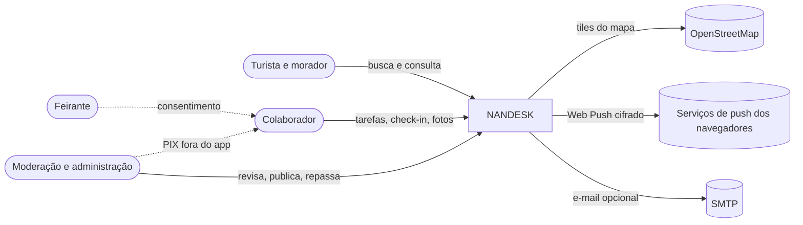
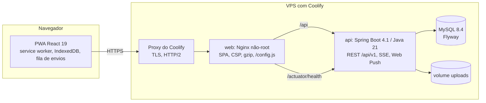
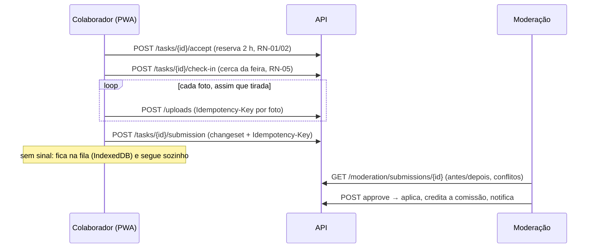

# Arquitetura da NANDESK

Visão em camadas no estilo C4. Decisões detalhadas nos ADRs (`docs/adr/`) e na especificação (seção 9).

## 1. Contexto

## 2. Contêineres

- **web:** serve o build com hash (cache de 1 ano), `index.html`/`sw.js`/`config.js` sem cache, e faz proxy de `/api`
  (SSE sem buffer, uploads até 6 MB). Cabeçalhos de segurança da seção 12.5 em cada `location`.
- **api:** monólito modular (ADR-0003). Porta 8080 para a API e 8091 para a gestão (health e Prometheus), nunca publicada.
- **db:** MySQL 8.4 com `utf8mb4_0900_ai_ci` e fuso UTC. Esquema só por Flyway (`ddl-auto=validate`).

## 3. Módulos do backend

| Módulo | Responsabilidade | Principais requisitos |
|---|---|---|
| `shared` | Erros (Problem Details), i18n, relógio, segurança (JWT, limites de taxa, segregação de funções), cache | RNF-08, RNF-09 |
| `user` | Contas, perfil, chave PIX cifrada, feiras de interesse | RF-11 |
| `auth` | Cadastro, login, refresh rotativo, verificação de e-mail, redefinição de senha | RF-08 a RF-10 |
| `file` | Upload idempotente, pipeline de imagem (EXIF fora), armazenamento | RF-18, RN-06, RN-27 |
| `market`, `catalog`, `stall` | Feiras, setores, categorias, produtos (3 idiomas, sinônimos), boxes e ofertas | RF-01, RF-03 a RF-05, RF-29 a RF-31 |
| `search` | Busca normalizada, ranking, sugestões, vitrine e snapshot com ETag | RF-02, RF-36 |
| `task` | Tarefas, aceite otimista, check-in por cerca, prazos, reputação | RF-13 a RF-20, RN-01 a RN-05, RN-17 |
| `submission` | Changeset, idempotência, moderação com conflitos, aplicação | RF-18, RF-21, RF-22, RN-26 |
| `commission` | Regras, extrato imutável, repasses, orçamento | RF-25 a RF-28, RN-07 a RN-10 |
| `report` | Denúncias com limite e verificação automática | RF-07, RN-16 |
| `notification` | Notificações, SSE, Web Push (RFC 8291) | RF-14, RF-19 |
| `audit` | Registro de quem fez o quê | RNF-10 |
| `admin` | Painel: indicadores, usuários, catálogo, seed de demonstração | RF-12, RF-32 |
| `lgpd` | Exportação, exclusão, retenção e anonimização | RF-12, RN-20 a RN-22 |

## 4. Fluxo principal (CA-2)

## 5. Frontend

- `src/app`: rotas (públicas na hora; conta, colaborador e painel sob demanda), layout, React Query com persistência
  só das consultas públicas.
- `src/shared`: cliente HTTP (token em memória, uma renovação simultânea), fila de envios (outbox), snapshots e busca
  local, i18n (PT-BR no pacote inicial), PWA e push, componentes de interface sobre os tokens.
- `src/features`: telas por funcionalidade (vitrine, conta, tarefas, ganhos, notificações, painel).
- Orçamentos de tamanho verificados no CI (ADR-0015); app shell estático no `index.html`.

## 6. Qualidade

| Camada | Ferramenta | Situação |
|---|---|---|
| Regras de negócio | JUnit 6 + AssertJ (128 testes) | verde |
| Integração | `*IT` com MySQL 8.4 (Testcontainers ou `IT_JDBC_URL`), 71 testes | verde, JaCoCo 91% |
| Arquitetura | ArchUnit | verde |
| Frontend | Vitest + Testing Library + MSW (87 testes, 78,7% de linhas) | verde |
| E2E | Playwright J1–J8 com axe e perfis de rede | verde (Chromium) |
| Contrato | `docs/api/openapi.json` gerado e conferido no CI | verde |
